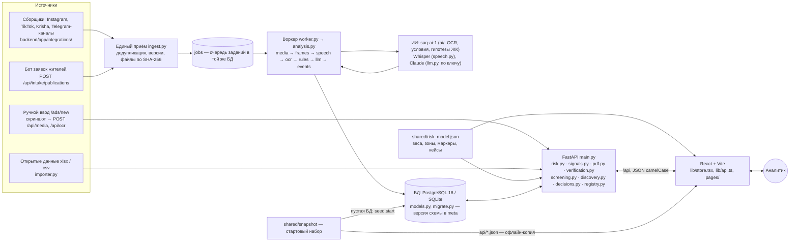

# SAQ Qurylys

[](https://github.com/VigesSvet/codemasters8/actions/workflows/ci.yml)

Цифровой помощник уполномоченного органа (ДЭР / ГАСК ВКО) для мониторинга рекламы долевого строительства и риск-скоринга жилых комплексов Усть-Каменогорска. Codemasters 8.0. Система собирает рекламу новостроек (Instagram, TikTok, Krisha.kz, заявки жителей, ручной ввод со скриншотом), находит в тексте, на картинках и в речи роликов предложения внести деньги, сопоставляет публикацию с ЖК и с открытыми реестрами (Homeportal, Казреестр / Ashyq Data), считает объяснимый риск по модели ТЗ §5 с доказательствами у каждого фактора и формирует сигнальную карточку, которую подтверждает или возвращает аналитик, с выгрузкой в PDF.

**Разделы по ТЗ §8:** [Проблема и ценность](#проблема-и-ценность) · [Реализованные возможности](#реализованные-возможности) · [Технологии](#технологии-стек) · [Архитектура](#архитектура) · [Запуск](#запуск) · [Тестовый сценарий](#тестовый-сценарий) · [Известные ограничения](#известные-ограничения) · [Использование ИИ](#использование-ии) · [Тесты и CI](#тесты) · `.env.example` · тестовые данные — [«Данные»](#данные).

> ИИ формирует рекомендацию, решение о нарушении принимает аналитик. Стартовый набор данных — **реальные** сведения: ЖК Усть-Каменогорска из открытого реестра и известные по рекламе, их застройщики и публичная реклама реальных компаний, собранная 18–19.10.2026 (Instagram, Krisha, TikTok), с OCR и анализом ИИ (см. «Развёртывание со стартовым набором данных»). «Проверка по рекламе» — предварительная автоматическая оценка, а не вывод о нарушении; по карточке без проверенных сведений риск не оценивается. Вымышленный демо-набор остался только у тестов (`shared/testdata`).

## Проблема и ценность

**Кто пользователь.** Специалист уполномоченного подразделения МИО / региональный аналитик (ТЗ §1) — в Усть-Каменогорске это сотрудники ДЭР и ГАСК ВКО. Он проверяет сведения о строящихся ЖК и решает, какие случаи рассматривать дальше. Продукт — внутренний инструмент органа, а не сервис для жителей.

**Что долго сегодня.** По встрече с заказчиком 14.10.2026 (`docs/Выжимка_встречи_—_дополнения_к_ТЗ_SAQ_QURYLYS.txt`):

- рекламу продажи квартир на стадии строительства ищут вручную по лентам соцсетей и площадкам объявлений; часть рекламы персонализирована — один человек её видит, другой нет, повторно найти её трудно, а пост могут удалить;
- найденный объект сверяют со своей картотекой: какое у него основание привлечения денег (гарантия Единого оператора / КЖК, разрешение МИО, банк второго уровня), есть ли он в публикуемом ГАСК перечне; сведения об объектах, документах, рекламе и обращениях лежат в разных источниках, а единого реестра долевого строительства, по словам выступавших, нет;
- «нет в списке» легко принять за «нарушение», хотя закон допускает разные способы долевого участия, и отсутствие сведений — не отсутствие основания (ТЗ §5, «Правовой нюанс»);
- понять, какие случаи требуют внимания в первую очередь, сложно; жители звонят за уточнениями.

**Что делает SAQ Qurylys.**

- **Собирает в одно место** рекламу (подключения к источникам и ручной ввод), карточки ЖК, записи открытых реестров с источником и временем сбора, обращения, снимки площадки и решения аналитиков — с копией текста и картинок публикации на сервере на случай её удаления.
- **Ускоряет поиск**: OCR скриншотов и кадров видео, распознавание речи в роликах, извлечение условий оплаты (бронь, взнос, рассрочка, ДДУ — с суммами и дословной цитатой), гипотезы ЖК по названию, адресу, аккаунту и телефону; объекты из рекламы, которых нет в реестре, и «Проверка по рекламе» — у каких застройщиков есть основание по открытым данным, а где реклама с приёмом денег есть, а основания нет.
- **Делает проверяемым**: балл и зона — по формуле ТЗ §5 из одного файла модели, одинаковые данные дают одинаковый результат; у каждого фактора — цитата, документ, обращение или снимок с источником и датой; «нет данных» — 0 баллов и «Нужна проверка», а не R1; гипотеза ИИ не идёт в балл, пока её не принял аналитик.
- **Оставляет решение человеку**: сигнал подтверждает или возвращает аналитик с комментарием, каждое действие — в журнале с автором и временем; в госорганы ничего автоматически не отправляется.

## Реализованные возможности

| Модуль ТЗ | Что сделано | Где в коде | Подробно |
|---|---|---|---|
| 01 Карта / обзор | Карта ЖК: метка цвета «Проверки по рекламе» с баллом риска в цвете зоны, фильтры по баллу и статусу, слой «Открытые данные» серыми метками без балла, подложки «Схема · Спутник · 3D»; реестр ЖК с фильтром «Зона» | `frontend/src/pages/Dashboard.tsx`, `components/MapView.tsx`, `lib/mapFilters.ts`, `pages/Complexes.tsx` | [Экраны](#экраны), [Спутник и 3D-карта](#спутник-и-3d-карта) |
| 02 Реестр ЖК | Карточка ЖК: застройщик и БИН, стадия и готовность, основание по каждому документу с источником, датой сверки и ссылкой, публикации, обращения, снимки, журнал; сверка сведений аналитиком, сверка адреса в 2ГИС, архив спутниковых снимков | `pages/ComplexCard.tsx`, `components/Verification.tsx`, `backend/app/verification.py`, `backend/app/integrations/dgis.py` | [Сверка сведений аналитиком](#сверка-сведений-аналитиком) |
| 03 Мониторинг рекламы | Лента с подсветкой формулировок, разбор публикации (файлы, версии в источнике, OCR, речь, анализ ИИ), ручное добавление со скриншотом и OCR, сбор подключениями (Instagram, TikTok, Krisha, Telegram), приём заявок бота и публикаций по API; привязка к ЖК — гипотеза ИИ до решения аналитика | `pages/Ads.tsx`, `pages/AdDetail.tsx`, `pages/AdNew.tsx`, `backend/app/integrations/`, `backend/app/ingest.py`, `backend/app/analysis.py` | [Подключение источников рекламы](#подключение-источников-рекламы) |
| 04 Риск-скоринг | R1–R6 с весами ТЗ §5, «Нужна проверка» для неизвестного, зоны и правило «красная только при R1 + R2», доказательства у каждого фактора, пересчёт после каждого решения, калькулятор и контрольные кейсы A/B/C на `/method`; карточка без проверенных сведений не оценивается | `shared/risk_model.json`, `backend/app/risk.py`, `frontend/src/lib/risk.ts`, `components/Factors.tsx`, `pages/Method.tsx` | [Скоринг](#скоринг) |
| 05 Сигнальная карточка | Снимок факторов и доказательств на момент создания, «Подтвердить» / «Вернуть на доработку» с обязательным комментарием, один открытый сигнал на ЖК, журнал, PDF A4 и печатная версия | `backend/app/signals.py`, `backend/app/pdf.py`, `pages/Signals.tsx`, `pages/SignalCard.tsx`, `pages/SignalPrint.tsx`, `components/SignalPanel.tsx` | [Сигнальная карточка](#сигнальная-карточка-модуль-05) |
| ИИ (§6) | Офлайн-движок `saq-ai-1`: OCR (Tesseract rus/kaz/eng), условия оплаты с цитатой и уверенностью, до трёх гипотез ЖК; Claude по ключу — признаки продажи, суммы, упомянутые ЖК и стадия с дословными цитатами; речь в роликах (faster-whisper); принять / отклонить — аналитик; проверка на 26 новых текстах | `backend/app/ai/`, `backend/app/llm.py`, `backend/app/speech.py`, `shared/ai_cases.json` | [ИИ-сценарий](#ии-сценарий-тз-6) |
| Данные (§4) | Стартовый набор реальных данных (23 ЖК, 230 публикаций, 459 ответов ИИ) загружается в пустую БД; 103 записи открытых реестров с провенансом, импорт xlsx/csv; тестовый вымышленный набор — только у автотестов | `shared/snapshot/`, `backend/app/snapshot.py`, `backend/app/importer.py`, `backend/app/registry.py`, `shared/testdata/` | [Данные](#данные), [Открытые данные](#открытые-данные-и-источники-тз-4) |
| Контроль и достоверность (§7) | Вход по ролям пилота, автор и время каждого действия в журнале (только пополняется), метки «факт из источника / гипотеза ИИ / решение аналитика / демо», индикатор режима и ошибки без замалчивания, секреты только на сервере | `backend/app/models.py` (`AuditEvent`), `components/Audit.tsx`, `components/Provenance.tsx`, `components/Shell.tsx`, `backend/app/settings.py`, `backend/app/logs.py` | [Достоверность](#достоверность-и-безопасность-данных-тз-7), [Вход и журнал](#вход-и-журнал) |
| Нормативная база | Закон РК № 486-V «О долевом участии в жилищном строительстве», ст. 7, 8, 18 (ориентиры ТЗ) и 23 (реклама): дословные выдержки из ИПС «Әділет» (редакция на 01.07.2026); «Основание: ст. …» у факторов R1–R3 в методике, карточке ЖК, сигнале, печатной версии и PDF; ИИ указывает, к какой норме может относиться реклама — гипотеза с проверенной цитатой | `shared/law.json`, `backend/app/law.py`, `lib/law.ts`, `pages/Method.tsx` | [Нормативная база](#нормативная-база) |
| Двуязычный интерфейс (§11) | RU/KZ: переключатель «РУС / ҚАЗ» в шапке, на входе и лендинге, без перезагрузки; шапка, навигация, вход, лендинг, карта, очередь, новостройки и общие метки статусов и зон | `lib/i18n.ts`, `lib/i18n/ru.ts`, `lib/i18n/kk.ts`, `components/LangSwitch.tsx` | [Двуязычный интерфейс](#двуязычный-интерфейс-rukz) |
| Сверх MVP | «Проверка по рекламе» и объекты из рекламы вне реестра; решения «Объект сдан» / «Проверено — замечаний нет»; очередь проверки с перетаскиванием; быстрый поиск с транслитерацией; спутниковый архив с 2014 года и 3D-карта; офлайн-копия стартового набора без бэкенда; лендинг | `backend/app/screening.py`, `backend/app/discovery.py`, `backend/app/decisions.py`, `pages/Discovered.tsx`, `pages/Queue.tsx`, `components/QuickSearch.tsx`, `components/SatHistory.tsx`, `frontend/src/data/snapshot.ts`, `pages/Landing.tsx` | [Проверка по рекламе](#проверка-по-рекламе-и-объекты-из-рекламы), [Удобство аналитика](#удобство-аналитика-тз-7) |

Пути `pages/…`, `components/…`, `lib/…` — от `frontend/src/`.

## Архитектура



**Данные.** Публикации приходят тремя путями: сборщики подключений по расписанию воркера, приём готового (бот заявок жителей, внешние сборщики по API) и ручной ввод аналитика. Все сборщики и приём пишут через единый приём (`backend/app/ingest.py`, `ads_service.py`): дедупликация по внешнему ID, новая версия при правке в источнике, файлы — в хранилище по SHA-256 (`media.py`), снимок ответа источника без секретов. Открытые реестры — из файла (`importer.py` → `shared/registry_ust_kamenogorsk.json` → таблица `source_records`), у каждой записи источник, ссылка, ID и время сбора. Схема БД версионируется и обновляется на месте при старте API (`migrate.py`, `seed.py`); пустая БД получает стартовый набор `shared/snapshot` (`snapshot.py`).

**Анализ.** Воркер (`worker.py`, задания — `jobs.py`, без Redis: таблица `jobs` в той же БД) ведёт публикацию по этапам `analysis.py`: файлы → кадры видео (ffmpeg, `video.py`) → речь в роликах (faster-whisper, `speech.py`) → OCR (Tesseract, `ai/ocr.py`) → правила `saq-ai-1` (условия оплаты — `ai/terms.py`, гипотезы ЖК — `ai/matching.py`) → Claude (`llm.py`, только с `ANTHROPIC_API_KEY`) → события журнала. Сбой этапа не роняет анализ и виден у публикации. Результат — гипотезы с цитатой и уверенностью; привязку к ЖК анализ не назначает.

**Риск и решения.** Движок `backend/app/risk.py` — чистые функции над словарями (`world.py` собирает их из БД): балл, зона, факторы R1–R6 с доказательствами и наблюдения вне балла по `shared/risk_model.json`. Тот же файл читает TS-порт `frontend/src/lib/risk.ts` (офлайн-фоллбэк), паритет проверяет эталон `shared/testdata/risk_golden.json`. Решения аналитика — сверка сведений (`verification.py`), принятие гипотез и вето R2 (`main.py`), решения по «Проверке по рекламе» (`decisions.py`) — пишутся в журнал `audit_events` и сразу меняют риск. Сигнал (`signals.py`) фиксирует снимок факторов и доказательств; PDF — `pdf.py` (reportlab).

**Интерфейс.** React 19 + TypeScript + Vite. Данные и режим работы — `frontend/src/lib/store.tsx`, запросы и тексты ошибок — `lib/api.ts`, сессия входа — `lib/session.ts`; экраны — `pages/` (карта, реестр и карточка ЖК, лента и разбор публикации, очередь, сигналы, методика, источники), общие блоки — `components/` (карта, факторы, метки происхождения, журнал, сверка, подключения), UI-кит — `styles/go.css`. Если API не ответил при запуске, фронтенд открывает офлайн-копию стартового набора только для чтения (`frontend/src/data/snapshot.ts` читает `shared/snapshot/api/*.json`; риск и «Проверка по рекламе» — как их посчитал сервер при выгрузке).

**Поток «публикация → факторы → балл → сигнал».** (1) Публикация собрана или внесена вручную → (2) OCR, речь и правила находят условия оплаты с цитатой и предлагают ЖК → (3) аналитик принимает гипотезу ЖК — привязка становится фактом с его именем → (4) R2 / R3 публикации идут в балл ЖК, R1 — по сверенным документам основания, R4–R6 — по обращениям, готовности и снимкам; неизвестное — «Нужна проверка» → (5) балл и зона пересчитываются → (6) аналитик формирует сигнал: снимок фиксируется, решение «Подтвердить» / «Вернуть» — с комментарием в журнал, PDF — для передачи по внутреннему маршруту.

## Использование ИИ

- **В продукте** ИИ только предлагает: OCR, условия оплаты и гипотезы ЖК (`saq-ai-1`, офлайн и детерминированно), анализ Claude (по ключу, с дословными цитатами, которые сервер сверяет с материалом) и расшифровка речи роликов (faster-whisper, локально). Балл ИИ не меняет, R2 ставит правило модели по словарю, привязку и нарушение подтверждает аналитик. Как это устроено, как считается уверенность и как проверено на новых данных — раздел [«ИИ-сценарий (ТЗ §6)»](#ии-сценарий-тз-6).
- **Сторонние модели и библиотеки** — Tesseract OCR (Apache 2.0), Claude (Anthropic) через SDK `anthropic` 1.15.0 (MIT) — [CREDITS.md](CREDITS.md), раздел «ИИ-анализ и OCR»; faster-whisper 1.2.1 и CTranslate2 (MIT, по метаданным пакетов) с моделью Whisper, которую команда `python -m app.speech download` скачивает с HuggingFace (см. «Речь в роликах»). Собственный код ИИ — `backend/app/ai/` без сторонних моделей.

## Экраны

Интерфейс собран в визуальном языке сервисов Яндекса. Основной образец — Яндекс Недвижимость (раздел «Новостройки»): шапка с вкладками, полоса фильтров «Комнат ⌄», выдача ЖК карточками, страница ЖК с панелью «Об объекте», метки-ценники на карте. Панель на карте — как у Яндекс Go, круглые цветные категории — как у Яндекс Карт. Палитра: текст `rgba(0,0,0,.92)`, серые кнопки `#F3F1F1`, жёлтый `#FED42B`, ссылки `#0065D9`, семантика зелёный `#00B341` / оранжевый `#F59D00` / красный `#E4402D`.

- UI-кит: `frontend/src/styles/go.css`
- Иконки: оригинальные SVG сервисов Яндекса (`frontend/src/ui/yandex-svg.ts`), недостающие — [Gravity UI Icons](https://gravity-ui.com/icons)
- Логотипы площадок: Simple Icons (CC0) для Instagram, TikTok, Telegram, Facebook; фавиконки сайтов Krisha, OLX, 2ГИС (`frontend/public/brands`)
- Шрифт: YS Text / YS Display (файлы Яндекса, см. CREDITS.md)
- Карта: тайлы Яндекс Карт в MapLibre GL (широты пересчитаны под проекцию EPSG:3395); подложки «Спутник» — Esri World Imagery, «3D» — снимок и объёмные дома OpenStreetMap (OpenFreeMap), см. «Спутник и 3D-карта»
- Логотип — `frontend/public/logo.svg` (лупа над кварталом), он же фавикон; эмблемы панелей статистики — свои SVG (`frontend/src/components/emblems.tsx`)
- Шапки разделов — панели статистики своей формы для каждого экрана (`frontend/src/components/StatBoard.tsx`): конвейер очереди, светофор риска сводки, кольцо «Проверки по рекламе» у застройщиков, цепочка источников, шкала весов методики

| Путь | Экран |
|---|---|
| `/about` (и `/` для гостя) | Лендинг: что делает система, «Было. Стало.» со спутником, живые цифры, «Открыть систему» — на вход (`pages/Landing.tsx`) |
| `/login` | Вход: выбор роли без пароля (пилот: «Аналитик · ДЭР ВКО», «Ведущий аналитик», «Специалист · ГАСК ВКО» — без имён сотрудников), после входа — возврат на исходную страницу; кнопки A / B / C (сценарии ТЗ §5) — только если их ЖК есть в данных (в стартовом наборе их нет); остальные экраны без входа не открываются |
| `/` | Карта: поиск ЖК, фильтр по зонам, список, карточка объекта, промо-плашки; переключатель «Открытые данные» — реальные объекты серыми метками без балла, клик ведёт на `/registry/:key`; подложки «Схема · Спутник · 3D» (в 3D — объёмные дома и ЖК столбиками цвета статуса) |
| `/ops` | Оперативная сводка; «Контрольные сценарии ТЗ §5» — ссылки на A/B/C с текущим и ожидаемым баллом, если их ЖК есть в данных; «Последние действия» — кто, что и когда сделал, из журнала (только с бэкендом) |
| `/complexes` | Реестр ЖК: переключатель «ЖК на контроле / Открытые данные». ЖК — фильтры слева, список или карточки с метками «реестр» / «по рекламе» (у демо-строк прежних версий — «демо»); `?layer=open` — объекты открытых данных: источники, дата сбора, способ привлечения средств как факт источника, отдельный раздел «Без координат» |
| `/complexes/:id` | Карточка ЖК: метка происхождения («Открытый реестр», «По рекламе»; у демо-строк прежних версий — «Демо-сценарий (вымышленный ЖК)», у `c14` / `c2` / `c10` — баннер сценария A/B/C); галерея, ход строительства, основания с источником, датой сверки и ссылкой по каждому документу, заявленная и подтверждённая готовность, обращения, риск R1–R6 с доказательствами, создание сигнала; «Сверка адреса в 2ГИС» — кандидаты адреса, координаты меняются только решением аналитика; вкладка «Журнал» — сведения и их источники, публикации, сигналы, запросы сведений; «Запросить сведения»; вкладка «Спутник» — снимки места с 2014 года, шторка «до / после», период стройки по документам |
| `/registry/:key` | Объект открытых данных: все записи источников — поля как у источника, ссылка, ID в источнике, время сбора, дата загрузки у поставщика, файл и строка импорта, примечание; сводка и мини-карта; «Сверка адреса в 2ГИС» без изменения сведений источника. Плашка «риск не оценивается», балла, зон и сигналов нет |
| `/ads` | Лента рекламы с подсветкой формулировок; метка «демо» у публикаций прежнего демо-набора, «собрано автоматически» и «прислано через бота» — у собранных; фильтры «Привязка — гипотеза ИИ» и «Собраны автоматически» |
| `/ads/:id` | Разбор публикации: происхождение (демо, добавлена аналитиком, собрана из источника или прислана жителем через бота — со временем получения сервером; привязка — гипотеза ИИ или решение аналитика), файлы публикации, ход обработки, «Версии в источнике», OCR, сигналы, «Анализ ИИ» — гипотезы ЖК и условия оплаты с цитатой и уверенностью, «Принять» / «Отклонить», «Анализ ИИ (Claude)» — гипотезы языковой модели с дословными цитатами (если на сервере задан ключ Anthropic) и «Проанализировать ещё раз» в режиме администратора, история из журнала сервера, комментарии, решение аналитика с основанием |
| `/ads/new` | Ручное добавление: скриншот сохраняется на сервере (`POST /api/media`), OCR скриншота на сервере, живой анализ ИИ (условия оплаты, до трёх гипотез ЖК), оценка на лету |
| `/queue` | Очередь проверки: доска с перетаскиванием |
| `/signals` | Реестр сигналов: новые, подтверждённые, возвращённые |
| `/signals/:id` | Сигнальная карточка: снимок факторов и доказательств, «Подтвердить» / «Вернуть на доработку», журнал, PDF |
| `/signals/:id/print` | Печатная версия сигнальной карточки (A4) |
| `/developers` | Застройщики |
| `/sites` | Фото-мониторинг (доп. модуль) |
| `/method` | Методика §5 по `shared/risk_model.json`: калькулятор балла, факторы с условиями и источниками, формула, зоны, наблюдения вне балла, контрольные кейсы ТЗ A/B/C (`/method#cases`) — их проверяют автотесты на тестовых данных (`shared/testdata`), здесь они открываются в калькуляторе; «ИИ-анализ публикаций» и «Проверка на новых данных» — прогон `shared/ai_cases.json` |
| `/sources` | Источники: «Подключения» — фактическое состояние сборщиков публикаций, приёма заявок и публикаций, 2ГИС, анализатора Claude (Anthropic) и OLX с сервера, проверка, настройка и запуск сбора в режиме администратора (см. «Подключение источников рекламы»); открытые данные из `GET /api/sources` (записей, объектов, когда собрано, дата у поставщика, ссылка), импорт xlsx/csv с отчётом, ручной ввод, стартовый набор, перечень ГАСК; прямая пометка, что автоматической синхронизации с реестрами нет |
| `/sellers` | «Кто продаёт»: связанные продавцы (общий телефон, WhatsApp, БИН, имя, картинка) со схемой и доказательствами; вкладка «Цена» — цена за м² против медианы и «100% оплата». Гипотезы вне балла (см. [«Кто продаёт»](#кто-продаёт-связанные-продавцы-и-цена)) |
| `/reports`, `/residents` | Отчёты, идея push жителям |

## Запуск

### Docker (Postgres + API + воркер + фронт)

```bash
cp .env.example .env     # ключи подключений; без них всё работает, подключения «не настроены»
docker compose up --build
# фронт  http://localhost:5180
# API    http://localhost:8000/docs   (порты db и api опубликованы только на 127.0.0.1)
docker compose up -d api worker      # после правки .env
```

Образ `api` собирается из корня репозитория (`context: .`, `backend/Dockerfile`) — в него копируется `shared/` с моделью риска, открытым реестром и стартовым набором (`shared/testdata` — только для тестов, в образ не попадает, `.dockerignore`); в образе есть Tesseract (rus, kaz) и ffmpeg, процессы работают от непривилегированного пользователя. Тот же образ запускает сервис `worker` (`python -m app.worker`) — сбор публикаций и их анализ; он стартует после готовности API. `.env` передаётся в `api` и `worker` через `env_file`. Тома: `pgdata` — база, `media` — файлы публикаций, `tgsession` — сессия Telegram (только у воркера), `asrmodels` — модели распознавания речи (только у воркера); `docker compose down -v` удаляет все четыре. Контейнер `web` монтирует `./frontend` и `./shared` (только чтение).

### Локально одной командой

```bash
./dev.sh                 # API :8000 (SQLite) + воркер сбора + фронт :5180
SAQ_WORKER=0 ./dev.sh    # без воркера
```

`dev.sh` сам создаёт `backend/.venv` и доустанавливает зависимости, если `requirements*.txt` изменились. Воркер стартует после ответа API. Ключи подключений приложение читает из `.env` в корне репозитория само (после правки — перезапуск); файлы публикаций и сессия Telegram — в `backend/data/` (вне Git).

### Локально вручную

```bash
# бэкенд (без Postgres можно на SQLite)
cd backend
python3 -m venv .venv && .venv/bin/pip install -r requirements.txt -r requirements-dev.txt
DATABASE_URL=sqlite:///./saq.db .venv/bin/uvicorn app.main:app --reload --port 8000
DATABASE_URL=sqlite:///./saq.db .venv/bin/python -m app.worker   # воркер сбора и анализа — во втором терминале, после API

# фронтенд
cd frontend
npm install
npm run dev            # http://localhost:5180, /api проксируется на :8000 (другой адрес — API_PROXY=http://…)
```

### Данные

- **Стартовый набор** — `shared/snapshot/`: реальные данные мониторинга на 18–19.10.2026 (подробно — следующий раздел). Пустая БД получает его при первом старте API — и в Docker, и локально (`./dev.sh`, SQLite). Без бэкенда фронтенд показывает его офлайн-копию только для чтения.
- **Открытые данные** — `shared/registry_ust_kamenogorsk.json`: 103 записи Homeportal и Казреестра, собранные импортёром из `docs/Усть-Каменогорск_объекты.xlsx` (см. «Открытые данные и источники»). Загрузка набора кладёт их в таблицу `source_records`, без бэкенда фронтенд показывает ту же копию.
- **Вымышленный демо-набор** (14 ЖК, 7 застройщиков, 12 публикаций) приложение больше не засевает и не показывает: он лежит в `shared/testdata/` и нужен только тестам бэкенда и фронтенда (см. `shared/testdata/README.md`). Переменная `SAQ_DEMO_DATA` больше не читается — если она осталась в `.env`, API при старте предупредит, строку можно удалить.
- Схема БД версионируется (`meta.schema_version`, сейчас `2026.10-decisions-1`). Базу известной прошлой версии API при старте обновляет на месте — шаги только добавляют таблицы и nullable-столбцы, ничего не удаляя; файловую SQLite перед этим копирует в `saq.db.bak-<старая версия>-<UTC>`. Базу неизвестной версии API пересоздаёт (пустая БД снова получит стартовый набор), только если в ней нет невосстановимых данных (собранные и добавленные аналитиком публикации, файлы, токены OLX, заявки бота, сверки 2ГИС, анализы ИИ, настройки подключений, решения аналитика по «Проверке по рекламе»); иначе не стартует и объясняет причину, а `SAQ_ALLOW_SCHEMA_RESET=1` разрешает пересоздание с потерей данных. PostgreSQL перед обновлением копировать вручную: `docker compose exec db pg_dump -U saq saq > backup-$(date +%F).sql` (подробнее — [docs/INTEGRATIONS.md](docs/INTEGRATIONS.md), разделы 6–7).
- Начать с чистого листа: локально — удалить `backend/saq.db` и `backend/data/media`, в Docker — `docker compose down -v` (удаляет тома базы, файлов публикаций и сессии Telegram); следующий старт загрузит стартовый набор заново.

### Развёртывание со стартовым набором данных

Новое развёртывание поднимается сразу с текущими данными мониторинга, а не с пустыми экранами или вымышленными примерами:

```bash
docker compose up --build        # пустой том pgdata → API при первом старте загружает shared/snapshot
./dev.sh                         # то же на SQLite: новая backend/saq.db получает набор
```

В журнале API — строка «Пустая БД: загружен стартовый набор от … (схема …): developers — 21, complexes — 23, ads — 230, …; файлов — 347; записей открытого реестра — 103». В непустую БД набор не загружается никогда: рабочая база, обновлённая новой версией, остаётся как была. Модуль — `backend/app/snapshot.py`, старт — `seed.start` (`backend/app/seed.py`).

**Что в наборе** (`shared/snapshot/`, 32 МБ, 374 файла; выгрузка 18.10.2026, схема `2026.10-discovery-1`):

| Данные | Строк | Комментарий |
|---|---|---|
| ЖК (`complexes`) | 23 | 15 карточек открытого реестра (`origin = registry`) и 8 ЖК, известных только по рекламе (`advertised`) |
| Застройщики (`developers`) | 21 | 13 из реестра (название и БИН источника), 8 — по рекламе |
| Аналитики (`analysts`) | 3 | учётные записи для входа без пароля (пилот) |
| Публикации (`ads`) | 230 | реальная публичная реклама: Instagram 168, Krisha 52, TikTok 10; собраны 18.10.2026 |
| Записи приёма и версии (`ingest_items`, `ingest_versions`) | 230 / 230 | снимки ответов источников — ещё раз очищены (`ingest.scrub`: без токенов, cookie, телефонов, e-mail, query у ссылок) |
| Файлы (`media_assets`, `media/`) | 500 строк, 347 файлов | изображения (обложки и слайды каруселей) уменьшены до 1024 px по длинной стороне, JPEG q75 (PNG — только если меньше): 27 МБ вместо 76 МБ; имена файлов — SHA-256 |
| Анализы ИИ (`llm_analyses`) | 459 | ответы Claude по всем 230 публикациям (`saq-llm-1` и `saq-llm-2`); повторно не оплачиваются — тот же материал в Claude не уходит |
| Объекты из рекламы (`discovered_objects`, `discovered_mentions`) | 15 / 60 | с решениями аналитика (8 привязаны) |
| Журнал (`audit_events`) | 1212 | кто, что и когда — включая загрузку реестра и решения аналитиков |
| Сигналы (`signals`) | 2 | сформированные аналитиком сигнальные карточки |
| Подключения и запуски (`collectors`, `collection_runs`) | 5 / 10 | настройки (аккаунты, ссылки поиска) и «включено»; статус, факты, курсоры и расписание сброшены — новое развёртывание проверит подключения заново |
| Сверки 2ГИС (`geo_checks`) | 3 | только решения аналитика (выбранный дом, «было → стало»); кэш кандидатов 2ГИС не хранится |
| Ответы API (`api/*.json`) | — | `GET /api/complexes`, `/ads`, `/developers`, `/risk`, `/stats`, `/discovered`, `/signals`, `/analysts`, `/appeals` по этому набору и карта `media.json` (id файла → имя) — офлайн-копия фронтенда |

**Чего в наборе нет и почему:**

- **видео** (118 файлов, ~1 ГБ) и **кадры видео** (923) — слишком велики для репозитория. Строка видео остаётся со статусом «недоступно», пояснением «не включено в стартовый набор — откройте оригинал» и ссылкой на оригинал (`origin_url`, у публикации — `url`); текст, распознанный по кадрам, уже в `ads.ocr`;
- **заявки жителей** (`bot_submissions`) — персональные данные заявителей;
- **секреты и служебное**: токены OLX (`integration_tokens`), состояния OAuth, задания воркера и аренды, счётчики квот и бюджета; ключи подключений живут только в `.env`. Перед записью выгрузка проверяет все файлы на значения секретов из настроек и на токеноподобные строки — найдено что-то, набор не записывается;
- **записи открытого реестра** (`source_records`) — загрузка пересоздаёт их из `shared/registry_ust_kamenogorsk.json` (выгрузка сверяет записи БД с файлом, расхождение — в `manifest.json`, `registry`).

**Обновить набор** (из рабочей БД, только чтение — БД и файлы не меняются; каталог `shared/snapshot` заменяется целиком, только если всё получилось):

```bash
# Docker: файлы публикаций — в томе media, поэтому выгрузка — в контейнере образа api с подключённым репозиторием
docker compose run --rm --no-deps -v "$PWD/backend:/repo/backend:z" -v "$PWD/shared:/repo/shared:z" \
  -e SAQ_SHARED_DIR=/repo/shared -e PYTHONDONTWRITEBYTECODE=1 -w /repo/backend --user "$(id -u):$(id -g)" \
  api python -m app.snapshot export --out /repo/shared/snapshot
# локально (SQLite, как ./dev.sh): cd backend && DATABASE_URL=sqlite:///./saq.db .venv/bin/python -m app.snapshot export
```

Параметры: `--max-px` (1024) и `--quality` (75). Выгрузка читает БД одной транзакцией (PostgreSQL — `REPEATABLE READ, READ ONLY`), схему не обновляет и пишет её версию в `manifest.json`; ответы API строит отдельный процесс на временной SQLite — тем же кодом, что у нового развёртывания. Набор прежней версии схемы загружается и новой версией кода: столбцы, добавленные шагами `migrate`, получают NULL или значение по умолчанию; набор неизвестной или более новой версии — отказ с просьбой выгрузить его заново. Тест `test_offline_views_match_api` напомнит перевыгрузить набор, если код риска или «Проверки по рекламе» изменился.

**Загрузить вручную** (в пустую БД; в непустую — отказ, ничего не меняется):

```bash
docker compose exec -T api python -m app.snapshot import            # локально: cd backend && DATABASE_URL=sqlite:///./saq.db .venv/bin/python -m app.snapshot import
docker compose exec -T api python -m app.snapshot import --dir /путь/к/набору
```

Загрузка идёт одной транзакцией: таблицы — в порядке зависимостей с прежними первичными ключами (PostgreSQL — последовательности переставляются за максимальный id), файлы — в хранилище `MEDIA_ROOT` через `media.store_bytes` (тип по сигнатуре, SHA-256 сверяется с записью), записи реестра — из файла, флаг `meta.demo_data = purged`. Набор — публичная реклама третьих лиц, собранная для мониторинга (см. CREDITS.md).

### Демо-данные прежних версий

Базы прежних версий, засеянные вымышленным демо-набором, очищаются командой `python -m app.demo purge` (модуль `backend/app/demo.py`); 12 реальных ЖК с координатами и 3 без координат из открытого реестра становятся карточками ЖК (это делает и каждый старт API — идемпотентно).

```bash
docker compose exec -T db pg_dump -U saq saq > backup-$(date +%F).sql      # 1. резервная копия PostgreSQL
docker compose up -d --build api                                          # 2. новая версия API (обновит схему БД)
docker compose exec -T api python -m app.demo purge --dry-run             # 3. что будет удалено и что останется
docker compose exec -T api python -m app.demo purge --yes                 # 4. удалить демо-набор
docker compose up -d                                                      # 5. воркер и фронтенд
# локально (SQLite): cd backend && .venv/bin/python -m app.demo purge --dry-run / --yes — копия saq.db.bak-demo-purge-<UTC> делается сама
```

- **Что удаляется** — только строки демо-набора (`origin = demo`): публикации и всё, что на них висит (журнал, анализы ИИ, записи приёма, файлы, задания, заявки бота), обращения, сигналы и события журнала по демо-ЖК, явные события журнала демо-набора (перечислены в `demo.SEED_AUDIT` — сам набор приложение больше не хранит), сами демо-ЖК и демо-застройщики. Собранные и внесённые аналитиком публикации не удаляются: привязка к демо-ЖК снимается, в их журнале — «Привязка снята: демо-ЖК «…» удалён». Если по демо-ЖК есть обращение не из демо-набора, команда ничего не удаляет и называет его.
- **Что остаётся** — аналитики (для входа), записи открытого реестра, собранные и внесённые публикации и их анализы ИИ, подключения и запуски сбора, файлы, задания, счётчики квот. В журнал пишется одно событие «Удалены демо-данные: …» от «Системы»; флаг `meta.demo_data = purged` ставится в той же транзакции, повторный `purge` ничего не удаляет.
- **Карточки ЖК из реестра** (`origin = registry`, id `r-<ключ объекта>`, застройщик `rd-<БИН>`): название без «ЖК "…"», адрес, координаты, застройщик (название и БИН источника), начало и плановое завершение — только если записи объекта не расходятся (завершение — только у строящегося по источнику объекта). Стадия, готовность и основание (гарантия ЕО / МИО / БВУ) — «нет сведений»: «В строительстве»/«Завершён» у источника — фильтр, а не стадия, а применимость документа к очереди источник просит проверить; номер документа — справкой у основания. Команда `python -m app.demo import-registry` создаёт недостающие карточки и дополняет пустые поля; правки аналитика (например, координаты из 2ГИС) не перезаписываются. В карточке — метка «Открытый реестр · не проверено» и ссылка на записи источников.
- **Риск честно.** Пока по карточке из реестра нет проверенных сведений — подтверждённой аналитиком привязки публикации, сверенного документа основания (есть/нет с источником и датой), проверенного обращения, подтверждённой готовности или снимка площадки, — риск **не оценивается**: вместо балла и зоны «Риск не оценивается — нет проверенных данных», на карте серая метка, в зоны и счётчики `/api/stats` (`notAssessed`) карточка не входит, сигнал не создаётся (422). Дальше риск считается обычным порядком — факторы дают баллы только по подтверждённым фактам (`risk.assessed`, тот же код в `frontend/src/lib/risk.ts`, эталон — `shared/testdata/risk_golden.json`).
- **Вернуть демо-набор нельзя** — в приложении его больше нет; новая пустая БД получает стартовый набор реальных данных.

### Тесты

```bash
cd backend && .venv/bin/python -m pytest -q   # модель §5, API, сигналы, журнал, ИИ и OCR, открытые данные, сбор публикаций и подключения
cd frontend && npm test                        # vitest: паритет TS-движка с эталоном Python, сессия входа, ошибки API, выводы ИИ, подключения, 2ГИС, файлы
cd frontend && npx tsc -b                      # проверка типов
cd frontend && npx oxlint src                  # линтер: падает только на ошибках
```

**CI.** GitHub Actions — `.github/workflows/ci.yml`, на каждый push в `master`, pull request и вручную; статус — значок вверху README. Два задания на `ubuntu-latest`:

- **backend** — Python 3.12 (как образ `python:3.12-slim`), из apt — `tesseract-ocr`, `tesseract-ocr-rus`, `tesseract-ocr-kaz`, `ffmpeg` (как `backend/Dockerfile`), `pip install -r requirements.txt -r requirements-dev.txt`, затем `python -m pytest -q` в `backend/` на SQLite. Без Tesseract и ffmpeg тесты OCR настоящим Tesseract, кадров видео и извлечения звука пропускались бы; на Linux есть и `prlimit`, поэтому идёт и тест кадров 1080p под ограничениями памяти, который на macOS пропускается (ожидается 1250 пройдено и 2 пропущено — оба только для PostgreSQL). Модель распознавания речи не скачивается: тесты подменяют движок (`conftest._no_asr`), `HF_HUB_OFFLINE=1`.
- **frontend** — Node 24 LTS (vitest 5 требует `^22.12 || ^24 || >=26`), `npm ci`, `npx tsc -b`, `npm test` (`vitest run`), `npx oxlint src` (предупреждения не роняют), `npx vite build`.

Кэш pip и npm — по `requirements*.txt` и `package-lock.json`. Прогон на PostgreSQL в CI не входит — его делают вручную (ниже).

Тесты подключений сеть не используют: ответы Graph API, Apify, 2ГИС, OLX, Anthropic и страницы Krisha — заглушки и синтетические файлы, клиент Telegram — подменный, клиент SDK Anthropic ходит в транспорт-заглушку. Прогон на PostgreSQL 16 — на отдельном сервере, не на базе compose (тесты пересоздают таблицы приложения):

```bash
docker run -d --rm --name saq-pgtest -e POSTGRES_PASSWORD=t -p 127.0.0.1:55432:5432 postgres:16-alpine
cd backend && SAQ_TEST_DATABASE_URL=postgresql+psycopg://postgres:t@localhost:55432/postgres .venv/bin/python -m pytest -q
docker stop saq-pgtest
```

На 19.10.2026: бэкенд — 1249 пройдено и 3 пропущено на SQLite; фронтенд — 452 теста vitest, `tsc -b` без ошибок, oxlint без ошибок (22 предупреждения), сборка vite проходит (офлайн-копия — отдельными чанками). Распознавание текста на картинках локально требует языков Tesseract `rus` и `kaz` (в Docker-образе они есть; на macOS — `brew install tesseract-lang` или файлы `rus.traineddata`, `kaz.traineddata` в `tessdata`).

- `backend/tests/test_risk.py` — модель §5: веса, границы зон 24/25/59/60, «красная только при R1+R2», кейсы A/B/C, «неизвестное не становится R1», «гипотеза привязки не даёт R2/R3 при любой уверенности — факт только после подтверждения аналитиком», вето R2 решением аналитика по условиям оплаты, источник цитаты `quoteFrom`, R1 по провенансу документов («отсутствие» — только при источнике и дате и у гарантии, и у МИО; своя запись документа целиком, иначе общая сверка; документ «нет данных» — без источника и даты), удалённые пороги привязки нигде не используются, фикстуры `shared/testdata/risk_fixtures.json` на каждую ветку правил, актуальность эталона.
- `backend/tests/test_ai.py` — ИИ-сценарий: нормализация и транслитерация KZ/RU/латиница, телефоны, форматы сумм, процентов и сроков, каждый маркер `markers.money` даёт условие, дословные цитаты с источником, уверенность (число рядом, OCR, противоречие), бесплатная бронь, числа, которые не деньги (площадь, гарантия), признаки сопоставления, подборки и контрпримеры, детерминизм, сид; каждый кейс `shared/ai_cases.json` и итоговые метрики; эндпоинты — `/api/analyze` ничего не пишет, анализ публикации без отклонённых гипотез, принятие и отклонение (409 для подтверждённой привязки), вето R2 через `terms-review`, снимок сигнала, `/api/ai/eval`; OCR с подменой Tesseract — предобработка, 413/415/422, `engine: none` без Tesseract, тайм-аут и сбой движка. Тест на настоящем Tesseract пропускается, если программа не установлена.
- `backend/tests/test_api.py` — справочники, светофор тестового демо-набора, совпадение `/api/risk` с движком, ручная публикация (привязка — гипотеза ИИ или ЖК, выбранный аналитиком) и журнал.
- `backend/tests/test_signals.py` — снимок доказательств, 404/409/422, решения и журнал, неизменность снимка, реестр, PDF.
- `backend/tests/test_pdf.py` — PDF сигнальной карточки: перенос длинных списков и текстов, формулировки, подписи «вымышленный ЖК (демо)» и «вымышленная организация (демо)» у демо-строк прежних версий, источник, дата и ссылка по каждому документу основания, «не проверялся».
- `backend/tests/test_snapshot.py` — стартовый набор: состав и размер `shared/snapshot`, файлы по SHA-256, нет исключённых таблиц, видео, кадров и секретов; пустая БД получает набор (23 ЖК, 230 публикаций с анализом ИИ, файлы отдаёт `/api/media/{id}`), непустая — нет (ни старт, ни `import`); выгрузка → загрузка → выгрузка дают те же строки и файлы (SQLite и PostgreSQL); последовательности после загрузки; набор прежней версии схемы и отказ на неизвестной; выгрузка прерывается, если нашла секрет; `api/*.json` совпадают с ответами API.
- `backend/tests/test_registry.py` — открытые данные: разбор `docs/Усть-Каменогорск_объекты.xlsx` (103 записи, 15 объектов, 3 без координат, далёкие координаты помечены), нормализация дат, времени сбора, БИН, координат, способа привлечения и ключа объекта; `shared/registry_ust_kamenogorsk.json` совпадает с xlsx и с `GET /api/registry`; CLI с `--dry-run`; `/api/sources`, `/api/registry` с поиском, `/api/registry/{key}`; импорт xlsx и CSV («,» / «;», с BOM и без) — дедупликация, обновление, пропуски и повторы, журнал, 413/415/422, предел до чтения тела; без файла реестра демо работает. Проверка §7: у записей нет риска, зон и сигналов (404), раздел источника — только атрибутированный факт, названия демо-ЖК, демо-застройщиков и их БИН не совпадают с открытыми данными, `origin` в ответах.
- `backend/tests/test_audit.py` — журнал: исходные события тестового демо-набора (публикации, сведения ЖК с источником и временем, явные события) и их повторяемость, смена статуса (автор обязателен, для «Нарушение подтверждено» — основание; текст события; повтор без изменений не пишется), комментарии, запросы сведений, журнал ЖК, фильтры и `limit` общего журнала, `/api/analysts`, 500 в JSON, время в UTC.
- `frontend/src/lib/risk.test.ts` — TS-движок на тестовом демо-наборе и фикстурах (`shared/testdata`) даёт ровно `shared/testdata/risk_golden.json`; правило привязки, вето R2 и R1 по провенансу документов — как в Python.
- `frontend/src/lib/api.test.ts` — тексты ошибок API: 422 по-русски с названием поля, «Сервер недоступен» при обрыве сети и 502–504 от прокси, `detail` у 409 и 500.
- `frontend/src/lib/session.test.ts` — сессия входа без пароля: ключ `saq.analyst`, испорченная запись, недоступный или бросающий `localStorage`.
- `frontend/src/lib/ai.test.ts` — выводы ИИ в интерфейсе: поле OCR при смене скриншота (текст прежнего не остаётся, ручная правка не пропадает молча), сообщения OCR без повторов, уверенность текущей привязки-гипотезы, отклонённый ЖК сразу уходит из списка, ответ на решение по ИИ не откатывает статус публикации.
- `frontend/src/components/Hypothesis.test.ts` — гипотеза ЖК: кнопка выбора в форме (доступное имя «ЖК «X» N%», `aria-pressed`), карточка с кнопками решения.
- `backend/tests/test_settings.py` — настройки из окружения и `.env`, правила токенов, `.env.example` с пустыми значениями, маскирование секретов в логах.
- `backend/tests/test_migrate.py` — обновление схемы на месте с резервной копией SQLite, защита собранных данных, новые таблицы и поля API.
- `backend/tests/test_ads_service.py` — общая запись публикации: ручной ввод, собранная, заявка бота.
- `backend/tests/test_media.py` — хранилище файлов, тип по сигнатуре и пределы, безопасный загрузчик (только публичные адреса), кадры видео, `POST /api/media`.
- `backend/tests/test_speech.py` — речь в роликах с подменённым движком (модель не скачивается): без пакета и при `SAQ_ASR_MODEL=off` этап пропускается с пояснением, расшифровка у видео и в OCR доходит до правил, материала Claude и API, выбор ru/kk, отбрасывание «галлюцинаций», слишком длинный ролик и тайм-аут — «пропущено» без текста, повтор того же файла без распознавания; извлечение звука настоящим ffmpeg.
- `backend/tests/test_intake.py` — единый приём (дедупликация, версии, файлы) и `POST /api/intake/publications`: токен, 409/413/422, статус подключения, приёмка по §14 плана подключения.
- `backend/tests/test_worker.py` — задания и воркер: захват, повторы, итоги запусков, планировщик, остановка платного сбора, анализ публикации по этапам.
- `backend/tests/test_llm.py` — анализ ИИ (Claude) без сети: форма запроса (модель, `output_config`, `fallbacks: "default"` только у поддерживающих моделей, без `thinking`), материал как данные, сверка цитат и ЖК, отказ модели, обрезанный ответ, 401/403/429/5xx/400, бюджет, повторное использование результата, секреты, `llm` в API и журнале, статусы подключения и строка smoke; дозапрос старых публикаций (партия, новые первыми, в пределах бюджета, ответ другой модели не отправляется заново, пропуск из-за бюджета — до следующего дня, без цикла при исчерпанном бюджете) и `POST /api/ads/{id}/reanalyze` (401/403/503, 409, новая строка с историей, без дубля задания, событие журнала).
- `backend/tests/test_connectors_api.py` — API подключений: ответы без секретов, права администратора, настройки, запуски, «Обновить всё», изоляция модулей, защита публичного адреса.
- `backend/tests/test_integration_{instagram,telegram,telegram_bot,tiktok,dgis,krisha,olx}.py` — по файлу на подключение: проверка, сбор или приём, повтор без дублей, правки и версии, ошибки и лимиты источника, отсутствие секретов в ответах и журналах; Krisha — на синтетических страницах `backend/tests/fixtures/krisha/`.
- `frontend/src/lib/llm.test.ts` — блок «Анализ ИИ (Claude)»: состояния (отказ, сбой, повтор, пропуск — «не выполнен», а не «риска нет»), отброшенные элементы, суммы, модель; «Проанализировать ещё раз» — когда кнопка недоступна и почему, запрос только в режиме администратора, текст ошибки сервера.
- `frontend/src/lib/{connectors,geo,media,platform}.test.ts` — режим администратора и статусы подключений, сверка 2ГИС, загрузка скриншота и адреса файлов, названия площадок.

## Тестовый сценарий

5–10 минут на стартовом наборе, ключи и интернет не нужны (без интернета нет только подложек карты и спутника). Нужен бэкенд: сигналы, журнал, OCR и анализ живут на сервере, офлайн-копия — только для чтения.

```bash
./dev.sh            # или docker compose up --build; новая БД сама получает стартовый набор
# http://localhost:5180
```

Сценарий меняет данные БД (решение по условиям оплаты, сигнал, журнал). Вернуть исходное состояние: остановить `./dev.sh`, удалить `backend/saq.db` и `backend/data/media` (в Docker — `docker compose down -v`), запустить снова.

1. **Вход.** `/` → «Открыть систему» → `/login` → роль «Аналитик · ДЭР ВКО». Без входа экраны не открываются; имя роли становится автором действий в журнале.
2. **Обзор (модуль 01).** Карта `/`: метки ЖК цвета «Проверки по рекламе» с баллом в цвете зоны, фильтр по баллу, «Открытые данные» — серые метки без балла. Реестр `/complexes` → фильтр «Зона» → «Жёлтая»: 5 ЖК по 35 баллов; 16 ЖК — «риск не оценивается» (нет проверенных сведений), красных 0.
3. **Карточка ЖК (модуль 02).** Открыть любой жёлтый ЖК: застройщик и БИН, стадия, основание по документам — у каждого «не проверялся» или источник и дата сверки; метка происхождения «Открытый реестр» или «По рекламе». «Почему 35 баллов →» ведёт к факторам.
4. **Фактор, балл, зона (модуль 04).** R2 «Прямое предложение внести деньги» +25 и R3 «Активная реклама строящегося жилья» +10 — с цитатой, маркером, датой и ссылкой на публикацию; R1 — «Нужна проверка»: «Сведения об основании не получены — это не считается отсутствием основания»; R4–R6 — «Нужна проверка». Итог 35, жёлтая — это кейс A ТЗ §5 на реальных данных.
5. **Публикация (модуль 03).** Перейти по цитате R2 в разбор `/ads/:id`: текст с подсвеченными формулировками, файлы, OCR, «Анализ ИИ» — условия оплаты с дословной цитатой и уверенностью, «Анализ ИИ (Claude)» — ответ из стартового набора; привязка к ЖК — «решение аналитика».
6. **Пересчёт балла.** Там же «Это не предложение денег» (вето R2 аналитиком): балл ЖК 35 → 10, зона зелёная, R3 остаётся; «Условия верны» — снова 35, жёлтая. Оба решения — в «Истории» публикации с автором и временем.
7. **Новые данные (§6).** `/ads/new` → вставить текст, которого нет в данных, например «Старт продаж в ЖК Сатти Сити! Бронь квартиры — 500 000 тг, первоначальный взнос от 30%, рассрочка на 2 года.» Через 400 мс живой анализ находит платную бронь (500 000 ₸), первоначальный взнос и рассрочку с цитатами и предлагает гипотезу «Satti City» ≈ 78% (транслитерация кириллица ↔ латиница). Скриншот распознаётся OCR, если установлен Tesseract (в Docker он есть).
8. **Сигнал (модуль 05).** В карточке ЖК из шага 3 — «Сформировать сигнал»: открывается `S-000N` со снимком балла, факторов и доказательств. Если по ЖК уже есть сигнал на решении (в наборе — `S-0001`, `S-0002`), вместо кнопки — «Открыть сигнал S-…»; второй открытый сигнал не создаётся (409), у ЖК без оценки риска — тоже нет (422).
9. **Решение человеком.** «Подтвердить сигнал» или «Вернуть на доработку» — только с комментарием (пустой — 422, повторное решение — 409). Автор, время и комментарий — в сигнале, его журнале и во вкладке «Журнал» карточки ЖК.
10. **Выгрузка.** «Скачать PDF» — `signal-S-000N.pdf` (A4, кириллица и ₸), событие «Выгружен PDF» в журнале; «Печатная версия» — `/signals/:id/print`. Реестр сигналов — `/signals`.

**Контрольные кейсы A / B / C (ТЗ §5).** Их ЖК (`c14`, `c2`, `c10`) вымышлены и есть только в тестовом наборе `shared/testdata` — в данных приложения их нет. Проверить можно тремя способами:

- **Калькулятор** — `/method#cases` → «В калькулятор» у кейса (или чип A / B / C в шапке методики): состояния факторов из `shared/risk_model.json` (`cases`) дают A — 35, жёлтая (R1 «нет сведений» не превращается в R1); B — 70, красная (R1 + R2 + R3); C — 10, зелёная (гарантия ЕО есть, разрешения МИО нет — не R1). Состояние каждого фактора можно переключить и увидеть границы зон.
- **Автотесты** — модель на Python и её TS-копия:

  ```bash
  cd backend && .venv/bin/python -m pytest -q tests/test_risk.py -k "case or zone"   # кейсы, границы 24/25/59/60, «красная только при R1 + R2»
  cd frontend && npx vitest run src/lib/risk.test.ts                                   # те же кейсы и паритет с эталоном Python
  ```
- **Реальные данные** — кейс A воспроизводится на стартовом наборе (шаги 3–4). Красной зоны в наборе нет: R1 требует сверенного аналитиком отсутствия и гарантии ЕО, и разрешения МИО с источником и датой («Сверка сведений аналитиком»), а таких сверок по реальным ЖК не делалось. Если такие ЖК есть в БД (тестовая или прежняя демо-БД), карточки `c14` / `c2` / `c10` показывают баннер сценария с ожидаемым баллом, а `/login` и `/ops` — кнопки A / B / C (см. «Достоверность и безопасность данных»).

## Скоринг

Модель — по ТЗ §5. Риск — оценка необходимости проверки, а не юридическое заключение; решение принимает аналитик.

| Код | Фактор | Баллы | Когда учитывается |
|---|---|---|---|
| R1 | Установлено отсутствие применимого правового основания | 35 | Проверкой установлено: нет ни гарантии ЕО, ни разрешения МИО, и у каждого из двух документов есть источник и дата сверки — свои (`basis.sources`) или общей сверки. При действующей гарантии ЕО отсутствие разрешения МИО — не R1; МИО + банк второго уровня — тоже основание. «Нет данных», нет источника или даты хотя бы у одного из двух документов, МИО без подтверждённого банка → «Нужна проверка» |
| R2 | Прямое предложение внести деньги | 25 | В тексте или OCR привязанной публикации — бронь, депозит, взнос, рассрочка, ДДУ и т. п. (словарь `markers.money`). Публикация, по которой аналитик отметил «Это не предложение денег», R2 не даёт |
| R3 | Активная реклама строящегося жилья | 10 | Привязанная публикация продаёт или продвигает квартиры до ввода объекта (`markers.sale`, а также `money`) |
| R4 | Подтверждённое коллективное обращение | 15 | Коллективное обращение со статусом «проверено». Только непроверенные → «Нужна проверка», отклонённые не учитываются |
| R5 | Несовпадение заявленной и подтверждённой готовности | 10 | Разница от 20 п.п., у обоих значений есть источник и дата. Нет пары → «Нужна проверка» |
| R6 | Подтверждённый простой / значимая просрочка | 5 | Срок сдачи прошёл 180+ дней назад либо простой 90+ дней, подтверждённый не менее чем двумя датированными снимками с активностью «нет»/«низкая». Таких снимков меньше двух или снимков нет → «Нужна проверка» |

Балл = min(100, сумма весов подтверждённых факторов).

- **Неизвестное → 0.** Нет сведений — фактор даёт 0 баллов и помечается «Нужна проверка» (`state: unknown`, `needsCheck`). Отсутствие данных не превращается в R1.
- **Основание — по документам.** У гарантии ЕО, разрешения МИО и участия БВУ своя запись сверки `basis.sources.{guarantee, mio, bvu}` = `{source, url?, checkedAt}`. Если её нет, берётся общая сверка `basis.source` / `basis.checkedAt` (без ссылки). Своя запись без даты дату общей сверки не занимает. Документ «нет данных» не сверялся: у него нет ни источника, ни даты даже при общей сверке, и в карточке ЖК, сигнале и PDF он помечен «не проверялся». Доказательства R1 идут по каждому документу — источник, дата, ссылка. Текст фактора: «гарантии ЕО нет (источник, дата); разрешения МИО нет (источник, дата)», а если источник и дата у обоих документов совпадают — одной скобкой.
- **Гипотеза — не факт.** Привязку публикации к ЖК предлагает ИИ (см. «ИИ-сценарий»), и это гипотеза, пока её не подтвердил аналитик: по такой публикации R2/R3 получают «Нужна проверка», а не баллы, при любой уверенности. Уверенность сопоставления (`matchConfidence`) — оценка ИИ, она показывается, но фактом привязку не делает: порога «факта» в модели нет. Отклонённые публикации не учитываются.
- **Привязку подтверждает аналитик.** Фактом её делает «Принять» у гипотезы ЖК в разборе публикации (`POST /api/ads/{id}/hypotheses/accept`), «Подтвердить привязку» или выбор ЖК вручную — там же (`PATCH /api/ads/{id}/complex`, привязку можно сменить или снять) или в форме ручного добавления. Кто и когда подтвердил — `linkConfirmedBy` / `linkConfirmedAt`; фактом считается и привязка публикации со статусом «Нарушение подтверждено». Решение пишется в журнал с автором, риск объекта пересчитывается; в демо-режиме без бэкенда — только в браузере до перезагрузки.
- **Вето аналитика по R2.** R2 ставит правило модели по словарю — это воспроизводимая цитата, а не вывод ИИ. Если аналитик отметил «Это не предложение денег» (`termsReview: rejected`), публикация не даёт R2 ни объекту, ни в своей оценке; R3 не затрагивается. «Подтвердить» (`accepted`) — только пометка, на балл не влияет.
- У введённого в эксплуатацию объекта R1–R3, R5 и R6 не применяются.

| Зона | Правило | Действие |
|---|---|---|
| зелёная | 0–24 | Плановый мониторинг |
| жёлтая | 25–59, а также 60+ без пары R1 + R2 | Углублённая ручная проверка |
| красная | 60+ и подтверждены R1 и R2 | Приоритетная сигнальная карточка |

**Наблюдения вне балла** показываются рядом с факторами и на балл не влияют: O1 — нет в опубликованном перечне ГАСК (перечень может отставать), O2 — профиль застройщика (незавершённые объекты при портфеле до трёх), O3 — простой 30–89 дней, ниже порога R6.

**Контрольные кейсы ТЗ** воспроизводятся на тестовом демо-наборе (`shared/testdata/demo_seed.json`, `asOf` 15.10.2026; в данных приложения этих вымышленных ЖК нет):

| Кейс | ЖК тестового набора | Факторы | Итог |
|---|---|---|---|
| A — основание не проверено, есть платная бронь | `c14` «Солнечный квартал» | R2 + R3; R1 — «Нужна проверка» | 35, жёлтая |
| B — установлено отсутствие основания + депозит | `c2` «Алтай Резиденс» | R1 + R2 + R3 | 70, красная |
| C — действующая гарантия, обычная реклама | `c10` «Белуха Парк» | R3; нет МИО — не R1 | 10, зелёная |
| 60+ без пары R1 + R2 | `c8` «Тихий берег» | R2 + R3 + R4 + R5; R1 — «Нужна проверка» | 60, жёлтая |

Светофор тестового набора на ту же дату: красная 3, жёлтая 3, зелёная 8. Стартовый набор реальных данных на 19.10.2026: жёлтая 5, зелёная 2, «риск не оценивается» — 16 (нет проверенных сведений), красная 0; «Проверка по рекламе»: подозрение 2, проверить 8, в порядке 13.

**Оценка публикации** (разбор `/ads/:id`, ручное добавление) — те же веса и зоны по трём факторам: R2 и R3 по тексту и OCR самой публикации плюс R1 объекта. R1 учитывается, только если публикация продвигает продажу и привязка к ЖК подтверждена аналитиком; ЖК не определён или привязка — гипотеза ИИ → «Нужна проверка». R2 не засчитывается, если аналитик отклонил условия оплаты.

**Где живёт модель.**

- `shared/risk_model.json` — единый источник правды: версия, веса, условия, пороги, зоны, тексты пояснений, словари маркеров, контрольные кейсы. Отдаётся как `GET /api/risk/model`, его же импортирует фронтенд.
- `backend/app/risk.py` — эталонный движок (чистые функции). Каждый фактор приходит с пояснением и доказательствами: цитата из публикации, документ основания (со ссылкой на источник, если она есть), обращение, значение готовности, снимок — с источником и датой. У цитаты публикации указано, откуда она: `quoteFrom: 'text'` или `'ocr'` — тогда в разборе публикации, карточке ЖК, сигнале и печатной версии она помечена «из скриншота (OCR)», в PDF — «цитата со скриншота (OCR)».
- `frontend/src/lib/risk.ts` — порт на TypeScript, офлайн-фоллбэк. С бэкендом фронтенд берёт риск ЖК из `/api/risk`.
- `shared/testdata/risk_golden.json` — эталон Python по тестовому демо-набору (`shared/testdata/demo_seed.json`) и `shared/testdata/risk_fixtures.json`; `npm test` сверяет с ним TS-порт, `test_risk.py` — что эталон не устарел. После правки модели, тестовых данных или фикстур:

```bash
cd backend && .venv/bin/python -m app.golden   # перезаписывает shared/testdata/risk_golden.json
```

## ИИ-сценарий (ТЗ §6)

ИИ предлагает, решает аналитик. Модуль `backend/app/ai/` (движок `saq-ai-1`, версия приходит в каждом ответе) работает на сервере офлайн: правила, словари, нечёткое сравнение строк и Tesseract, без внешних API и ключей. Он детерминирован: одинаковый вход даёт одинаковый результат. Всё, что он выдаёт, — гипотезы с фрагментом-основанием и уверенностью. Фронтенд анализ не дублирует.

- **OCR скриншота** (`ocr.py`). Tesseract 5 (нейросеть LSTM), языки rus + kaz + eng (из установленных). Перед распознаванием — поворот по EXIF, оттенки серого, увеличение мелких картинок, автоконтраст. В ответе — текст, движок, версия, средняя уверенность слов и время. Не изображение → 415, больше 10 МБ (или 40 Мп) → 413, битый файл → 422, с понятным текстом. Распознанный текст в форме можно поправить; он сохраняется в публикации (`ocr`) и анализируется наравне с текстом.
- **Условия оплаты** (`terms.py`). Платная бронь, депозит/задаток, первоначальный взнос, рассрочка, ДДУ, оплата напрямую застройщику, цена, инвестиционный вход — в русских и казахских формах («бастапқы жарна», «бөліп төлеу»). Суммы нормализуются: «500 тыс. тг», «1,2 млн ₸», «$10 000», «310 тыс. тг/м²» (цена за м²); проценты, сроки («на 2 года» = 24 мес.). У каждого условия — дословная цитата и источник: текст или скриншот (`from: 'ocr'`). Бесплатная бронь и цена квартиры — не предложение внести деньги (`money: false`).
- **Сопоставление с ЖК** (`matching.py`). Признаки: название — точно, в другом написании (транслитерация KZ/RU/латиница: «Altai Residence» ≈ «Алтай Резиденс», «Shygys» ≈ «Шығыс») или с опечаткой (сходство символьных триграмм); адрес (улица + дом — сильный признак, только улица — слабый); официальный аккаунт или сайт застройщика, название ЖК в имени аккаунта; телефон застройщика; история аккаунта (его подтверждённые аналитиком публикации по этому ЖК); район (слабый). Выдача — до трёх гипотез с причинами и фрагментом, где найдено совпадение.

**Как считается уверенность.**

- Условие оплаты: у ключевого слова своя базовая уверенность. Сумма, процент или срок рядом её повышают, как и то же условие и в тексте, и на скриншоте. Источник OCR (шум распознавания), «бесплатно» и два разных значения одного условия (например, два разных взноса) её понижают. Итог — от 0,1 до 0,97.
- Гипотеза ЖК: логистическая комбинация весов признаков. Одно точное название даёт ≈ 80%, адрес «улица + дом» ≈ 71%, только аккаунт или телефон застройщика с одним строящимся ЖК ≈ 48%. Признак со скриншота весит меньше. Если у застройщика несколько строящихся ЖК, вклад телефона и аккаунта делится между ними. Если в тексте названо несколько ЖК (подборка), уверенность каждого снижается: это не реклама конкретного объекта. Нет ни одного признака — нет и гипотез.
- Пороги — в `thresholds` модели (`shared/risk_model.json`): ниже `lowConfidence` (0,5) вывод помечается «низкая уверенность», ниже `hypothesisMin` (0,3) гипотеза не показывается, показываются не больше `hypothesesTop` (3) лучших. Уверенность — подсказка для аналитика: на балл она не влияет (см. «Скоринг»).

**Что делает аналитик.** В разборе публикации карточка «Анализ ИИ» показывает бейдж «гипотеза ИИ», уверенность числом и полоской, причины и цитаты.

- «Принять» у гипотезы ЖК — привязка становится фактом с именем аналитика и временем (`linkConfirmedBy` / `linkConfirmedAt`), уверенность — этой гипотезы. R2/R3 публикации начинают идти в балл объекта.
- «Отклонить» (комментарий необязателен) — ЖК больше не предлагается этой публикации (`rejectedLinks`); если это была текущая привязка-гипотеза, она снимается. Подтверждённую привязку так не отменить (409) — её снимают в блоке «Привязка к ЖК».
- По условиям оплаты: «Подтвердить» — пометка «подтверждено аналитиком»; «Это не предложение денег» — вето R2 (см. «Скоринг»). Решение можно изменить.
- Каждое решение — событие журнала вида `ai` с автором и временем; после него риск и история перечитываются.
- В форме ручного добавления: выбранная гипотеза — привязка-гипотеза, ЖК, выбранный вручную, — привязка, подтверждённая этим аналитиком. Если ЖК не выбран, сервер берёт лучшую гипотезу не ниже `lowConfidence` как привязку-гипотезу; ниже — публикация остаётся без ЖК.

**Чего ИИ не делает.** Не выносит юридический вердикт и не подтверждает нарушение. Не меняет балл сам: привязка-гипотеза даёт 0 баллов и «Нужна проверка», как бы ни была высока уверенность. Не ставит R2 — его ставит правило модели по словарю `markers.money`; снять R2 может только аналитик.

**Где видно.** `/ads/new` — OCR и живой анализ (`POST /api/analyze` через 400 мс после ввода), `/ads/:id` — «Анализ ИИ», `/method` — «ИИ-анализ публикаций» и проверка на новых данных. В сигнальной карточке и PDF привязка — «факт (подтвердил …)» или «гипотеза ИИ N%, в балл не входит». В демо-режиме без бэкенда анализа и OCR нет — они на сервере: ЖК выбирают вручную, риск считается локально той же моделью.

**Проверка на новых данных.** `shared/ai_cases.json` — 26 вымышленных текстов (не из собранной рекламы): латиница вместо кириллицы, опечатки в названии, казахский текст, адрес без названия, телефон застройщика, история аккаунта, два ЖК на одной улице, подборка трёх ЖК, шумный OCR (капс, «·», слипшиеся слова), бесплатная бронь, вторичка в сданном доме, суммы в разных форматах и контрпримеры без признаков объекта (услуги, гараж, «бронь не нужна», ничья гипотез одного застройщика и др.). У каждого — ожидаемые условия и ЖК (или «без уверенной привязки»). `GET /api/ai/eval` прогоняет движок по справочнику кейсов (`catalog` того же файла — вымышленные ЖК прежнего демо-набора, только для этой проверки; в данных приложения их нет), таблица кейсов — на `/method`, проверка — `test_ai.py`. Текущий прогон `saq-ai-1`: пройдено 26 из 26 кейсов, найдено 40 из 40 ожидаемых условий, лишних условий нет (`termsPrecision` 1,0), верный ЖК — первой гипотезой в 17 из 17 кейсов (`linkTop1` 1,0), ложных уверенных привязок 0. Кейсы составлены командой, это не выборка реальной рекламы: прогон показывает, что движок держит перечисленные случаи, а не точность в эксплуатации.

```bash
cd backend && .venv/bin/python -c "from app.ai import evaluate; print(evaluate.run()['metrics'])"
```

**Анализ ИИ (Claude, по ключу).** Поверх правил `saq-ai-1` задание анализа собранной публикации вызывает Claude (Anthropic) — этап `llm` (`backend/app/llm.py`, подключение `anthropic`). Без `ANTHROPIC_API_KEY` этап не выполняется и ничего не пишет: статус подключения «не настроен — нет `ANTHROPIC_API_KEY`», работают одни правила. Всё сказанное выше о `saq-ai-1` (офлайн, детерминированно) не меняется.

- **Что делает.** По тексту публикации и OCR возвращает признаки продажи, суммы, кандидатов ЖК из переданного списка (до 30: гипотезы правил первыми), неясности и сводку до 400 символов. Ответ — JSON по схеме (`output_config.format`), глубина размышления — `ANTHROPIC_EFFORT` (`medium`); модель по умолчанию — Claude Sonnet 5.5 (`claude-sonnet-5-5`, 2 / 10 $ за миллион токенов входа / выхода), официальный SDK `anthropic` 1.15.0.
- **Не верит на слово.** Цитата должна дословно встречаться в отправленном тексте или OCR (без учёта регистра и пробелов), ЖК — быть в отправленном списке, сумма — конечным числом; остальное отбрасывается и считается. Статус, привязку, подтверждение и вывод о нарушении модель не задаёт; R1–R6 считает прежний движок, кандидаты ЖК — только гипотезы.
- **Материал — данные.** Текст и OCR идут в размеченных блоках с обезвреженными разделителями; системный промпт велит игнорировать указания внутри материала.
- **Резервная модель включена.** Для Claude Sonnet 5.5 / Opus 5.5 / Opus 5 / Fable 5.1 запрос идёт с `fallbacks: "default"` (бета `server-side-fallback-2026-07-01`): если классификаторы безопасности Anthropic отклонят запрос, тот же запрос в том же вызове выполнит рекомендованная для этой категории модель; в карточке видно, какая модель ответила. Отказ всей цепочки — «модель отказалась», это «анализ ИИ не выполнен», а не «риска нет».
- **Расход.** Дневной бюджет `ANTHROPIC_DAILY_BUDGET_USD` (5 $, день — по Усть-Каменогорску): перед запросом резервируется наихудшая стоимость (у Sonnet 5.5 около 0,17 $), после ответа — фактическая по токенам и прайсу модели; бюджета не хватает — этап пропускается с пояснением. Тот же материал с той же моделью и версией промпта повторно не отправляется (кроме «Проанализировать ещё раз»).
- **Старые публикации дорабатываются сами.** Раз в `ANTHROPIC_BACKFILL_INTERVAL_MIN` (10 мин) воркер ставит в очередь до `ANTHROPIC_BACKFILL_BATCH` (5) собранных публикаций с текстом или OCR, у которых нет ответа Claude по текущей версии промпта, — новые первыми и только пока хватает остатка дневного бюджета; исчерпан — продолжит после полуночи. Ответ любой модели засчитывается: смена `ANTHROPIC_MODEL` не отправляет заново всё. Пропуск или сбой — повтор не раньше следующего дня, правила и OCR перезапускаются без новых событий в журнале. `ANTHROPIC_BACKFILL_BATCH=0` — выключено.
- **«Проанализировать ещё раз».** Кнопка в блоке «Анализ ИИ (Claude)» (только режим администратора: запрос платный) отправляет тот же материал снова, даже если он уже проанализирован: новый результат — новой строкой, прежний остаётся в истории; в журнале — «Запрошен повторный анализ ИИ» с автором и событие нового результата. Бюджета не хватает — сервер отвечает 409 и задания не ставит.
- **Сбои.** Сеть, 429 и 5xx — до трёх попыток с паузой (не раньше `retry-after`), 401/403 — подключение «истёк доступ» / «нет доступа» и пропуск до замены ключа, 400 — «не выполнен» без повтора. Любой сбой — событие «Анализ ИИ (Claude) не выполнен: … — проверьте вручную».
- **Приватность.** Текст публикации и OCR (с расшифровкой речи роликов) отправляются в Anthropic; аккаунт и ссылка из заявки жителя, данные заявителя, сами видео и звук — нет.
- **Где видно.** `/ads/:id` — блок «Анализ ИИ (Claude)» (признаки и суммы с цитатами, кандидаты ЖК с пометкой «гипотеза — решение за аналитиком», неясности, модель, дата, оценка стоимости); API — поле `llm` публикации; журнал — «ИИ (Claude): признаки продажи — …; кандидаты ЖК — …; требует проверки аналитиком». Подробно — [docs/INTEGRATIONS.md](docs/INTEGRATIONS.md), раздел 4.9.

**OCR локально и в Docker.** В Docker-образ API Tesseract ставится с языками rus и kaz (`backend/Dockerfile`, eng — в составе пакета): `GET /api/ocr/status` → `available: true`, `engine: "tesseract"`, версия 5.5. Локально (`./dev.sh`) без Tesseract распознавания нет: `/api/ocr` отвечает 200 с `engine: "none"` и пояснением, текст со скриншота вводят вручную; анализ текста работает. Установка: `sudo apt install tesseract-ocr tesseract-ocr-rus tesseract-ocr-kaz` (Debian/Ubuntu) или `sudo dnf install tesseract tesseract-langpack-rus tesseract-langpack-kaz` (Fedora). Путь к программе — `TESSERACT_CMD`, тайм-аут распознавания — `SAQ_OCR_TIMEOUT` (60 с).

**Речь в роликах.** Этап `speech` задания анализа распознаёт звуковую дорожку собранных видео локально и бесплатно — faster-whisper (Whisper на CTranslate2, CPU), русский и казахский (`backend/app/speech.py`). Расшифровка хранится у файла видео (`media[].speech` в API) и добавляется к OCR публикации абзацем «Речь в ролике: …» — её читают правила `saq-ai-1` и Claude, в карточке публикации — блок «Речь в ролике». Модель один раз скачивается с HuggingFace: `cd backend && .venv/bin/python -m app.speech download` (в Docker — `docker compose exec worker python -m app.speech download`, том `asrmodels`); без пакета, модели или ffmpeg этап пропускается с пояснением в журнале. Настройки — `SAQ_ASR_MODEL` (`off` — выключено), `SAQ_ASR_MODEL_DIR`, `SAQ_ASR_MAX_S`, `SAQ_ASR_TIMEOUT_S` в `.env.example`; подробно — [docs/INTEGRATIONS.md](docs/INTEGRATIONS.md), раздел 4.10.

## Сигнальная карточка (модуль 05)

Сигнал создаётся из карточки ЖК кнопкой «Сформировать сигнал» (в разборе публикации — «Сформировать сигнал по ЖК», доступна после привязки публикации к ЖК) и открывается сразу после создания. Если по объекту уже есть сигнал на решении, вместо неё — «Открыть сигнал S-…».

- **Снимок.** В момент создания сервер фиксирует балл, зону, факторы с пояснениями и доказательствами, наблюдения, версию модели и материалы: ЖК, застройщика, привязанные публикации (кроме отклонённых) с найденными маркерами, обращения (кроме отклонённых), снимки стройки, документы-основания. Дальше снимок не пересчитывается — видно, на каком основании сигнал сформирован, даже если данные ЖК потом изменились.
- **Статусы.** Код вида `S-0001`; `new` — ожидает решения, `confirmed` — подтверждён, `returned` — возвращён на доработку.
- **Решение — за человеком.** «Подтвердить» и «Вернуть на доработку» — только из `new` и только с комментарием. Автор, время и комментарий сохраняются в сигнале и в журнале; повторное решение → 409.
- **Один открытый сигнал на ЖК.** Пока по объекту есть сигнал в `new`, новый не создаётся: API отвечает 409 с id существующего, интерфейс ведёт на него. Гонку двух одновременных запросов закрывает частичный уникальный индекс в БД.
- **Журнал.** Создание, решение и каждая выгрузка PDF — события с автором (вошедший аналитик) и временем; они же видны во вкладке «Журнал» карточки ЖК.
- **Выгрузка.** PDF A4 собирается на бэкенде (reportlab, шрифт Noto Sans — кириллица, казахские буквы, ₸; эмодзи вырезаются), файл `signal-S-0001.pdf`, время выгрузки сохраняется в сигнале. Печатная версия — `/signals/:id/print`.
- **Только с бэкендом.** Сигналы хранятся в БД; без API фронтенд не создаёт и не открывает их и просит запустить бэкенд.
- В карточке и PDF — пометка: предварительная оценка по открытым данным и публичной рекламе, рекомендация для проверки, не юридическое заключение, автоматической отправки в госорганы нет (у демо-строк прежних версий — ещё «демонстрационные данные»).

## Открытые данные и источники (ТЗ §4)

Реальные объекты Усть-Каменогорска живут отдельным слоем «Открытые данные» и с демо-ЖК не смешиваются. Это сведения источников как есть, на момент сбора: система их не оценивает. Модуль — `backend/app/importer.py` (разбор файла), `backend/app/registry.py` (БД, объекты, API).

- **Что импортировано.** `docs/Усть-Каменогорск_объекты.xlsx`, лист «Усть-Каменогорск», 26 колонок: 103 записи — 16 карточек ЖК Homeportal, 1 запись отдельного раздела Homeportal и 86 строк Казреестра из CSV Ashyq Data. Собраны 15.10.2026 с 11:17 до 11:24 UTC, у поставщика Ashyq Data набор загружен 15.06.2026 17:35:09. Записи группируются в объекты по нормализованному названию: без «ЖК/МЖК», кавычек, регистра, «блок А», «пятно N», «очередь N», «здание N», «(ГС: …)». Получилось 15 объектов: у 12 есть координаты, у 3 нет (`ab-residence-2`, `diamond`, `prestizh-sparkle-diamond`). Координаты есть у 15 записей из 103 (`0` в источнике значит «нет координат»), БИН — у 17 (в CSV Казреестра БИН нет). У `renesans` координаты источника лежат в 188 км от центра города. Они сохранены как есть с пометкой `flags.coordsFarKm`, но на карту объект не ставится, а в списке попадает в «Без координат». Итого на карте 11 серых меток.
- **Провенанс записи.** У каждой записи хранятся код и подпись источника (`source`: `homeportal` / `homeportal_section` / `ashyq`, `sourceName`), раздел источника (`sourceSection`, только у записи отдельного раздела Homeportal), ссылка (`sourceUrl`), ID в источнике (`sourceRecordId`), время сбора (`collectedAt`, UTC) и дата загрузки у поставщика (`providerLoadedAt` — как у поставщика, без часового пояса). Ещё — когда, из какого файла и какой строки запись загружена в систему (`importedAt`, `importFile`, `row`). Значения не дополняются: пустая ячейка — `null`, даты обоих форматов («07.10.2026», «2024-06-19») переводятся в ISO, БИН — строка из 12 цифр, способ привлечения — код `guarantee` / `mio` / `bvu` плюс исходный текст.
- **Перегенерация JSON.** Docker-образ видит только `shared/`, поэтому нормализованный набор коммитится в `shared/registry_ust_kamenogorsk.json`: записи, готовые объекты для офлайн-режима, источники, отчёт импорта, sha256 исходного файла. Сид загружает его в `source_records` и пишет событие журнала `data`. После правки xlsx:

  ```bash
  cd backend && .venv/bin/python -m app.importer ../docs/Усть-Каменогорск_объекты.xlsx --out ../shared/registry_ust_kamenogorsk.json
  cd backend && .venv/bin/python -m app.importer ../docs/Усть-Каменогорск_объекты.xlsx --dry-run   # только отчёт, без записи
  ```

  `--out` по умолчанию — `shared/registry_ust_kamenogorsk.json`. Команда печатает отчёт: «прочитано строк 103, принято 103, пропущено 0, повторов 0; объектов 15, из них без координат 3; по источникам: homeportal — 16, homeportal_section — 1, ashyq — 86» и предупреждение о далёких координатах (строка 8). Если файл не разобран, код выхода — 2. Что JSON совпадает с xlsx, проверяет `test_registry.py`. В уже созданную БД новый JSON сам не попадёт: загрузите файл на `/sources` или сбросьте демо-БД (см. «Данные»).
- **Импорт через `/sources`** (только с бэкендом): `POST /api/sources/import`, multipart с полем `file`. Автор — поле формы `author` или `?author=`, без него — «Система». Парсер тот же, что у команды. Поддерживаются `.xlsx` (берётся первый лист со строкой заголовка) и `.csv` в UTF-8 (BOM допустим) с разделителем «,» или «;» — его определяет строка заголовка. Шапка — как в `docs/Усть-Каменогорск_объекты.xlsx`. Обязательны «Источник», «ЖК / объект» и «ID в источнике»: недостающие колонки остаются пустыми, неизвестные пропускаются с предупреждением. Из источников принимаются Homeportal и Казреестр / Ashyq Data, строка другого источника пропускается. Записи сверяются по паре «источник + ID в источнике»: новые добавляются, изменившиеся обновляются, остальные считаются «без изменений». Повтор пары внутри файла пропускается — остаётся первая строка. Ответ — отчёт: прочитано, новых, обновлено, без изменений, пропущено, повторов, ошибки и предупреждения по строкам («Строка 7: нет «ID в источнике» — пропущена»), итог в БД (записей, объектов, без координат). В журнал пишется событие `data` с автором: «Импорт: N новых, M обновлено, U без изменений, K пропущено — <файл>» (K — пропущенные строки вместе с повторами).
- **Лимиты и ошибки.** Файл больше 5 МБ → 413, по `Content-Length` — ещё до чтения тела. Не `.xlsx` и не `.csv` (в том числе `.xls`) → 415. Повреждённая книга, больше 64 МБ после распаковки, пустой файл, CSV не в UTF-8, нет строки заголовка, больше 20 000 строк → 422. Параллельный импорт тех же записей → 409. Текст ошибки — по-русски в `detail`.
- **Синхронизации нет.** Автоматической синхронизации с Homeportal, Казреестром и Ashyq Data нет, и интерфейс её не изображает: записи появляются только из файла (сид или импорт), и `/sources` говорит об этом прямо. Публикации из соцсетей и площадок объявлений собирают подключения (см. «Подключение источников рекламы»); добавить публикацию вручную тоже можно.
- **Где видно.** `/complexes?layer=open` — список объектов с разделом «Без координат», `/` — переключатель «Открытые данные» на карте, `/registry/:key` — карточка объекта со всеми записями, `/sources` — источники, импорт и подключения. Без бэкенда фронтенд показывает встроенную копию `shared/registry_ust_kamenogorsk.json` (отдельный чанк, грузится только в демо-режиме) с теми же объектами и записями, что API после сида; импорт в этом режиме недоступен.

## Проверка по рекламе и объекты из рекламы

Многие ЖК, которые рекламируют в Усть-Каменогорске, в открытом реестре отсутствуют. Поэтому на карте их не было. Два механизма показывают, у каких застройщиков есть основание по открытым данным, а какие объекты требуют особой проверки. Код — `backend/app/discovery.py`, `backend/app/screening.py`.

- **Claude v2 (`saq-llm-2`).** Тот же один запрос по публикации теперь возвращает и `mentionedComplexes` — все ЖК, проекты и очереди, которые реклама продаёт или называет, в справочнике и вне его: `{name, address, quote}`. Ещё он возвращает `objectStage` — стадию объекта по материалу `{value: under_construction | completed | unknown, quote}`. Сервер всё сверяет. Название должно встречаться в тексте или OCR. Цитата — дословная. Адрес, которого нет в материале, очищается. Стадия без дословной цитаты — `unknown`. Отброшенное считается в `dropped` (`name`, `address`, `stage`). Ответы `saq-llm-1` остаются строками истории и показываются, пока нет нового. Дозапрос (backfill) повторно отправляет те же публикации по новой версии промпта в пределах дневного бюджета.
- **Объекты из рекламы** (`GET /api/discovered`). Название упомянутого ЖК сравнивается со справочником ЖК (любого происхождения), со всеми названиями записей открытого реестра (части в скобках тоже: «Престиж (Sparkle Diamond)») и с уже известными объектами. Сравнение не учитывает «ЖК», «жилой комплекс», «ЖК бизнес-класса», кавычки, эмодзи, регистр и ё/е. Латиница приравнена к кириллице: «Satti City» = «Сатти Сити». Номер очереди и «блок» не важны: «AB-Residence» ≈ «AB-Residence 2». Совпало со справочником или реестром — объекта нет: привязку предлагают правила и Claude. Иначе создаётся объект (`new`) с упоминанием: цитата, адрес, источник (`parser` / `bot` — заявка жителя, её аккаунт в «аккаунты рекламы» не идёт), стадия. Счётчики пересчитываются, повторный анализ упоминание обновляет.
- **Решения аналитика** (автор — в журнал, `kind = data`). Аналитик может создать карточку ЖК по объекту (`origin = advertised`; застройщик ищется по БИН или названию, иначе создаётся `advertised`, без названия — «Застройщик не установлен»). Может привязать объект к существующему ЖК — тогда это другое написание названия, а его упоминания становятся рекламой этого ЖК. Может отклонить объект с причиной. После создания карточки правила сопоставления пересчитываются по публикациям с упоминаниями. Это задание анализа `rulesOnly` — без нового запроса к Claude. Справочник ЖК изменился, значит, изменился и ключ материала, а обычный анализ отправил бы запрос заново. Координаты подбирает 2ГИС (`POST /api/discovered/{id}/geo`) — по «Казахстан, Усть-Каменогорск, ЖК <название>» и по адресу из рекламы. Сначала проверяется кэш; квота и права те же, что у «Сверить адрес» (`force` — администратор). Сверка хранится как обычная (`targetKind = discovered`), ничего не принимается автоматически. Выбранный кандидат передаётся в `create-complex` как `candidateId`.
- **Импорт ЖК по рекламе** (администратор): `POST /api/discovered/import` `{author, note?, items}` или `cd backend && .venv/bin/python -m app.demo add-advertised --file x.json [--author ИМЯ] [--note ТЕКСТ]`. Файл — список `[{name, aliases[], address, lat?, lng?, developerName?, developerBin?, accounts[], sourceUrls[], note?}]` или `{"note", "items": [...]}`. Координаты необязательны (пара `lat`/`lng`). Повтор идемпотентен по ключу названия: у карточки дополняются только пустые адрес и координаты, другие названия, аккаунты и ссылки. ЖК, который есть в реестре или справочнике, пропускается с причиной. По каждой карточке в журнале — событие с примечанием импорта.
- **Карточки по всем объектам реестра.** Импорт карточек из открытого реестра теперь создаёт их и для 3 объектов без координат (`r-ab-residence-2`, `r-diamond`, `r-prestizh-sparkle-diamond`). Координаты у таких ЖК — `null` до сверки 2ГИС (`complexes.lat/lng` допускают NULL с `2026.10-discovery-1`).
- **«Проверка по рекламе»** (`screening` у `GET /api/complexes`, `/api/complexes/{id}`, `/api/developers`, сводка — в `/api/stats`). Оценка детерминированная и с причинами по-русски: цитата, ID публикации, вид признака. Формальный риск R1–R6 она не меняет. Статусы публикаций и привязки не трогает. У каждой оценки есть пометка «Предварительная автоматическая оценка по рекламе и открытым данным — не вывод о нарушении».

| Статус | Когда |
|---|---|
| `ok` «В реестре — замечаний нет» | Есть основание (`permit = permitted`): Homeportal называет документ (гарантия ЕО, разрешение МИО, участие БВУ), в Казреестре (набор разрешений Ashyq Data) есть запись объекта или аналитик сверил документ «есть». Конфликта стадии нет |
| `check` «Требует проверки» | В реестре, но источник считает объект завершённым, а свежая реклама с признаком приёма денег предлагает строящийся объект или старт продаж — новая очередь может не иметь основания. Нет основания, свежая реклама с признаками есть, но объект сдан по рекламе («дом сдан», с цитатой) или по карточке («введён»): продажа квартир в сданном доме законна. Раздел Homeportal «Без разрешения на дольщиков» без свежей рекламы с признаками. Реклама есть, но без признаков приёма денег в окне. Карточка создана по рекламе, а публикаций к ней пока нет |
| `suspect` «Подозрение: продажа без разрешения» | Основания нет: ЖК не в реестре, раздел «Без разрешения на дольщиков» или аналитик сверил «нет» по гарантии ЕО и разрешению МИО. Есть хотя бы одна свежая реклама с признаком приёма денег. Стадия по этой рекламе не «сдан», карточка не «введён» |
| `unknown` «Нет данных для оценки» | Нет ни сведений об основании, ни рекламы |
| `ok` «Дом сдан — замечаний нет» (`variant: commissioned`) | Решение аналитика «Объект сдан»: ввод в эксплуатацию подтверждён (акт, дата акта, источник). Важнее любого автоматического статуса, пока не снято новой рекламой (ниже) |
| `ok` «Проверено — замечаний нет» (`variant: analyst`) | Решение аналитика «Проверено — замечаний нет»: что проверено и где. Так же важнее автоматического статуса, пока не снято |

Признаки приёма денег — старт продаж, бронь, ДДУ, рассрочка, первоначальный взнос. Берутся из проверенного ответа Claude; без него — из словаря модели риска (`markers.money` + «старт продаж»). Продажа, цена и скидка только сопутствуют. Решение «это не предложение внести деньги» снимает признаки публикации. Свежая реклама — опубликованная не раньше `SAQ_SCREENING_DAYS` дней назад (по умолчанию 120).

Как публикация относится к ЖК (`basis` в причинах):
- привязка, подтверждённая аналитиком, — тогда только к этому ЖК;
- кандидат Claude высокой или средней уверенности;
- упоминание объекта из рекламы, привязанного к ЖК;
- лучшая гипотеза правил или привязка-гипотеза.

Отклонённые гипотезы и публикации «Отклонено» не учитываются. `basis` оценки: `confirmed` — решающие публикации привязаны аналитиком (у `suspect` — хотя бы одна) или публикации не использовались, `hypothesis` — иначе. Застройщик получает `suspect`, если подозрителен хотя бы один его ЖК, `ok` — если все его ЖК `ok`, `unknown` — если ЖК нет, иначе `check`; в оценке — счётчики по статусам и до трёх худших ЖК. Формальный риск карточки `advertised`, как и `registry`, не оценивается до проверенных сведений (`notAssessed.origins` в `shared/risk_model.json`).

### Решение аналитика: «Объект сдан» и «Проверено — замечаний нет»

Сданный дом, который всё ещё рекламируют, автоматическая оценка оставляет в «Требует проверки»: продажа квартир в сданном доме законна, но ввод в эксплуатацию надо сверить. Аналитик закрывает такой случай решением в карточке ЖК — блок «Решение аналитика» под «Проверкой по рекламе» (код — `backend/app/decisions.py`, правила — `backend/app/screening.py`, интерфейс — `frontend/src/components/Decision.tsx`, `frontend/src/lib/decision.ts`).

- **«Объект сдан»** (`POST /api/complexes/{id}/commissioned`): акт № (необязателен), дата акта (обязательна, не позже сегодня), источник (ЕГКН, «Акт приёмки в эксплуатацию», «2ГИС — жилой дом», «Ответ акимата / ГАСК» или свой текст), ссылка, комментарий. Оценка — `ok` «Дом сдан — замечаний нет» (`variant: commissioned`), первая причина — «Сдан: акт № 12 от 01.09.2026, источник ЕГКН; подтвердил: Омарова Ж., 19.10.2026», затем основание и «Без решения аналитика оценка — «Требует проверки»». Стадия карточки — «введён»: формальный риск считает объект введённым, как любой введённый ЖК (R1, R2, R3, R5, R6 — «объект введён в эксплуатацию», модель риска и её TS-копия не менялись; карточка реестра без других проверенных сведений по-прежнему «риск не оценивается»).
- **«Проверено — замечаний нет»** (`POST /api/complexes/{id}/screening-decision`, `decision: "no_issues"`): что проверено (не короче 10 символов), источник, ссылка, комментарий. Оценка — `ok` «Проверено — замечаний нет» (`variant: analyst`). Стадию не меняет.
- **Отмена** (`DELETE /api/complexes/{id}/screening-decision`, у «сдан» — и `DELETE /api/complexes/{id}/commissioned`; причина обязательна): оценка снова автоматическая, у «сдан» — прежняя стадия карточки. Новое решение заменяет прежнее. История — `GET /api/complexes/{id}/screening-decisions` (отменённые и заменённые не удаляются).
- **Снятие новой рекламой.** Решение перестаёт действовать, когда к ЖК отнесена публикация, вышедшая не раньше минуты решения (дата публикации без времени — со следующего дня), с признаком приёма денег (старт продаж, бронь, ДДУ, рассрочка, первоначальный взнос). У «Проверено» — любая такая. У «Сдан» — только если реклама предлагает строящийся объект или новую очередь: стадия по рекламе «строится», признак «старт продаж» или слова «строится», «новая очередь», «котлован» в тексте; обычная продажа квартир (в том числе в рассрочку) в сданном доме решение не снимает. Тогда статус — автоматический (`check` / `suspect` / …), первая причина — «Новая реклама после решения аналитика (19.10.2026): …», `decision.status = "reopened"`, `decision.reopenedBy = {adId, date, signal, quote}`; в БД решение остаётся. Снова действует, если аналитик отклонил эту публикацию, отметил «это не предложение внести деньги» или отклонил привязку; либо записывается новое решение.
- **В ответах.** У ЖК — `decision: {kind: commissioned | no_issues, status: active | reopened, label, by, at, actNumber?, actDate?, source, sourceUrl?, reason?, comment?, reopenedBy?}` или `null`; у `screening` — `variant: commissioned | analyst | null`, у причин решения — `kind: "decision"` (они идут первыми, строка основания — следом). Застройщик с ЖК «в реестре», «сдан» и «проверено» — `ok` «Все ЖК без замечаний — в реестре, сданы или проверены аналитиком». `GET /api/stats` → `screening.decisions = {commissioned, analyst, reopened}`; в `screening.complexes.ok` решения уже учтены.
- **Интерфейс.** У «Требует проверки» блок «Решение аналитика» выделен, кнопки «Объект сдан» и «Проверено — замечаний нет» — заметные; у подозрения и «без замечаний» — приглушённые. Действующее решение — зелёная карточка «Сдан: акт № … от …, источник … · подтвердил: …» с «Отменить решение» (причина обязательна). Снятое рекламой — янтарное «Решение снято автоматически: новая реклама <дата> — «цитата»» со ссылкой на публикацию, кнопки снова доступны. На карте, в списках, у застройщиков и в сводке «Проверка по рекламе» оба варианта зелёные с короткими подписями «сдан» / «проверено»; в легенде одна строка «Зелёный ✓ — в реестре, сдан или проверено аналитиком». В офлайн-копии кнопки недоступны («доступно с сервером»).

## Сверка сведений аналитиком

У карточек ЖК из открытого реестра и по рекламе основание, перечень ГАСК, готовность, обращения и снимки сначала «нет сведений»: реестр называет документ, но аналитик его ещё не проверил. Без проверенных сведений риск не оценивается, а R4 без сверки обращений — «нужна проверка», а не «обращений нет». Сверку вносит аналитик в карточке ЖК (модуль `backend/app/verification.py`, интерфейс — `frontend/src/components/Verification.tsx`, `frontend/src/lib/verification.ts`). Это действия аналитика, а не администратора: автор — имя вошедшего сотрудника («Система» — 422), каждая запись — событие журнала объекта `kind = data`.

- **Основание** (гарантия ЕО, разрешение МИО, банк). На плитке документа, который называет реестр, — жёлтая кнопка «Подтвердить — совпадает с источником»: окно показывает, что будет записано (документ — есть, номер и дата, источник, ссылка, дата сверки — сегодня, автор), и пишет это одним кликом. «Не совпадает / изменить» и «Сверить» открывают форму: есть / нет / нет сведений, номер и дата, где проверено (Homeportal, Казреестр (Ashyq), ответ уполномоченного органа, ЕГКН, другое), ссылка, дата сверки, комментарий. После записи плитка зелёная («есть») или красная («нет»), на ней — «Сверено: имя, дата · источник» со ссылкой. Номер от аналитика заменяет справку реестра «… Аналитиком не проверено»; повторный импорт реестра её не возвращает. «Нет сведений» снимает сверку.
- **Подсказка** «Сверено 1 из 4 оснований — сверьте остальные, чтобы рассчитать риск» — вверху карточки и на вкладке «Основания»; кнопка ведёт к первой несверенной плитке. Все четыре сверены — подсказки нет.
- **Перечень ГАСК** (O1, вне балла) — так же: есть / нет с источником.
- **Готовность** — «Внести готовность» на плитках «Заявлено застройщиком» и «Подтверждено»: процент, источник, дата. Подтверждённая с источником и датой — проверенные сведения и готовность ЖК; пара значений даёт R5.
- **Обращения** — «Добавить обращение» (дата, суть, заявителей, коллективное, откуда): оно «на проверке», коллективное — R4 «нужна проверка». «Подтвердить» / «Отклонить» у обращения; подтверждённое коллективное — R4. «Обращений нет — сверено» (где проверено и когда) — R4 у карточки реестра и рекламы «коллективных обращений нет» вместо «нужна проверка». У демо-ЖК пустой список обращений — «нет», как прежде.
- **Снимки площадки** — «Добавить снимок» на вкладке «Снимки»: файл (JPEG, PNG, WEBP, GIF до 10 МБ, те же пределы, что у скриншота), дата съёмки, откуда, на площадке «идут работы / работ нет / не видно», примечание. Файл — в хранилище (`/api/media/{id}`), не удаляется уборкой непривязанных скриншотов. У ЖК не из демо-набора простой (`idleDays`) пересчитывается по снимкам: от первого до последнего снимка хвостовой серии без активности. Датированный снимок с источником — проверенные сведения; два снимка «работ нет» через 90+ дней — R6.
- **Риск и «Проверка по рекламе»** пересчитываются сразу: карточка реестра оценивается с первого сверенного документа «есть/нет», подтверждённой готовности, проверенного обращения или датированного снимка (перечень ГАСК и «обращений нет» риск не открывают). Сверенное «есть» по любому документу — основание (`permit = permitted`, `source = analyst`, `verified = true`); «нет» по гарантии ЕО и разрешению МИО — `not_permitted` и R1. Сверка аналитика важнее открытых данных: документ Homeportal того вида, по которому аналитик сверил «нет», основанием больше не считается.
- **Офлайн-копия без сервера** — кнопки сверки недоступны с подписью «доступно с сервером».
- Заявки жителей через Telegram-бота по-прежнему становятся публикациями (`source = bot`), а не обращениями: обращение вносит аналитик.

## Подключение источников рекламы

Публикации застройщиков собирают подключения: Instagram (Meta Graph API · Business Discovery), Telegram-каналы (MTProto, Telethon, отдельный аккаунт), TikTok (Apify, платно), Krisha.kz (HTML выдачи — API у сайта нет). Ещё два входа принимают готовое: приёмник Telegram-бота заявок жителей и `POST /api/intake/publications` для внешних сборщиков. Всё идёт через единый приём (дедупликация по внешнему ID, версии, файлы в хранилище на сервере) в очередь воркера: кадры видео → речь в роликах (faster-whisper, локально) → OCR → правила `saq-ai-1` → анализ ИИ Claude (если задан `ANTHROPIC_API_KEY`) → лента и журнал → решение аналитика. 2ГИС — сверка адреса в карточке ЖК, OLX — OAuth собственного аккаунта, Claude (Anthropic) — гипотезы с дословными цитатами по тексту и OCR. Пошаговая инструкция (ключи, токены Meta, вход в Telegram, расходы Apify и Anthropic, OLX и ngrok, воркер, резервные копии) — **[docs/INTEGRATIONS.md](docs/INTEGRATIONS.md)**.

- **Как запустить.** `cp .env.example .env`, заполнить нужные ключи, `docker compose up --build` (сервис `worker` выполняет проверки, сбор и анализ) или `./dev.sh` (воркер включён). Дальше `/sources` → «Подключения» → «Режим администратора» (значение `SAQ_ADMIN_TOKEN`) → «Проверить подключение» → «Настроить» → «Собрать сейчас» или «Сбор по расписанию». Из консоли: `cd backend && .venv/bin/python -m app.integrations.smoke`.
- **Подготовка ≠ работа.** Успешная интеграция — новый материал из источника, сохранённый с доказательствами, обработанный и доступный аналитику. Логин, ключ или удачный тестовый запрос — только подготовка. Статус на странице — результат фактической проверки, а ошибка источника не выглядит пустой выдачей.
- **Границы.** Сбор аккаунтов и каналов из списка — это не все персонализированные рекламные показы; бот заявок жителей дополняет мониторинг. Собранная публикация приходит со статусом «Новая», привязку к ЖК ИИ только предлагает.

| Подключение | Состояние на 17.10.2026 | Чего не хватает |
|---|---|---|
| Instagram | не настроен | пользовательский токен Meta (`META_USER_ACCESS_TOKEN`) |
| Telegram-каналы | не настроен: `TG_API_ID` / `TG_API_HASH` заданы, авторизованной сессии нет | однократный вход по коду из Telegram |
| TikTok (Apify) | не настроен | `APIFY_TOKEN` |
| Krisha.kz | готов к сбору: выдача Усть-Каменогорска доступна; сквозной сбор на временной БД — 23 новые публикации и 23 фото, запуск «частично»: карточки непостоянно закрыты проверкой доступа SafeLine (HTTP 468) | — (обход проверок не выполняется) |
| Telegram-бот заявок | ожидает заявок; приёмник есть | сверка контракта с проектом `saq-telegram-bot` |
| Приём публикаций API | ожидает публикаций | — |
| 2ГИС | готов: живой запрос «Увалиева 8/3» вернул 2 кандидата — точный дом и «8/3а» | — |
| Claude (Anthropic) | не настроен — нет `ANTHROPIC_API_KEY`; этап анализа реализован и проверен тестами, живого запроса не было | ключ `ANTHROPIC_API_KEY` (необязательно) |
| OLX.kz | не настроен: заявка в OLX ожидает одобрения | одобрение, `OLX_CLIENT_ID`, `OLX_CLIENT_SECRET` |

**Отступления от плана подключения.**

- Состояние подключений — `GET /api/sources/connectors`: `GET /api/sources` остался списком открытых данных. Изменение, проверка и сбор — как в плане (`PATCH /api/sources/{code}`, `POST /api/sources/{code}/test`, `POST /api/sources/{code}/collect`), плюс `POST /api/sources/collect-all` и `GET /api/collection-runs`.
- Старт OAuth OLX — `POST /api/integrations/olx/start` (администратор), а не `GET`. Одноразовый state привязан к токену администратора, а не к сессии браузера: браузерную сессию на домене ngrok проверить нельзя.
- Krisha: карточки объявлений периодически закрыты проверкой доступа (HTTP 468, SafeLine) — тогда сохраняются данные выдачи, запуск «частично». Обход не выполняется; запасная загрузка через Playwright реализована, но не проверялась.
- Исходный ответ Telegram сохраняется белым списком полей (объекты Telethon — не JSON); правки отслеживаются только среди последних `TG_EDIT_WINDOW` сообщений канала.
- Анализатор публикаций — Claude (Anthropic): поставщика ИИ выбрал заказчик. Локальный классификатор не подключён.
- Контракт приёмника бота (`/api/intake/telegram`) не сверен с адаптером `saq-telegram-bot`: проекта бота нет на машине, поэтому у приёмника свои модели (`bot_submissions`), а не модели адаптера.
- Файлы публикаций (`GET /api/media/{id}`) доступны каждому, кто достучится до API; API опубликован только на 127.0.0.1.
- Приём через API: `collectedAt` клиента хранится как заявлено (в исходном снимке), время получения публикации — время сервера; `sourceId` клиента подключение не выбирает — всё записывается от «Приёма публикаций API».
- Речь в видео распознаётся локальной моделью Whisper: в названиях ЖК и числах бывают ошибки, казахская речь распознаётся хуже русской; цитаты из речи помечаются как OCR. Расписание Apify (Schedule) не используется — запускает только воркер.
- Слайды каруселей Instagram вживую не проверены: если Business Discovery их не отдаёт, сохраняется первое изображение с заметкой.
- Подложка карты 2ГИС (`MapView.tsx`) не подключалась — только геокодер.
- OLX Partner API даёт доступ только к ресурсам своего аккаунта: мониторинга чужих объявлений через него нет.

## Спутник и 3D-карта

- **Подложки главной карты** — переключатель «Схема · Спутник · 3D» справа (выбор хранится в `localStorage`, `saq.mapMode`): «Схема» — Яндекс Карты (EPSG:3395, широты меток пересчитываются), «Спутник» — Esri World Imagery с подписями мест, «3D» — тот же снимок, объёмные дома OpenStreetMap (векторные тайлы OpenFreeMap, высота `render_height`) и наши ЖК полупрозрачными столбиками цвета «Проверки по рекламе» (высота — этажность × 3,2 м, без этажности — 36 м). Карта наклоняется и вращается мышью. Код — `frontend/src/components/MapView.tsx`.
- **Архив снимков ЖК** — вкладка «Спутник» карточки ЖК (`/complexes/:id?tab=sat`, ссылка «Спутник» и в боковой карточке на карте): выпуски Esri World Imagery Wayback с 2014 года, где снимок этого места менялся (служба `tilemap` называет выпуск-источник тайла), и для каждого — дата съёмки, спутник и разрешение из службы метаданных. Шторка «до / после» с общей камерой, лента времени со штриховкой «стройка по документам» (`start` — `plannedEnd` карточки), «▶ По годам». По умолчанию «до» — последний снимок до начала стройки, «после» — свежий. Код — `components/SatHistory.tsx`, `lib/wayback.ts`.
- **Индекс снимков** — `frontend/public/wayback-index.json`: снимки по точкам всех ЖК собраны заранее, вкладка открывается без запросов к архиву. Обновить (API запущен): `node frontend/scripts/wayback-index.mjs`. Для ЖК вне индекса — обход ~10 запросами (5–10 с) и кэш браузера на неделю.
- **Ограничения.** Сервисы бесплатные и без ключей, но внешние: без интернета подложки и архив недоступны (вкладка объясняет это). По Усть-Каменогорску архив отдаёт тайлы до 17-го масштаба — ближе изображение увеличивается. Свежайший снимок по этим точкам — осень 2024 года. Снимок помогает увидеть ход работ, но не заменяет выезд и фото-мониторинг и в балл риска не входит. Атрибуция — на карте: Esri, Maxar, Earthstar Geographics; © OpenStreetMap, OpenFreeMap.

## Нормативная база

- **Источник.** Закон Республики Казахстан от 7 апреля 2016 года № 486-V «О долевом участии в жилищном строительстве» — дословные выдержки статей 7, 8, 18 (ориентиры ТЗ) и 23 из ИПС «Әділет» (https://adilet.zan.kz/rus/docs/Z1600000486, редакция на 01.07.2026, получено 19.10.2026) — `shared/law.json`; пересказы хранятся отдельно и в интерфейсе подписаны «пересказ, не текст закона».
- **Связь с факторами** (поле `law` у факторов в `shared/risk_model.json`, его отдаёт `GET /api/risk/model`): ст. 7 (п. 1 — три способа организации долевого участия: гарантия Единого оператора, проект с банком второго уровня, привлечение денег после возведения каркаса; п. 2 — иные способы запрещены) → R1, R2; ст. 8 п. 6 (договор гарантии ЕО — основание без разрешения МИО) → R1, R2 — прямое обоснование кейса C и правила «нет разрешения МИО ≠ незаконно»; ст. 18 п. 1 (при способах с банком и «после каркаса» деньги привлекаются по разрешению МИО) → R1, R2; ст. 23 (реклама продажи в строящемся доме — только с номером и датой разрешения или договора гарантии) → R3. У R4–R6 прямой нормы в этих статьях нет.
- **Где видно.** `/method#law` — реквизиты закона, статьи (пересказ и дословный текст по раскрытию, ссылка на «Әділет»), документы основания; строка «Основание: ст. …» в списках факторов карточки ЖК, сигнала и публикации, в печатной версии и PDF сигнала; оговорка: оценка — не юридическое заключение.
- **ИИ.** Промпт `saq-llm-3` содержит правовой контекст из `shared/law.json`; ответ может содержать `legalRefs` — «может относиться к ст. N п. M» с объяснением и дословной цитатой публикации. Сервер отбрасывает статьи вне списка и цитаты, которых нет в тексте или OCR. В разборе публикации — блок «Может относиться к нормам закона» с подписью «гипотеза, а не вывод о нарушении». Смена версии промпта отправляет публикации на повторный анализ в пределах дневного бюджета.
- Модули — `backend/app/law.py`, `frontend/src/lib/law.ts`; тесты — `backend/tests/test_law.py`, `legalRefs` в `test_llm.py`, `frontend/src/lib/law.test.ts`.

## Двуязычный интерфейс RU/KZ

- Переключатель «РУС | ҚАЗ» — в шапке, на экране входа и в навигации лендинга; выбор хранится в `localStorage` (`saq.lang`), применяется без перезагрузки, вместе с ним меняется атрибут `lang` у `html`; соседние вкладки получают его событием `storage`.
- Ядро — `frontend/src/lib/i18n.ts` без внешних библиотек: типизированные ключи, хук `useT()` (`t`, `tn` — формы по числу, `tr` — перевод подписей из данных и общих таблиц при показе), русский текст при отсутствии перевода, даты с казахскими названиями месяцев. Словари — `frontend/src/lib/i18n/ru.ts` и `kk.ts` (одинаковые ключи).
- Переведены: шапка и навигация, меню профиля, вход (роли — «Талдаушы», «Жетекші талдаушы», «Маман»), лендинг, левая панель карты, очередь проверки, список новостроек, общие метки статусов, зон и «Проверки по рекламе». Термины: ТҮК (тұрғын үй кешені), құрылыс салушы, үлестік құрылыс, ЖАО рұқсаты, Бірыңғай оператордың кепілдігі, ЕДБ.
- Не переводятся данные сервера (тексты публикаций, журнал, адреса, причины проверки) и остальные экраны — следующий этап; казахские тексты стоит вычитать носителю языка. Тест `src/lib/i18n.test.ts` проверяет полноту казахского словаря.

## Кто продаёт: связанные продавцы и цена

Гипотезы для проверки, а не выводы: в балл риска не входят, решения аналитика не меняют и реальные компании не обвиняют — общий номер бывает у агентства, которое продаёт несколько ЖК, одна картинка — у застройщика и агента. Считается на сервере на лету (схема БД не меняется), в офлайн-копии раздела нет.

- **Контакты** (`backend/app/sellers.py`) — из текста публикации, OCR картинок и речи роликов (абзац «Речь в ролике:»), у каждого — дословный фрагмент и источник: телефоны РК в любом написании («8 (777) 700-77-33», «+77777007733» → `+7 777 700 77 33`; цена «7 200 000 000» номером не считается), WhatsApp-ссылки (`wa.me/…`, `api.whatsapp.com/send?phone=…`) — тот же номер, @упоминания, БИН / БСН с подписью рядом и верной контрольной цифрой (веса 1…11, при остатке 10 — 3…11, 1, 2).
- **Продавец** — связная компонента аккаунтов (площадка + аккаунт) по общему телефону или WhatsApp, БИН, одному имени на разных площадках, упоминанию @аккаунта из наших данных и одной картинке: dHash 64 бита, расстояние Хэмминга ≤ 6, однотонные кадры не сравниваются, хэши кэшируются по SHA-256 файла в `backend/data/image_hashes.json`. «Специалист», «хозяин» и «агент» Krisha — тип продавца, а не аккаунт: такая публикация — отдельный аккаунт «krisha.kz / специалист · AD-…». У группы — аккаунты, телефоны, БИН (и застройщик с этим БИН), ЖК по привязкам публикаций (`ads.complex_id`: факт или гипотеза ИИ), число публикаций, первое и последнее появление, доказательства по каждой связи.
- **Экран `/sellers`** (меню «ещё» → «Кто продаёт»): список групп по числу аккаунтов, радиальная схема «аккаунты ↔ телефоны / БИН ↔ ЖК» на SVG без библиотек (`lib/sellers.ts`, `radialLayout`), «Почему вместе» — цитаты с номером, превью совпавших картинок, аккаунты, ЖК и публикации; `?key=` — группа или любой её аккаунт. В разборе публикации — блок «Кто продаёт»: «Этот номер встречается ещё в N публикациях / M аккаунтах» со ссылкой на схему (`components/SellerHints.tsx`).
- **Аномальная цена** (`backend/app/prices.py`, вкладка «Цена»): цена за м² из текста и OCR — названная («от 450 000 ₸/м²», «470 000 тенге за квадратный метр»), «Цена от 450 000 тенге» (сумма меньше цены любой квартиры) или цена квартиры ÷ площадь (у Krisha — поле цены и площадь из заголовка; в соцсетях — одна цена и одна площадь в посте). Не берутся речь роликов, диапазоны площадей, займы, взносы и платежи, кладовые, машино-места и коммерция. Медиана — по городу и по числу комнат (если таких публикаций 5 и больше); «цена ниже рынка на X%» — дешевле 70% медианы. Отметка «100% оплата» («скидка при 100% оплате», «100% төлем», «только за наличный расчёт») — с цитатой.
- **Проверка застройщика по БИН** (`backend/app/affiliations.py`, блок «Проверка по БИН и связи» в профиле на `/developers`): контрольная цифра БИН, руководитель (если есть в данных), первое появление, ЖК, публикации, аккаунты и телефоны их рекламы, уполномоченные компании из открытого реестра, совпадения с другими застройщиками — руководитель, телефон, уполномоченная компания, общий продавец. Ссылки на официальные сервисы — КГД («Поиск налогоплательщика»), Бюро национальной статистики (поиск по БИН), реестр недобросовестных участников госзакупок, е-лицензирование; адреса проверены 19.10.2026, система их не опрашивает.
- **На стартовом наборе (19.10.2026):** 47 продавцов из 56 аккаунтов, 6 связанных групп — @elitstroy.uka и @zolotoi_kvadrat.kz (Instagram и TikTok: один номер и одно имя) и четыре группы «специалистов» Krisha с одной и той же картинкой ЖК (самая большая — 4 объявления в ЖК «Престиж»); 13 телефонов, из них 2 — у разных аккаунтов. Цена за м² — у 81 публикации, медиана города 470 000 ₸/м²; дешевле 70% медианы — ни одной; отметка «100% оплата» — у 6.
- **Ограничения.** Номера, которых нет в тексте и на картинках (скрытые телефоны Krisha), не видны; речь роликов распознаётся с ошибками — такие находки помечены «речь в ролике». Адреса офисов продаж не извлекаются. Руководителей застройщиков в стартовом наборе нет — совпадение по руководителю появится после сверки. Связь по картинке ловит и общий рендер застройщика у разных агентов. Тесты — `backend/tests/test_sellers.py`, `frontend/src/lib/sellers.test.ts`.
## Запрос сведений и маршрут рассмотрения

**Проект запроса в ЖАО / Единому оператору / ГАСК (T-78).** Кнопка «Запрос в ЖАО / ЕО (письмо)» — в карточке ЖК под «Запросить сведения», «Запрос в ЖАО / ЕО» — в блоке «Выгрузка» сигнальной карточки. В окне — адресат («ЖАО (МИО) ВКО» — разрешение на привлечение денег дольщиков, ст. 18; «Единый оператор жилищного строительства» — АО «Казахстанская жилищная компания», договор гарантии, ст. 8; «ГАСК ВКО» — перечень строящихся объектов и разрешительная документация), темы (как у «Запросить сведения», по умолчанию — те, где риск «Нужна проверка»), комментарий и предпросмотр письма, который собирает сервер.

- **Содержание.** Пометка «ПРОЕКТ. Черновик для внутреннего маршрута — автоматической отправки нет», адресат, «Исх. № ____ от <дата>», отправитель — ДЭР ВКО, тема «О предоставлении сведений по ЖК «…» (адрес)», пункты запроса (по основанию — свой для каждого адресата). Сведения об объекте: название и происхождение карточки, адрес, застройщик и БИН (или «БИН не установлен»), стадия и подтверждённая готовность с источником, «Проверка по рекламе», предварительный балл. Основание по документам: значение, источник, дата сверки или «не проверялся: источника и даты сверки нет», запись открытых данных. Публикации (до 10): площадка, аккаунт, дата публикации, время фиксации системой, цитата, ссылка, привязка — факт или гипотеза ИИ. Нормы — дословно ст. 7 п. 1, 2, ст. 8 п. 6 (у ЕО ещё п. 5), ст. 18 п. 1, 8, ст. 23 ч. 1 из `shared/law.json` (`app.law`) с адресом закона в «Әділет» и оговоркой «нет разрешения МИО ≠ нарушение». Приложения: перечень публикаций, сигнальная карточка S-… (если есть), выписка из журнала — «на ___ л.». Подпись — должность учётной записи («Ведущий аналитик ДЭР ВКО»), «(подпись)», «М. П.», дата; имён в письме нет, у неизвестного автора — «Должность: ____».
- **Файлы.** «Скачать PDF» (A4, reportlab и шрифт Noto Sans из `app/pdf.py`, ссылки кликабельны) и «Скачать DOCX» (Word, LibreOffice, «Страницы»; Times New Roman). DOCX собирается без python-docx — WordprocessingML через `zipfile`, новых зависимостей нет. Имя — `request-<id ЖК>-<mio|operator|gask>-<ГГГГММДД>.pdf|docx`.
- **Журнал.** Каждое скачивание — событие `request` в журнале объекта: «Сформирован проект запроса в ЖАО (МИО) ВКО (PDF): <темы>. Черновик для внутреннего маршрута, автоматической отправки нет», автор — вошедшая учётная запись. Предпросмотр в журнал не пишется. Во внешние органы ничего не отправляется (ТЗ §2, §7): письмо подписывают и отправляют вне системы.
- Код — `backend/app/letters.py`, `frontend/src/lib/letter.ts`, `components/RequestLetter.tsx`; тесты — `backend/tests/test_letters.py`.

**Маршрут рассмотрения сигнала и сроки (T-79).** Этапы: «Разбор аналитиком» (с создания сигнала) → аналитик «Передать на согласование» → «На согласовании у руководителя» → руководитель «Согласовать» (сигнал подтверждается той же логикой, что «Подтвердить сигнал»: статус `confirmed`, автор, время и комментарий решения) или «Вернуть аналитику» с обязательным комментарием (сигнал остаётся `new`, разбор и его срок начинаются заново). Прежние «Подтвердить сигнал» и «Вернуть на доработку» и их API не изменились и закрывают маршрут из любого этапа.

- **Кто согласует.** В пилоте руководителя представляет роль «Ведущий аналитик ДЭР» (`an2`): сервер находит учётную запись по имени автора и проверяет, что её роль начинается с «Ведущий аналитик»; остальным «Согласовать» и «Вернуть аналитику» → 403, в интерфейсе вместо кнопок — «Ожидает решения: руководитель». Имя автора сервер, как и везде в пилоте, не проверяет.
- **Сроки.** SLA — рабочие дни (пн–пт, по времени Алматы, праздники не учитываются): разбор — 2, согласование — 1; константы — `SLA_DAYS` в `backend/app/route.py`, фронтенд берёт их из API. Срок этапа — конец (23:59:59) N-го рабочего дня после дня начала этапа. В карточке сигнала — блок «Маршрут рассмотрения»: этап, срок, «осталось 2 дн. / 6 ч» или «просрочено на …», история этапов (кто, когда, срок, комментарий, «просрочен» у закрытых после срока). В реестре `/signals` — колонка «Срок» (этап и плашка «осталось» или красная «просрочен»), в панели статистики — «Маршрут рассмотрения»: на разборе, на согласовании, просрочено.
- **Хранение — без новых таблиц и колонок.** Переходы — события `signal` в журнале сигнала («Маршрут: передан на согласование руководителю», «Маршрут: возвращён аналитику», «Маршрут: согласовано руководителем, сигнал подтверждён» — с комментарием); текущий этап выводится из журнала и статуса сигнала. Недопустимый переход (согласовать до передачи, передать повторно, любое действие по рассмотренному сигналу) → 409; переход берёт блокировку строки сигнала, два одновременных не проходят оба.
- Код — `backend/app/route.py`, `frontend/src/lib/route.ts`, `components/SignalRoute.tsx`; тесты — `backend/tests/test_route.py` (переходы, 403/409, сроки и просрочка с подменённым временем), `frontend/src/lib/route.test.ts`.

## Достоверность и безопасность данных (ТЗ §7)

- **Метки происхождения** (`frontend/src/components/Provenance.tsx`). «Факт из источника» — с источником, временем фиксации и ссылкой. «Демонстрационные данные» — вымышленный сценарий (только у демо-строк прежних версий, до `python -m app.demo purge`). «Гипотеза ИИ» — с уверенностью, пока аналитик её не принял. «Решение аналитика» — кто и когда. Метки стоят у карточек и списка ЖК, на карте, в карточке ЖК (шапка «Демо-сценарий (вымышленный ЖК)», источник и дата у каждого основания и у перечня ГАСК), в ленте и разборе публикации (демо, добавлена аналитиком, собрана из источника или прислана жителем через бота; привязка — гипотеза ИИ или решение аналитика), в сигнале и печатной версии, у застройщиков («вымышленная организация (демо)»), у объектов открытых данных. В API это поле `origin`: `demo` — ЖК, застройщики, публикации и обращения прежнего демо-набора (в стартовом наборе их нет), `analyst` — публикация, добавленная через `POST /api/ads`, `collected` — публикация, собранная подключением или присланная через бота, `source` — записи и объекты открытых данных, `registry` — карточка ЖК и застройщик, созданные по открытому реестру («Открытый реестр» — сведения из открытого реестра, аналитиком не проверены), `advertised` — ЖК (и застройщик), известный только по рекламе: в открытом реестре его нет, карточку создал аналитик по объекту из рекламы или импорт (сведения рекламы, не проверены).
- **Собранное — не факт.** Собранная публикация приходит со статусом «Новая» и без привязки к ЖК: анализ записывает гипотезы, привязку назначает аналитик (`SAQ_COLLECTED_AUTOLINK=1` включает правило ручного ввода — только для показа). Аккаунт и ссылка, указанные жителем в заявке, в гипотезе ЖК не учитываются. Изменение публикации в источнике — новая версия: история хранится, решения аналитика не перезаписываются, в журнале — «Решения аналитика сохранены — проверьте их по новой версии». Документы со страницы Krisha — заявление продавца, не проверенное основание.
- **Секреты и доступ.** Ключи, токены и сессия Telegram — только на сервере (`.env`, том воркера), не в Git, не в образе и не во фронтенде; API их не возвращает, журналы маскируют. Настройка подключений — по токену администратора, приём — по отдельным токенам клиента и бота. Загрузчик файлов ходит только на публичные адреса с пределами размера и типа. Токены OLX и данные заявителей хранятся в БД и её копиях без шифрования. Подробнее — [docs/INTEGRATIONS.md](docs/INTEGRATIONS.md), раздел 8.
- **Реальные объекты не оцениваются по непроверенным сведениям.** У объекта открытых данных нет балла, зоны, «Нужна проверка» и сигналов. На карте это серые метки без балла, в карточке — плашка «Сведения из открытого источника; риск не оценивается: нет зафиксированной рекламы и проверенных данных». Запрос риска, карточки ЖК или сигнала по ключу объекта открытых данных даёт 404 с пояснением: «…сигнал формируется только по карточке ЖК». Карточка ЖК, созданная по реестру (см. «Демо-данные прежних версий»), тоже не оценивается, пока по ней нет проверенных сведений; ИИ сопоставляет публикации с карточками ЖК. Запись из раздела Homeportal «Без разрешения на дольщиков» показана только как атрибутированный факт источника: раздел, ссылка, дата сбора — без цвета, оценки и вывода.
- **Вымышленные сценарии — только в тестах.** Демо-набор (`shared/testdata/demo_seed.json`) приложение не засевает и не показывает; `test_demo_does_not_match_open_data` сверяет его с открытыми данными после нормализации. Названия демо-ЖК (без «ЖК», кавычек и регистра, в том числе в латинском написании) сравниваются с объектами открытых данных. Названия демо-застройщиков без формы собственности — с застройщиками и уполномоченными компаниями источников. БИН демо-застройщиков — с БИН источников. Совпадений нет. Демо-застройщики в интерфейсе и PDF подписаны «вымышленная организация (демо)». Демо-ЖК в интерфейсе помечены «Демо-сценарий (вымышленный ЖК)», в PDF — «вымышленный ЖК (демо)».
- **Провенанс оснований по документам.** На плитках гарантии ЕО, разрешения МИО и банка в карточке ЖК — свой источник, дата сверки и ссылка (`basis.sources`). Общая сверка подписана «общая сверка», документ «нет данных» — «Не проверялся: источника и даты сверки нет». То же — в доказательствах R1, сигнальной карточке, печатной версии и PDF (там ссылка кликабельна). R1 «установлено отсутствие основания» ставится, только если источник и дата есть и у гарантии, и у МИО (см. «Скоринг»). У перечня ГАСК (O1) указаны источник и дата перечня.
- **Сценарии A/B/C** — контрольные кейсы модели (`shared/risk_model.json`, `cases`): их проверяют автотесты на вымышленных ЖК тестового набора (`c14` / `c2` / `c10`), в методике они открываются в калькуляторе. Ниже — как они выглядят, если такие ЖК есть в БД (тестовая или прежняя демо-БД). В карточке ЖК `c14` / `c2` / `c10` — баннер «Демо-сценарий A/B/C из ТЗ §5: <название> · ожидание: <зона>, <балл>». В баннере видно, совпадает ли текущий балл, и есть ссылка на `/method#cases`. В методике — чипы сценариев в шапке и кнопки «Открыть сценарий A/B/C» у кейсов, на `/ops` — блок «Демо-сценарии ТЗ §5», на `/login` — кнопки A / B / C: войти и сразу открыть сценарий.

## Вход и журнал

- **Вход без пароля — пилотный.** На `/login` выбирают одну из трёх ролей (учётные записи пилота из стартового набора, `GET /api/analysts`): экран входа и профиль показывают должность и ведомство, а не имя (`roleOf` в `frontend/src/lib/session.ts`); учётные записи пилота и названы ролями — «Аналитик ДЭР», «Ведущий аналитик ДЭР», «Специалист ГАСК». Сохранённая сессия при загрузке обновляет имя, значок и роль по id. Выбор хранится в `localStorage` (`saq.analyst`) и общий для вкладок, поэтому печатная версия тоже видит вход; если хранилище недоступно (приватное окно), вход действует до перезагрузки. «Сменить роль» и «Выйти» — в меню профиля. В эксплуатации вход — по ЭЦП (NCALayer) или SSO; кнопка «Войти по ЭЦП (NCALayer)» на экране входа пока неактивна, её подключат после пилота.
- **Автор — вошедшая учётная запись.** Её имя (роль) пишется автором каждого действия: смена статуса и ответственного, привязка к ЖК, принятие и отклонение гипотезы ИИ, решение по условиям оплаты, комментарий, ручная публикация, запрос сведений, создание сигнала и решение по нему, выгрузка PDF, сверка адреса в 2ГИС, настройка подключений. Ограничение пилота: сервер принимает имя автора из запроса и не проверяет его. Имя «Система» зарезервировано за автоматическими записями: на маршрутах подключений и 2ГИС указать его автором нельзя.
- **Администратор подключений — отдельно от входа аналитика.** Настройка подключений и ручной запуск сбора требуют токена `SAQ_ADMIN_TOKEN`, который проверяет сервер: на `/sources` → «Режим администратора» его вводят один раз, он хранится только в этой вкладке и уходит заголовком `X-Admin-Token` лишь в маршруты администратора. Вход аналитика этого права не даёт.
- **Журнал** — таблица `audit_events`: кто (`who`), что (`what`), когда (`at`, UTC), вид (`kind`) и ссылки на публикацию, ЖК и сигнал. Виды: `system` — автоматические события (сбор публикации — «Публикация собрана автоматически (…)», заявка жителя через бота, новая версия в источнике, OCR и сбой анализа, ручное добавление), `data` — сведения из источника, загрузка открытых данных из сида и их импорт (с автором), итоги сборов и смена статуса источника, настройки подключений, сверка адреса в 2ГИС, подключение OLX, `status`, `link`, `comment` — работа с публикацией, `ai` — гипотезы ИИ о ЖК (их пишет «Система» при сборе и добавлении публикации) и решения аналитика по выводам ИИ: принятие и отклонение гипотезы, решение по условиям оплаты, `request` — запрос сведений, `signal` и `export` — сигнал и выгрузка PDF. В API журнал только пополняется, правки и удаления записей нет.
- **Источник и время фиксации данных ЖК.** В стартовом наборе журнал — тот, что накопился при сборе (загрузка реестра, создание карточек, сбор и анализ публикаций, решения аналитиков). Тестовый демо-набор (`backend/tests/demo_seed.py`) при засеве пишет в журнал объекта сведения с источником и датой: сверка основания (гарантия ЕО, разрешение МИО, банк), заявленная и подтверждённая готовность, обращения и итог их проверки, снимки площадки. Время события — дата из источника; если известен только день — 10:00 по Усть-Каменогорску, у снимков 12:00. Автор — «Система». Там же — сбор каждой публикации, гипотеза ИИ о её ЖК, подтверждение привязки аналитиком (автор и время — `linkConfirmedBy` / `linkConfirmedAt` сида) и исходные события из `audit` сида: решения по публикациям и запрос сведений.
- **Где виден журнал.** В разборе публикации «История» берётся из `GET /api/ads/{id}/audit` и перечитывается после решения, привязки, решения по гипотезе ИИ и комментария. В карточке ЖК вкладка «Журнал» собирает события объекта с фильтром «Данные и источники / Публикации / Сигналы / Запросы» и ссылками на публикации и сигналы. В сигнальной карточке — журнал сигнала, в оперативной сводке — «Последние действия»: 8 последних действий аналитиков без системных событий.
- **Решение по публикации.** «Подтвердить нарушение» — только с основанием, в разборе публикации и при переносе в «Нарушение» на доске очереди. У «Отклонить» и «Доп. проверка» основание необязательно. Основание пишется в журнал вместе со сменой статуса.
- **Запрос сведений** — кнопка «Запросить сведения» в карточке ЖК: темы (основание привлечения средств, подтверждённая готовность, обращения граждан, перечень ГАСК, другое) и комментарий. Это внутренняя запись в журнале объекта с автором и временем. Запрос никуда не отправляется, во внешние органы он не уходит.
- **Без бэкенда журнала нет** — он хранится на сервере. В офлайн-копии вкладка «Журнал» объясняет, что нужен сервер, «Последние действия» не показываются, действия с публикацией и «Запросить сведения» неактивны («доступно с сервером»).

## Удобство аналитика (ТЗ §7)

- **Быстрый поиск** — поле в шапке на любой странице (клавиша «/»): ЖК (название, адрес, район, застройщик, БИН), объекты открытых данных, публикации (AD-номер, аккаунт, текст) и сигналы (S-номер). Понимает латиницу и текст без казахских букв: «Shygys», «Шыгыс» и «shygys tower» находят «Шығыс Тауэр». Тот же поиск — на карте, в реестре, ленте и окне привязки.
- **«Назад» ничего не теряет:** фильтры реестра и ленты, вкладка карточки ЖК (`?tab=`) и фильтр очереди (`?who=`) хранятся в адресе. Публикация и ЖК показывают «← откуда пришёл» (очередь, сигнал, ЖК, методика).
- **Действия на виду:** в разборе публикации блок решений — на первом экране правой колонки; одинаковые действия называются одинаково везде («Принять привязку», «Условия верны» / «Это не предложение денег», «Подтвердить нарушение», «Подтвердить сигнал» / «Вернуть на доработку»). Гипотеза ИИ помечена и в очереди, и в сводке, и в заголовке публикации. «Почему N баллов →» в карточке ЖК ведёт к факторам и доказательствам.
- **Без имитации:** показатели сводки и отчётов считаются из данных; отчёт печатается или сохраняется в PDF средствами браузера; облёты, загрузка снимков и рассылка жителям — идеи развития, кнопки неактивны с пояснением.

## Режим работы и ошибки

- **Индикатор режима** — в шапке рядом с колокольчиком: «Данные из API» (зелёный), «Офлайн-копия» (жёлтый: API не ответил при запуске — открыта копия стартового набора только для чтения, `shared/snapshot/api`), «Подключение…» (серый), «Нет связи с сервером» (красный: бэкенд был, но последний запрос до него не дошёл). По клику — что это значит, адрес API, время последней синхронизации и «Проверить связь». Если сервер ответил, данные перечитываются и интерфейс переходит в режим API, в том числе из офлайн-копии.
- **Ошибки не замалчиваются.** Неудачный запрос выводит баннер под шапкой: текст ошибки, время, «Повторить» (проверить связь и перечитать данные) и «Скрыть». Несохранённое изменение откатывается. Если риск с сервера не обновился, показан локальный расчёт той же моделью, и баннер об этом говорит.
- **Ошибка источника — не пустая выдача.** У подключения — фактический статус: «не настроен», «не проверен», «готов к сбору», «работает», «работает частично», «ошибка», «истёк доступ», «нет доступа», «нужно ручное действие», «пауза: лимит запросов», метка «остановлен» и др. (таблица — [docs/INTEGRATIONS.md](docs/INTEGRATIONS.md), раздел 2). «Нет новых» — только запуск без ошибок и без записей. Если воркер не отвечает, страница «Подключения» так и пишет.
- Ошибки проверки 422 фронтенд переводит на русский и называет поле («автор: обязательное поле»). Обрыв сети и 502–504 от прокси — «Сервер недоступен». Необработанное исключение API отдаёт 500 с JSON `{"detail": "Внутренняя ошибка сервера. Подробности — в журнале API."}`, трассировка пишется в лог.

## Известные ограничения

Сводка того, что описано по разделам выше; ссылки — на подробности.

**Доступ и безопасность**

- **Казахский интерфейс — частичный.** Переведены ключевые экраны (шапка, вход, лендинг, карта, очередь, новостройки); карточки ЖК, сигналы, отчёты и данные сервера — по-русски; тексты не вычитаны носителем языка.
- **Вход пилотный, без пароля:** выбор одной из трёх ролей на `/login`, сервер принимает имя автора из запроса и не проверяет его. Вход по ЭЦП (NCALayer) или SSO — после пилота, кнопка неактивна ([«Вход и журнал»](#вход-и-журнал)).
- Режим администратора подключений — один общий токен `SAQ_ADMIN_TOKEN`, без учётных записей и ролей.
- Файлы публикаций (`GET /api/media/{id}`) отдаются каждому, кто достучится до API; поэтому порты `api` и `db` в `docker-compose.yml` опубликованы только на 127.0.0.1. Токены OLX и данные заявителей бота хранятся в БД и её копиях без шифрования.
- Шрифты YS Text / YS Display, SVG-иконки сервисов Яндекса и тайлы Яндекс Карт — собственность ООО «Яндекс» без открытой лицензии: перед публикацией или коммерческим использованием их нужно заменить или получить разрешение ([CREDITS.md](CREDITS.md)).

**Источники рекламы** (состояние подключений — [«Подключение источников рекламы»](#подключение-источников-рекламы))

- **Telegram-каналы:** код и тесты готовы, но нужен однократный вход по коду из Telegram на номер владельца аккаунта (`python -m app.integrations.telegram_login`); живого сбора каналов не было.
- **OLX:** заявка на доступ к Partner API ожидает одобрения; и после него API даёт только ресурсы своего аккаунта — мониторинга чужих объявлений через него нет.
- **Instagram и TikTok** собираются только с токенами владельца (`META_USER_ACCESS_TOKEN`, `APIFY_TOKEN`; TikTok через Apify платный). Business Discovery видит публикации аккаунтов из списка, а не персонализированные рекламные показы; слайды каруселей вживую не проверены.
- **Krisha.kz:** карточки объявлений периодически закрыты проверкой доступа SafeLine (HTTP 468) — тогда сохраняются данные выдачи, запуск «частично»; обход не выполняется, запасная загрузка через Playwright не проверялась.
- **Бот заявок жителей:** приёмник `/api/intake/telegram` есть, но контракт с адаптером `saq-telegram-bot` не сверен — проекта бота нет.
- **Открытые реестры** не синхронизируются автоматически: записи Homeportal и Казреестра / Ashyq Data появляются только из файла (собраны 15.10.2026) или импорта на `/sources`.

**ИИ и распознавание**

- **Анализ Claude** нужен `ANTHROPIC_API_KEY` и интернет, он платный (дневной бюджет `ANTHROPIC_DAILY_BUDGET_USD`, по умолчанию 5 $), а текст публикации и OCR уходят в Anthropic. Без ключа этап `llm` пропускается и работают только правила `saq-ai-1`; ответы Claude в стартовом наборе уже сохранены и повторно не запрашиваются.
- **Качество `saq-ai-1`** проверено на 26 текстах, составленных командой (`shared/ai_cases.json`): прогон показывает, что движок держит перечисленные случаи, а не точность на реальной рекламе.
- **Речь в роликах** (локальный Whisper): названия ЖК и числа местами искажаются, казахская речь распознаётся хуже русской; цитаты из речи помечаются как OCR. Модель скачивается отдельно (`python -m app.speech download`), без неё этап пропускается.
- **OCR** требует Tesseract с языками `rus` и `kaz`: в Docker-образе он есть, локально без него `/api/ocr` отвечает `engine: "none"` и текст со скриншота вводят вручную.

**Данные и риск**

- **Стартовый набор** — срез на 18–19.10.2026 и сам не обновляется. В нём нет видео и кадров (≈1 ГБ — смотреть по ссылке на оригинал) и заявок жителей ([«Развёртывание со стартовым набором данных»](#развёртывание-со-стартовым-набором-данных)).
- **Риск большинства реальных ЖК не оценивается** (16 из 23), пока аналитик не сверит основание, готовность, обращения или снимки; R1 автоматически не ставится, поэтому красной зоны на реальных данных нет. Контрольные кейсы A/B/C — на вымышленном тестовом наборе.
- Перечень ГАСК (O1) может отставать от фактического; наблюдения O1–O3 в балл не входят.
- **Офлайн-копия** (без бэкенда) — только для чтения: нет сигналов, журнала, OCR, анализа и сверки.
- «Запросить сведения» пишет только во внутренний журнал, в госорганы ничего не отправляется — так и задумано (ТЗ §2, §7).
- **Проект запроса и маршрут** ([«Запрос сведений и маршрут рассмотрения»](#запрос-сведений-и-маршрут-рассмотрения)): письмо — черновик без отправки и без регистрации исходящего номера; наименования адресатов — общие, их стоит сверить с ДЭР. Сроки маршрута — пн–пт без праздничных и перенесённых дней РК. Руководитель — роль «Ведущий аналитик» по имени автора, сервер его не проверяет. Этап выводится из текста событий журнала: правка этих формулировок в коде меняет разбор старых событий.

**Карта и спутник**

- Подложки (Яндекс Карты, Esri World Imagery, OpenFreeMap) и архив снимков — внешние бесплатные сервисы: без интернета их нет. Архив по Усть-Каменогорску — до 17-го масштаба, свежайший снимок по точкам ЖК — осень 2024 года; снимок в балл не входит и выезд не заменяет ([«Спутник и 3D-карта»](#спутник-и-3d-карта)). Подложка 2ГИС не подключена — только геокодер.
- Заявки на облёт, пакетная загрузка снимков на «Фото-мониторинге» и рассылка жителям — идеи развития после пилота: кнопки неактивны с пояснением. Снимок площадки аналитик добавляет по одному в карточке ЖК («Сверка сведений аналитиком»).

**Проверка**

- CI гоняет бэкенд только на SQLite; прогон на PostgreSQL 16 — вручную ([«Тесты»](#тесты)). Сквозного браузерного теста нет: сценарий выше проходят вручную.

## API

Полная схема — `http://localhost:8000/docs`. JSON в camelCase, время — ISO 8601 с UTC-смещением.

| Запрос | Что делает |
|---|---|
| `GET /api/analysts` | Аналитики для входа без пароля (пилот) `{id, name, fullName, short, role}`; `name` пишется автором в журнал |
| `GET /api/risk/model` | Модель риска (`shared/risk_model.json`) |
| `GET /api/risk?asOf=` | Риск всех ЖК одним запросом |
| `GET /api/complexes/{id}/risk?asOf=` | Риск ЖК: балл, зона, факторы с доказательствами, наблюдения |
| `GET /api/complexes`, `/api/complexes/{id}` | ЖК с основанием (в том числе `basis.sources` — источник, ссылка и дата сверки по каждому документу) и готовностью; `lat`/`lng` — `null`, если координат нет. Ещё: `permit` — основание по открытым данным или сверке, `screening` — «Проверка по рекламе», `advert` — объекты из рекламы, привязанные к ЖК. `?zone=` — фильтр по зоне, `?screening=ok\|check\|suspect\|unknown` — по оценке, `?asOf=` — дата расчёта. Ключ объекта открытых данных → 404 с пояснением, что риск и сигналы для него не считаются (так же `/risk` и `POST /api/signals`) |
| `GET /api/appeals?complexId=` | Обращения граждан; у внесённых аналитиком — `createdBy`, `createdAt`, `comment`, `decidedBy`, `decisionComment` |
| `GET /api/complexes/{id}/basis` | Основание по документам: значение, сверка (`source`, `url`, `checkedAt`, `checkedBy`, `comment`, `checked`), подсказка открытого реестра (`suggestion` — `{ref, source, sourceName, url, records}`); перечень ГАСК; `checked` из `total` (4). Подсказки — и в `basisSuggest` у `GET /api/complexes/{id}` |
| `POST /api/complexes/{id}/basis` | Сверка документа `{author, doc: guarantee\|mio\|bvu, value: yes\|no\|unknown, ref?, source, sourceUrl?, checkedAt?, comment?}` → ЖК (`ComplexListOut`). `source` обязателен для `yes`/`no`, `checkedAt` — по умолчанию сегодня, не позже сегодня; `unknown` — снять сверку. Событие `data` |
| `POST /api/complexes/{id}/published-list` | Перечень ГАСК `{author, value, source, sourceUrl?, checkedAt?, comment?}` → ЖК (`inPublishedList`, `publishedListCheck`) |
| `POST /api/complexes/{id}/readiness` | Готовность `{author, kind: declared\|confirmed, value: 0–100, source, date, comment?}` → ЖК |
| `POST /api/complexes/{id}/appeals` | Обращение `{author, date, subject, applicants ≥ 1, collective, source, comment?}` → 201, `status = pending` (коллективное — от двух заявителей) |
| `POST /api/appeals/{id}/verify`, `/api/appeals/{id}/reject` | Решение по обращению `{author, comment?}`; решение другого аналитика тем временем — 409 |
| `POST /api/complexes/{id}/appeals-check` | «Обращений нет — сверено» `{author, source, checkedAt?, comment?}` → ЖК (`appealsCheck`) |
| `POST /api/complexes/{id}/commissioned` | «Объект сдан» `{author, actNumber?, actDate, source, sourceUrl?, comment?}` → ЖК: `screening` — `ok` «Дом сдан — замечаний нет» (`variant: commissioned`), `decision`, `stage = "введён"`. `DELETE` того же адреса `{author, reason}` — отменить отметку «сдан» (409, если действующее решение — «проверено») |
| `POST /api/complexes/{id}/screening-decision` | «Проверено — замечаний нет» `{author, decision: "no_issues", reason (от 10 символов), source, sourceUrl?, comment?}` → ЖК (`variant: analyst`). `DELETE` того же адреса `{author, reason}` — отменить действующее или снятое рекламой решение (404 — решения нет) |
| `GET /api/complexes/{id}/screening-decisions` | История решений по ЖК, новые первыми: `active`, `cancelled`, `superseded` — кто, когда, акт, источник, причина отмены |
| `POST /api/complexes/{id}/photos` | Снимок площадки, multipart `{file, author, date, source, activity: active\|idle\|unknown, note?}` → 201, ЖК со снимком в `photos` (`src = /api/media/{id}`); пределы — как у `POST /api/media` (413, 415, 429, 507) |
| `GET /api/ads/{id}/score` | Оценка публикации |
| `PATCH /api/ads/{id}/complex` | Привязка к ЖК аналитиком `{complexId, author}`: факт — `linkConfirmedBy` = автор, `linkConfirmedAt`, уверенность 100%, ЖК убирается из отклонённых; `complexId: null` — снять привязку (0%, подтверждение сбрасывается); событие в журнале; нет публикации или ЖК → 404, пустой автор → 422 |
| `POST /api/analyze` | Анализ ИИ без записи в БД `{text, ocr?, account?, platform?, url?}` → `{engine, terms, hypotheses, signals, phones, addresses, note?}`: условия оплаты (вид, сумма, валюта, процент, срок, цитата, источник `text`/`ocr`, уверенность, `low`, `money`) и до трёх гипотез ЖК (уверенность, `low`, причины, фрагмент) |
| `GET /api/ads/{id}/analysis` | Анализ сохранённой публикации без отклонённых аналитиком гипотез, с решениями: `termsReview`, `termsReviewBy`, `termsReviewAt`, `linkConfirmedBy`, `linkConfirmedAt`, `rejectedLinks` |
| `POST /api/ads/{id}/hypotheses/accept` | Принять гипотезу ИИ `{author, complexId}`: привязка к ЖК — факт (`linkConfirmedBy` / `linkConfirmedAt`), уверенность — этой гипотезы; событие `ai` |
| `POST /api/ads/{id}/hypotheses/reject` | Отклонить гипотезу `{author, complexId, comment?}`: ЖК — в `rejectedLinks`, привязка-гипотеза к нему снимается; событие `ai`. Подтверждённую привязку так не отменить → 409 |
| `POST /api/ads/{id}/terms-review` | Решение по условиям оплаты `{author, decision, comment?}`: `rejected` — «это не предложение внести деньги», публикация не даёт R2; `accepted` — пометка. Повтор с другим решением меняет его; событие `ai` |
| `GET /api/ocr/status` | Доступен ли OCR: `{available, engine: tesseract\|none, version?, languages, detail?}` |
| `POST /api/ocr` | OCR скриншота (multipart, поле `file`) → `{text, engine, confidence?, languages, durationMs, version?, preprocess, detail?}` (`preprocess` — шаги предобработки). Не изображение → 415, больше 10 МБ → 413, битый файл → 422; нет Tesseract → 200 с `engine: none` и пояснением |
| `GET /api/ai/eval` | Проверка ИИ на новых данных: прогон `shared/ai_cases.json` → `{engine, cases: [{id, title, text, expected, got, ok, notes}], metrics: {termsFound, termsExpected, termsPrecision, linkTop1, linkCases, falsePositives}}` |
| `PATCH /api/ads/{id}/status` | Решение по публикации `{status, author, assignee?, comment?}`. `author` обязателен, для `confirmed` обязателен `comment` (основание решения), иначе 422. Событие `status`: старый и новый статус, новый ответственный, основание. Повтор без изменений и без комментария в журнал не пишется. Если статус или ответственного тем временем изменил другой аналитик — 409 без перезаписи чужого решения |
| `POST /api/ads/{id}/comments` | Комментарий к публикации `{author, text}` (до 2000 символов) → 201, событие `comment` |
| `GET /api/ads/{id}/audit`, `/api/complexes/{id}/audit` | Журнал публикации; журнал ЖК — сведения и их источники, публикации по объекту, сигналы, запросы сведений. По возрастанию времени, нет объекта → 404 |
| `GET /api/audit?adId=&complexId=&signalId=&kind=&limit=&human=` | Общий журнал с фильтрами; `human=true` — только действия людей (без событий «Системы» и импорта данных, для «Последних действий» в сводке); `kind` — один вид или несколько через запятую, неизвестный → 422; `limit` — последние N событий (по умолчанию 200, максимум 500), отданные по возрастанию времени |
| `POST /api/complexes/{id}/requests` | Запрос сведений `{author, topics, comment?}`, темы — из `basis`, `readiness`, `appeals`, `list`, `other` (хотя бы одна) → 201, событие `request`. Только запись в журнале, во внешние органы не отправляется |
| `POST /api/complexes/{id}/request-letter?format=pdf\|docx` | Проект запроса сведений `{addressee: mio\|operator\|gask, author, topics, comment?}` (для `other` комментарий обязателен) → файл PDF или DOCX, событие `request` «Сформирован проект запроса в …». Черновик, автоматической отправки нет |
| `POST /api/complexes/{id}/request-letter/preview` | То же тело → письмо JSON `{subject, addresseeName, lawRefs, attachments, signature, signalCode, blocks, text, …}` для предпросмотра, без записи в журнал |
| `GET /api/stats?asOf=` | Светофор, очередь, счётчики сигналов; `screening` — ЖК и застройщики по оценке «Проверка по рекламе», решения аналитика (`decisions`: сдан, проверено, снято рекламой), объекты из рекламы по статусам |
| `GET /api/developers?asOf=` | Застройщики с `screening`: статус, счётчики по статусам их ЖК, до трёх худших ЖК |
| `GET /api/discovered?status=new\|linked\|dismissed`, `/api/discovered/{id}` | Объекты из рекламы: упоминаний, аккаунты, первое и последнее упоминание, до трёх цитат с ID публикаций, стадия по рекламе, признаки продажи, последние сверки 2ГИС, оценка |
| `POST /api/discovered/{id}/geo` | Кандидаты 2ГИС `{author, force?}` по названию и адресу из рекламы: кэш (200) или новый запрос (201), `force` — администратор |
| `POST /api/discovered/{id}/create-complex` | Карточка ЖК по объекту `{author, name, address?, lat?, lng?, developerName?, developerBin?, candidateId?}` → 201, ЖК с `origin = advertised`; такой ЖК уже есть или объект привязан → 409 |
| `POST /api/discovered/{id}/link`, `/api/discovered/{id}/dismiss` | Привязать к существующему ЖК `{author, complexId}`, отклонить `{author, reason}` |
| `POST /api/discovered/import` | Администратор: ЖК по рекламе списком `{author, note?, items}` → `{created, updated, unchanged, skipped, developersCreated, eventIds}` |
| `POST /api/signals` | Создать сигнал `{complexId, author}` → 201; есть открытый → 409 `{message, signalId}` |
| `GET /api/signals?status=&complexId=` | Реестр сигналов, новые сверху |
| `GET /api/signals/{id}`, `/api/signals/{id}/audit` | Сигнал со снимком и журналом; журнал отдельно |
| `POST /api/signals/{id}/confirm`, `/api/signals/{id}/return` | Решение `{author, comment}`; пустой комментарий → 422, уже решён → 409 |
| `GET /api/signals/{id}/route` | Маршрут рассмотрения: `stage` (`analysis`, `approval`, `confirmed`, `returned`), `since`, `dueAt`, `slaDays`, `overdue`, `actions`, `sla`, `stages` — кто, когда, срок, итог и комментарий каждого этапа |
| `POST /api/signals/{id}/route` | Переход `{action: submit\|approve\|return, author, comment?}` → маршрут; `return` — только с комментарием (422), `approve` и `return` — только «Ведущий аналитик» (403), недопустимый этап или сигнал рассмотрен → 409; `approve` подтверждает сигнал как `/confirm` |
| `GET /api/signals/routes` | Кратко по всем сигналам `{signalId, code, status, stage, stageLabel, since, dueAt, slaDays, overdue}` — колонка «Срок» и панель реестра |
| `GET /api/signals/{id}/pdf?author=` | PDF сигнала; `author` — кто выгрузил, попадает в журнал |
| `GET /api/sources` | Источники данных `[{code, name, url, records, objects, collectedAt, providerLoadedAt, note}]`: `homeportal`, `homeportal_section`, `ashyq` (только те, по которым есть записи), последним — `demo` «Демонстрационный набор (вымышленные ЖК)» с `counts` (ЖК, застройщики, публикации, обращения) |
| `GET /api/registry?withCoords=&q=` | Объекты открытых данных `{objects, withoutCoords}` — с координатами и без; `withCoords=true` / `false` — только первый или только второй список. Объект — `{key, origin: 'source', name, address, developer, developerBin, agent, fundingMethods, stage, plannedEnd, lat, lng, records, sources, collectedAt, flags: {sourceSection?, coordsFarKm?}}`, риска, зоны и балла нет. `q` ищет по названию (в том числе очередей), адресу, застройщику, уполномоченной компании, БИН, номеру документа, кадастровому номеру — без регистра и кавычек, латиница ≈ кириллица |
| `GET /api/registry/{key}` | Объект и все его записи источников: нормализованные поля строки, провенанс, `importedAt`, `importFile`, `row`; по источнику, затем по строке файла. Нет ключа → 404 |
| `POST /api/sources/import` | Импорт xlsx/csv (multipart, поле `file`; `author` — поле формы или `?author=`) → отчёт `{file, format, read, created, updated, unchanged, skipped, duplicates, errors, warnings, records, objects, withoutCoords, sources, eventId}`, событие `data`. Больше 5 МБ → 413, не xlsx/csv → 415, повреждён / нет заголовка / не UTF-8 → 422, параллельный импорт тех же записей → 409 |
| `GET /api/sources/connectors`, `/api/sources/connectors/{code}` | Подключения: фактический статус с пояснением, недостающие переменные (только имена), настройки, счётчики, последний запуск, ограничение; жив ли воркер, настроен ли администратор. Значений секретов нет |
| `PATCH /api/sources/{code}` | Администратор: `{author, enabled?, intervalMin?, config?}` — сбор по расписанию, период, списки аккаунтов, каналов, профилей и URL; событие `data` |
| `POST /api/sources/{code}/test`, `/api/sources/{code}/collect` | Администратор `{author}`: проверка подключения или сбор сейчас — задание воркеру, ответ — запуск (202; уже идёт — 200) |
| `POST /api/sources/collect-all` | Администратор `{author}`: «Обновить всё» → `{queued, skipped}`, у пропущенных — причина |
| `GET /api/collection-runs?source=&limit=`, `/api/collection-runs/{id}` | Запуски сбора и проверок: статус, счётчики, заметки, ошибка, ID запуска Apify и стоимость |
| `POST /api/intake/publications` | Приём нормализованной публикации внешнего сборщика (`Authorization: Bearer` + `INTEGRATION_INGEST_TOKEN`) → 201 `created`, 200 `updated` / `unchanged`; собрана другим источником → 409, поля решений аналитика → 422 |
| `POST /api/intake/telegram`, `GET /api/intake/telegram/submissions/{externalId}`, `GET /api/intake/telegram/updates?since=` | Приёмник бота заявок (`SERVICE_API_TOKEN` — `Authorization: Bearer` или `X-API-Key`): заявка JSON или multipart с файлами, статус заявки, изменения статусов. Контракт адаптера не сверен |
| `GET /api/ads/{id}/versions` | Версии собранной публикации в источнике, новые первыми; у ручных и демо-публикаций — `[]` |
| `POST /api/ads/{id}/reanalyze` | Администратор `{author}`: «Проанализировать ещё раз» — задание анализа с повторным запросом к Claude (прежний результат — в истории), ответ — публикация с `processing` (202; анализ уже идёт или в очереди — 200). Не собрана, нет текста и OCR, ключ отклонён, бюджет 0 или исчерпан → 409; Claude не настроен → 503 |
| `POST /api/media`, `GET /api/media/{id}` | Скриншот формы ручного ввода → хранилище (multipart `file`, до 10 МБ) → `{id, url, mime, size}`; файл публикации по ID (тип — по сигнатуре, `nosniff`) |
| `GET /api/geo/status`, `GET /api/geo/checks?targetKind=&targetId=` | Квота и срок кэша 2ГИС; сохранённые сверки объекта — без обращения к 2ГИС |
| `POST /api/geo/checks` | «Сверить адрес» `{targetKind: complex\|registry\|discovered, targetId, query?, author, force?}`: кандидаты из кэша (200) или новый запрос (201); `force` — только администратор |
| `POST /api/geo/checks/{id}/accept`, `/api/geo/checks/{id}/reject` | Решение аналитика: принять кандидата (`apply` — перенести координаты в карточку ЖК, «было → стало» в журнал) или отклонить всех |
| `POST /api/integrations/olx/start`, `GET /api/integrations/olx/callback`, `POST /api/integrations/olx/disconnect` | OAuth OLX: старт (администратор, ответ — адрес авторизации), возврат (единственный путь, открытый через ngrok), отключение (токены удаляются) |
| `GET /api/sellers?linked=` | Продавцы: группы аккаунтов по общим телефонам, БИН, имени, упоминаниям и картинкам `{groups, stats, note, imageMaxDistance}`; у группы — `accounts`, `phones` (с `evidence`: публикация, источник, цитата), `bins`, `complexes`, `links`, `adIds`, `firstSeen`, `lastSeen`; `linked=true` — только 2+ аккаунта. Гипотеза, вне балла |
| `GET /api/sellers/{key}`, `/api/sellers/by-ad/{adId}` | Группа по ключу группы или любого её аккаунта со схемой `graph {nodes, edges}` и публикациями (нет — 404); подсказка разбора публикации: группа, номера с `otherAds` / `accounts`, цена за м² |
| `GET /api/price-anomalies?all=` | Цена за м²: `{items, median, n, byRooms, threshold, anomalies, fullPayment, note}`; без `all` — ниже 70% медианы и с отметкой «100% оплата». Контекст, не балл |
| `GET /api/developers/{id}/affiliations` | Проверка застройщика по БИН в наших данных: `developer` (`binValid`), ЖК, публикации, аккаунты, телефоны, `firstSeen`, `agents`, `related` (совпадения с причинами), `sellerGroups`, `lookups` — ссылки на официальные сервисы; нет застройщика — 404 |
| `GET /api/admin/check` | Проверка токена администратора (`X-Admin-Token` или `Authorization: Bearer`) |

`asOf` — дата расчёта `YYYY-MM-DD`, по умолчанию сегодня; от неё зависит просрочка в R6. Контрольные значения в тестах и эталоне посчитаны на `2026-10-15`. Ещё: `GET/POST /api/ads` (у `POST` автор — `author`, без него — «Система»; без `complexId` ЖК подбирает ИИ — лучшая гипотеза не ниже `lowConfidence` становится привязкой-гипотезой; `complexId` с `linkConfirmed: true` — ЖК выбрал аналитик, привязка сразу факт; `image` вида `/api/media/{id}` привязывает скриншот, загруженный через `POST /api/media`), `GET /api/developers`, `GET /api/health`. У собранной публикации в `GET /api/ads` есть ещё `collectedAt` (когда её получил сервер), `media` (файлы), `processing` (ход анализа) и `llm` — последний анализ ИИ (Claude): `status` (`done` | `refused` | `failed` | `skipped`), `saleSignals`, `amounts`, `complexCandidates` (с `complexName` из справочника), `mentionedComplexes`, `objectStage` (с `saq-llm-2`), `uncertainties`, `summary`, `dropped`, `model`, `servedModel`, `fallback`, `retryAt`, токены и `costUsd`.

Поле `origin` — у ЖК, застройщиков, публикаций и обращений (`GET /api/complexes`, `/api/complexes/{id}`, `/api/developers`, `/api/ads`, `/api/appeals`): `demo` — из прежнего демо-набора (в стартовом наборе нет), `analyst` — публикация, добавленная через `POST /api/ads`, `collected` — собранная подключением или присланная через бота (`source`: `parser` или `bot`), `registry` — карточка ЖК и застройщик из открытого реестра, `advertised` — ЖК и застройщик по рекламе. У записей и объектов открытых данных — `source`.

Токены: маршруты администратора — `X-Admin-Token` или `Authorization: Bearer` со значением `SAQ_ADMIN_TOKEN`; токен на сервере не задан → 503, нет заголовка → 401, неверный → 403. Чтение состояния подключений, запусков, версий и файлов токена не требует и секретов не содержит.

Событие журнала — `{id, at, who, what, kind, adId, complexId, signalId}`, `at` в UTC. Ошибки — JSON `{"detail": …}`: 404 и 409 — текстом (у 409 сигнала — `{message, signalId}`), 422 — стандартный список ошибок FastAPI (у `POST /api/ocr` 413, 415 и 422 — текстом), необработанное исключение — 500 с общим текстом, подробности — в логе API.

## Технологии (стек)

React 19 + TypeScript + Vite, собственный UI-кит, MapLibre GL (тайлы Яндекс Карт, Esri World Imagery и Wayback, OpenFreeMap), React Router, dnd-kit (доска очереди) · FastAPI, SQLAlchemy 2, PostgreSQL 16, reportlab (PDF), openpyxl (импорт xlsx открытых данных) · ИИ: собственный офлайн-движок `saq-ai-1` (правила, словари, транслитерация, нечёткое сравнение), Tesseract OCR 5 (rus/kaz/eng) в Docker-образе, Pillow (предобработка скриншота) · сбор публикаций: воркер на таблице заданий в той же БД (без Redis), httpx, Telethon (Telegram MTProto), Beautiful Soup (выдача Krisha), Meta Graph API, Apify API, 2ГИС Catalog API (геокодер), OLX Partner API, ffmpeg (кадры и звук видео) · речь в роликах: faster-whisper 1.2 (Whisper на CTranslate2, CPU) · анализ ИИ по ключу: Claude (Anthropic Messages API, SDK `anthropic` 1.15 на httpx2, структурированный ответ) · проверка: pytest, Vitest, oxlint, GitHub Actions.

Шрифт: YS Text / YS Display (файлы Яндекса). Иконки: SVG сервисов Яндекса и Gravity UI Icons (MIT), логотипы площадок — Simple Icons (CC0). Фото: Wikimedia Commons. Права и лицензии — [CREDITS.md](CREDITS.md).
