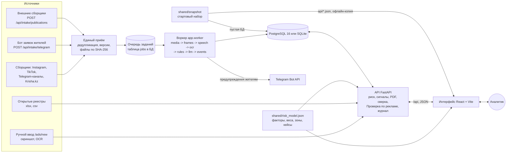

# SAQ Qurylys

[](https://github.com/VigesSvet/codemasters8/actions/workflows/ci.yml)

Цифровой помощник уполномоченного органа(ДЭР и ГАСК ВКО) для мониторинга рекламы долевого строительства и риск-скоринга жилых комплексов Усть-Каменогорска, проект Codemasters 8.0. Система собирает публикации о продаже квартир(Instagram, TikTok, Telegram-каналы, Krisha.kz, заявки жителей через Telegram-бота, приём по API, ручной ввод со скриншотом) и находит в тексте, на картинках и в речи роликов предложения внести деньги. Публикацию она сопоставляет с ЖК и открытыми реестрами(Homeportal, Казреестр через Ashyq Data) и считает объяснимый риск по модели ТЗ §5 с доказательством у каждого фактора. Итог - сигнальная карточка с решением аналитика и выгрузкой в PDF.

> - **ИИ предлагает, решает аналитик.** Гипотеза ИИ не входит в балл, пока её не принял человек; в госорганы система ничего не отправляет.
> - **Стартовый набор - реальные публичные данные**, собранные 18-19.10.2026. Оценки по ним предварительные и не являются выводом о нарушении; по ЖК без проверенных сведений риск не оценивается.
> - **Вымышленные сценарии нарушений есть только в тестовых данных**(`shared/testdata`).

**Разделы по ТЗ §8:** [проблема и ценность](#проблема-и-ценность) · [возможности](#возможности) · [архитектура](#архитектура) · [запуск](#быстрый-старт) · [тестовый сценарий](#тестовый-сценарий) · [проверка качества](#проверка-качества) · [использование ИИ](#использование-ии) · [известные ограничения](#известные-ограничения) · [технологии](#технологии) · [`.env.example`](.env.example) · [тестовые данные](shared/testdata/README.md).

## Проблема и ценность

**Пользователь** - специалист уполномоченного подразделения МИО и региональный аналитик(ТЗ §1), в Усть-Каменогорске - сотрудники ДЭР и ГАСК ВКО. Он проверяет сведения о строящихся ЖК и решает, какие случаи рассматривать дальше.

**Что сегодня занимает время:** рекламу ищут вручную по соцсетям и площадкам, часть её персонализирована, а посты удаляют; сведения об основании привлекать деньги дольщиков(гарантия Единого оператора, разрешение МИО, банк второго уровня), перечень ГАСК и обращения лежат в разных источниках; "нет в списке" легко принять за "нарушение", хотя отсутствие сведений - не отсутствие основания(ТЗ §5); неясно, что проверять в первую очередь.

**Что делает SAQ Qurylys:**

- **собирает в одно место** публикации, карточки ЖК, записи открытых реестров с источником и временем сбора, обращения, снимки и решения аналитиков; копия текста и картинок публикации остаётся на сервере, даже если пост удалён;
- **ускоряет поиск**: OCR, распознавание речи, условия оплаты(бронь, взнос, рассрочка, ДДУ) с суммой и дословной цитатой, гипотезы ЖК, объекты из рекламы вне реестра и "Проверка по рекламе" - где реклама с приёмом денег есть, а основания по открытым данным нет;
- **делает проверяемым**: балл и зона - по одной модели из одного файла, у каждого фактора цитата, документ, обращение или снимок с источником и датой, "нет данных" - 0 баллов и "Нужна проверка";
- **оставляет решение человеку**: сигнал подтверждает или возвращает аналитик с комментарием, каждое действие - в журнале с автором и временем, автоматической отправки в госорганы нет.

## Возможности

| Модуль ТЗ | Что делает система | Подробно |
|---|---|---|
| 01 Карта и обзор | Карта ЖК с меткой "Проверки по рекламе" и баллом в цвете зоны, фильтры, слой "Открытые данные" без балла, подложки "Схема", "Спутник", "3D"; оперативная сводка `/ops` | [FEATURES](docs/FEATURES.md#карта-и-обзор) |
| 02 Реестр ЖК | Реестр с фильтрами; карточка ЖК: застройщик и БИН, стадия и готовность, основание по каждому документу с источником и датой сверки, публикации, обращения, снимки, журнал | [FEATURES](docs/FEATURES.md#реестр-и-карточка-жк) |
| 03 Мониторинг рекламы | Лента с подсветкой формулировок, разбор публикации(файлы, версии в источнике, OCR, речь, анализ ИИ), ручное добавление, сбор подключениями и приём заявок | [FEATURES](docs/FEATURES.md#мониторинг-рекламы), [INTEGRATIONS](docs/INTEGRATIONS.md) |
| 04 Риск-скоринг | R1-R6 с весами ТЗ §5, "Нужна проверка" для неизвестного, зоны 0-24, 25-59, 60+ и "красная только при R1 и R2", доказательства, пересчёт после каждого решения, калькулятор и кейсы A, B, C | [RISK_MODEL](docs/RISK_MODEL.md) |
| 05 Сигнальная карточка | Снимок балла, факторов и доказательств; "Подтвердить сигнал" или "Вернуть на доработку" с комментарием; один открытый сигнал на ЖК; маршрут рассмотрения; PDF и печатная версия | [FEATURES](docs/FEATURES.md#сигналы-и-маршрут-рассмотрения) |
| ИИ(§6) | OCR, речь в роликах, условия оплаты с цитатой и уверенностью, до трёх гипотез ЖК(`saq-ai-1`), анализ Claude по ключу; решение по выводу - за аналитиком | [AI](docs/AI.md) |
| Данные(§4) | Стартовый набор реальных данных(23 ЖК, 230 публикаций) для пустой БД; 103 записи открытых реестров с источником и временем сбора; импорт xlsx и csv | [DATA](docs/DATA.md) |
| Достоверность(§7) | Вход по ролям, автор и время действий в журнале, метки "Факт из источника", "Гипотеза ИИ", "Решение аналитика", индикатор режима, ошибки без замалчивания, секреты только на сервере | [SECURITY](docs/SECURITY.md#достоверность-данных) |
| Нормативная база | Закон РК № 486-V, ст. 7, 8, 18, 23 - дословно из ИПС "Әділет"; "Основание: ст. ..." у факторов в методике, карточке, сигнале и PDF | [RISK_MODEL](docs/RISK_MODEL.md#правовая-основа) |
| RU/KZ(§11) | Переключатель "РУС / ҚАЗ" в шапке, на входе и лендинге без перезагрузки | [FEATURES](docs/FEATURES.md#двуязычный-интерфейс) |
| Дополнительно | "Проверка по рекламе" и объекты из рекламы; решения "Объект сдан" и "Проверено - замечаний нет"; сверка сведений аналитиком; связанные продавцы и цена; изменения и удаления в источнике; спутниковый архив и стадия на снимке против рекламы; проект запроса сведений; публичная проверка `/check`; предупреждения жителям с согласованием; ситуационный центр `/tv`; выезд `/field`; офлайн-копия | [FEATURES](docs/FEATURES.md) |

## Архитектура



**Процессы.** `db`(PostgreSQL 16), `api`(FastAPI), `worker`(`python -m app.worker`, тот же образ) и `web`(dev-сервер Vite с прокси `/api`). API при старте создаёт или обновляет схему БД и загружает стартовый набор в пустую базу. Воркер выполняет задания из таблицы `jobs` той же БД без отдельного брокера: сбор по расписанию, анализ публикаций, отправку согласованных предупреждений.

**Путь публикации.** Сборщики, бот и внешние клиенты пишут через единый приём: дедупликация по внешнему ID, новая версия при правке в источнике, файлы по SHA-256. Воркер ведёт публикацию по этапам: файлы, кадры видео, речь, OCR, правила `saq-ai-1`, Claude(только с ключом), события журнала. Сбой этапа виден у публикации и не роняет анализ; результат - гипотезы с цитатой и уверенностью, привязку к ЖК назначает аналитик.

**Риск и решения.** Движок риска - чистые функции над `shared/risk_model.json`; тот же файл читает TypeScript-копия движка во фронтенде, совпадение проверяет эталон `shared/testdata/risk_golden.json`. Решения аналитика пишутся в журнал и сразу пересчитывают риск. Сигнал фиксирует снимок факторов и доказательств, PDF собирается на сервере.

**Интерфейс и офлайн-режим.** Одностраничное приложение на React 19 и TypeScript. Если API не ответил при запуске, интерфейс открывает офлайн-копию стартового набора только для чтения(`shared/snapshot/api/*.json`) с риском, посчитанным сервером при выгрузке.

Подробно - [docs/ARCHITECTURE.md](docs/ARCHITECTURE.md).

## Быстрый старт

Нужен Docker с Compose v2; без Docker - Python 3.12, Node 22.12+ или 24, по желанию Tesseract(`rus`, `kaz`) и ffmpeg. Список целей - `make help`.

```bash
make up                  # Docker: PostgreSQL, API, воркер, интерфейс(то же: docker compose up -d --build)
make dev                 # без Docker: SQLite, API, воркер, интерфейс(то же: ./dev.sh)
SAQ_WORKER=0 make dev    # без воркера
```

Интерфейс - http://localhost:5180, OpenAPI - http://127.0.0.1:8000/docs. Журнал Docker - `make logs`, остановка - `make down`(тома остаются). При первом `make up` собирается образ и контейнер `web` ставит пакеты npm, это занимает несколько минут. Запуск вручную - [DEPLOYMENT](docs/DEPLOYMENT.md#локальный-запуск).

- **Ключи.** `.env` не обязателен: без ключей подключения "не настроены", остальное работает. Для ключей - `cp .env.example .env`, после правки в Docker - `docker compose up -d api worker`, перечень - [DEPLOYMENT](docs/DEPLOYMENT.md#переменные-окружения).
- **Данные.** Пустая БД при первом старте API получает стартовый набор(строка "Пустая БД: загружен стартовый набор ..." в журнале API); в непустую набор не загружается.
- **Сброс.** Docker - `docker compose down -v`(удаляет тома базы, файлов, сессии Telegram и моделей речи) и `make up`. Локально - остановить `make dev`, удалить `backend/saq.db`(с `saq.db-wal`, `saq.db-shm`) и `backend/data/media`, запустить снова.
- **Обновление.** API при старте обновляет схему БД(`meta.schema_version`, текущая `2026.10-audit-2`) на месте, данные сохраняются - [DEPLOYMENT](docs/DEPLOYMENT.md#обновление-версии).
- **Доступ.** Порты API(8000) и БД(5432) опубликованы только на 127.0.0.1. Интерфейс с прокси `/api` открывается только с этой машины, другие устройства - через `SAQ_ALLOWED_CLIENTS` - [DEPLOYMENT](docs/DEPLOYMENT.md#сетевой-доступ).

## Тестовый сценарий

5-10 минут на стартовом наборе. Ключи и интернет не нужны, без интернета нет только подложек карты и снимков. Нужен бэкенд(`make up` или `make dev`): офлайн-копия только для чтения. Сценарий меняет БД, исходное состояние возвращает "Сброс" выше. Те же шаги через API проверяет `make e2e`(`backend/tests/test_scenario.py`).

1. **Вход.** http://localhost:5180 -> "Открыть систему" -> роль "Аналитик · ДЭР ВКО". Без входа рабочие экраны не открываются; имя роли - автор действий в журнале.
2. **Обзор(01).** Карта `/`: метки ЖК, фильтры, слой "Открытые данные". Реестр `/complexes` -> фильтр "Зона" -> "Жёлтая": 5 ЖК по 35 баллов. Ещё 2 ЖК - в зелёной зоне, 16 - "Риск не оценивается"(нет проверенных сведений), красных нет.
3. **Карточка ЖК(02).** Открыть AINALAIYN: застройщик и БИН, метка "Открытый реестр", документы основания - "не проверялся". "Почему 35 баллов ->" ведёт к факторам.
4. **Факторы и зона(04).** R2 "Прямое предложение внести деньги" +25 и R3 "Активная реклама строящегося жилья" +10 - с цитатой, маркером, датой и ссылкой на публикацию. R1 - "Нужна проверка": "Сведения об основании не получены - это не считается отсутствием основания"; R4-R6 - "Нужна проверка". Итог 35, жёлтая - кейс A ТЗ §5 на реальных данных.
5. **Публикация(03).** По цитате R2 - разбор публикации: подсвеченные формулировки, файлы, OCR, "Анализ ИИ" с условиями оплаты, цитатой и уверенностью, ответ Claude из стартового набора; привязка к ЖК - решение аналитика.
6. **Пересчёт.** "Это не предложение денег"(вето R2): балл ЖК 35 -> 10, зелёная, R3 остаётся. "Условия верны" - снова 35, жёлтая. Оба решения - в истории публикации с автором и временем.
7. **Новые данные(§6).** `/ads/new` -> текст, которого нет в данных: "Старт продаж в ЖК Сатти Сити! Бронь квартиры - 500 000 тг, первоначальный взнос от 30%, рассрочка на 2 года." Живой анализ находит платную бронь 500 000 ₸, взнос 30% и рассрочку с цитатами и предлагает гипотезу "Satti City" с уверенностью 78%(транслитерация). Без подтверждённой привязки сохранённая публикация балл Satti City не меняет. Скриншот распознаётся, если установлен Tesseract(в образе Docker он есть).
8. **Сигнал(05).** В карточке AINALAIYN - "Сформировать сигнал": `S-0003` со снимком балла, факторов и доказательств. Второй открытый сигнал по ЖК не создаётся(409), по ЖК без оценки риска - тоже(422). У PARK LINE и Muztau уже открыты `S-0001` и `S-0002`, вместо кнопки - "Открыть сигнал".
9. **Решение.** "Подтвердить сигнал" или "Вернуть на доработку" - только с комментарием(пустой - 422, повторное решение - 409). Автор, время и комментарий - в сигнале, его журнале и журнале карточки ЖК.
10. **Выгрузка.** "Скачать PDF" - `signal-S-0003.pdf`(A4, кириллица и ₸) и событие "Выгружен PDF"; "Печатная версия" - `/signals/:id/print`; реестр - `/signals`.

**Контрольные кейсы A, B, C.** ЖК кейсов ТЗ §5 вымышлены и есть только в тестовых данных:

- **калькулятор** `/method#cases` -> "В калькулятор": A - 35, жёлтая(нет сведений - не R1); B - 70, красная(R1, R2, R3); C - 10, зелёная(гарантия ЕО есть, разрешения МИО нет - не R1);
- **автотесты** модели на Python и её TypeScript-копии:

  ```bash
  make test-backend PYTEST_ARGS='-q tests/test_risk.py -k "case or zone"'   # кейсы и границы зон
  cd frontend && npx vitest run src/lib/risk.test.ts                        # те же кейсы и совпадение с Python
  ```

- **реальные данные** - кейс A на шагах 3-4.

Красной зоны в наборе нет: R1 требует сверенного аналитиком отсутствия и гарантии ЕО, и разрешения МИО с источником и датой, а такой сверки по реальным ЖК не было - [RISK_MODEL](docs/RISK_MODEL.md#контрольные-кейсы).

## Проверка качества

`make check` выполняет то же, что CI: ruff, oxlint, `tsc -b`, pytest на временной SQLite, vitest и `vite build`; `make audit` - pip-audit и `npm audit`(нужна сеть, в CI входит в каждый прогон). Тестам сеть не нужна: внешние API и модель речи подменены. Покрыты модель §5 и совпадение движков Python и TypeScript, API и журнал, сигналы и PDF, ИИ и OCR, подключения, миграции схемы, стартовый набор и сценарий выше. CI идёт только на SQLite, PostgreSQL 16 - вручную; браузерного e2e-теста нет. Подробно - [DEVELOPMENT](docs/DEVELOPMENT.md).

**Секреты и персональные данные.** История Git и рабочее дерево проверены gitleaks и отдельным поиском ключей Anthropic, Apify, Meta, Telegram, 2ГИС, OLX и приватных ключей: реальных секретов нет, срабатывания - тестовые значения. `.env`, сессии Telegram и базы SQLite исключены `.gitignore` и в истории не встречаются. Телефоны и почта в `shared/snapshot` - контакты отделов продаж из публичных аккаунтов застройщиков, объявления частных продавцов Krisha - без имён и телефонов - [SECURITY](docs/SECURITY.md#персональные-данные).

## Использование ИИ

**В продукте ИИ только предлагает.** OCR - Tesseract; речь в роликах - faster-whisper локально; условия оплаты и гипотезы ЖК - собственные правила `saq-ai-1`, офлайн и детерминированно. Claude(Anthropic) работает только с ключом на сервере: признаки продажи, суммы, упомянутые ЖК и стадия с дословными цитатами, которые сервер сверяет с материалом и отбрасывает несовпавшие. Балл ИИ не меняет и вердикт не выносит. Качество правил проверяется на 26 новых текстах `shared/ai_cases.json` - [docs/AI.md](docs/AI.md).

**При разработке** команда использовала ИИ-ассистент Claude Code для написания и правки кода, тестов и документации и для ревью. Каждое изменение проходит автотесты и CI, за код и решения отвечает команда. Сторонние модели и библиотеки - [CREDITS.md](CREDITS.md).

## Известные ограничения

**Доступ** - [SECURITY](docs/SECURITY.md#принятые-риски)

- Вход пилотный, без пароля: сервер принимает имя автора из запроса и не проверяет его. Вход по ЭЦП(NCALayer) или SSO - после пилота, кнопка на экране входа неактивна.
- Режим администратора - один общий токен `SAQ_ADMIN_TOKEN`.
- У порта 5180 нет входа и TLS; файлы публикаций и маршруты аналитика доступны всем внутри разрешённого периметра.
- Токены OLX и данные заявителей бота хранятся в БД без шифрования.

**Источники** - [INTEGRATIONS](docs/INTEGRATIONS.md#ограничения-и-проверка-вживую)

- Instagram и TikTok собираются только с токенами владельца(`META_USER_ACCESS_TOKEN`, `APIFY_TOKEN`; TikTok через Apify платный). Business Discovery видит публикации аккаунтов из списка, а не персонализированные рекламные показы.
- Telegram-каналы вживую не собирались: нужен однократный вход по коду на номер владельца аккаунта(`python -m app.integrations.telegram_login`).
- OLX Partner API даёт только ресурсы своего аккаунта.
- Krisha.kz закрывает часть карточек проверкой SafeLine(HTTP 468), обход не выполняется.
- Контракт бота заявок не сверен с проектом бота, подписки на предупреждения бот не регистрирует.
- Предупреждения жителям вживую не отправлялись, Bot API проверен на заглушке.
- Открытые реестры не синхронизируются автоматически - [DATA](docs/DATA.md#открытые-реестры).

**ИИ и распознавание** - [AI](docs/AI.md)

- Claude платный(дневной бюджет `ANTHROPIC_DAILY_BUDGET_USD`, по умолчанию 5 $), нужен интернет, текст публикации и OCR уходят в Anthropic. Без `ANTHROPIC_API_KEY` этап пропускается и работают только правила `saq-ai-1`; ответы Claude в стартовом наборе уже сохранены.
- Качество `saq-ai-1` проверено на текстах команды, а не на выборке реальной рекламы.
- Речь распознаётся с ошибками в названиях и числах, казахская - хуже русской. Модель речи скачивается отдельной командой(`python -m app.speech download`), без неё этап пропускается.
- Без Tesseract OCR недоступен, текст скриншота вводят вручную.

**Данные и риск**

- Стартовый набор - срез на 18-19.10.2026 без видео и заявок жителей - [DATA](docs/DATA.md#стартовый-набор).
- Риск большинства реальных ЖК(16 из 23) не оценивается до сверки аналитиком - [RISK_MODEL](docs/RISK_MODEL.md#риск-не-оценивается).
- Опубликованный перечень ГАСК(O1) может отставать от фактического; наблюдения O1-O3 в балл не входят - [RISK_MODEL](docs/RISK_MODEL.md#наблюдения-вне-балла).
- Офлайн-копия без сигналов, журнала, OCR и сверки - [ARCHITECTURE](docs/ARCHITECTURE.md#офлайн-режим).
- Проект запроса сведений - черновик без отправки - [FEATURES](docs/FEATURES.md#запрос-сведений-и-проект-письма).
- Казахский интерфейс частичный - [FEATURES](docs/FEATURES.md#двуязычный-интерфейс).

**Карта и проверка**

- Подложки и архив снимков - внешние сервисы(OpenFreeMap, Esri), без интернета их нет - [FEATURES](docs/FEATURES.md#спутник-и-3d).
- CI без PostgreSQL и без браузерного e2e-теста - [DEVELOPMENT](docs/DEVELOPMENT.md#ci).

## Карта репозитория

```text
backend/app/              API, воркер, риск, сигналы, PDF, приём, файлы, миграции схемы
backend/app/ai/           saq-ai-1: OCR, условия оплаты, сопоставление с ЖК, оценка
backend/app/integrations/ подключения, Claude, приём и бот заявок
backend/app/fonts/        шрифт Noto Sans для PDF
backend/tests/            pytest, включая сценарий README
backend/Dockerfile        образ api и worker
frontend/src/             pages, components, lib(API, движок риска, переводы), data, styles, ui
frontend/public/          шрифты, логотипы площадок, фото, индекс снимков
frontend/scripts/         сборка индекса снимков Esri Wayback
shared/risk_model.json    модель риска - общая для API и интерфейса
shared/law.json           выдержки Закона РК № 486-V
shared/env_labels.json    названия настроек сервера для интерфейса
shared/registry_ust_kamenogorsk.json   записи открытых реестров
shared/ai_cases.json      тексты проверки ИИ
shared/sat_stage.json     стадии стройки по снимкам
shared/snapshot/          стартовый набор и офлайн-копия
shared/testdata/          вымышленные данные и эталон риска - только тесты
docs/                     документация и исходные материалы
.github/workflows/ci.yml  CI
docker-compose.yml, dev.sh, Makefile, .env.example, CREDITS.md
```

## Документация

| Документ | Для кого | Что внутри |
|---|---|---|
| [ARCHITECTURE](docs/ARCHITECTURE.md) | разработчик, жюри | процессы, модули, данные, очередь, хранилище, схема БД |
| [FEATURES](docs/FEATURES.md) | аналитик, заказчик, жюри | экраны и сценарии работы |
| [RISK_MODEL](docs/RISK_MODEL.md) | аналитик, заказчик | факторы, формула, зоны, кейсы, "Проверка по рекламе", право |
| [AI](docs/AI.md) | жюри, разработчик | OCR, речь, `saq-ai-1`, Claude, качество и стоимость |
| [DATA](docs/DATA.md) | разработчик, заказчик | стартовый набор, реестры, тестовые данные |
| [INTEGRATIONS](docs/INTEGRATIONS.md) | администратор | подключения, приём, бот, предупреждения |
| [API](docs/API.md) | разработчик, интегратор | маршруты, форматы, ошибки, доступ |
| [DEPLOYMENT](docs/DEPLOYMENT.md) | администратор | Makefile, Docker, сеть, переменные, обновление, копии |
| [SECURITY](docs/SECURITY.md) | администратор, жюри | угрозы, доступ, секреты, ПДн, принятые риски |
| [DEVELOPMENT](docs/DEVELOPMENT.md) | разработчик | команды, тесты, CI, стиль, расширения |
| [CREDITS.md](CREDITS.md) | все | лицензии и источники |
| [shared/testdata](shared/testdata/README.md) | разработчик | тестовые данные и эталон риска |

**Исходные материалы**(не документация системы): [кейс ТЗ](<docs/Кейс Codemasters 8.0. SAQ (1).pdf>), [ссылки на реестры](docs/Ссылки_и_реестры.md), [таблица объектов](docs/Усть-Каменогорск_объекты.xlsx)(её читают импортёр и тесты), [рабочий план команды](docs/PLAN.md).

## Технологии

- **Интерфейс:** React 19, TypeScript 6, Vite 8, React Router 7, MapLibre GL 6, dnd-kit, Gravity UI Icons, Simple Icons; шрифты Golos Text и Roboto Condensed.
- **Бэкенд:** Python 3.12, FastAPI, Starlette, SQLAlchemy 2, Pydantic 2, uvicorn, psycopg 3, reportlab 5, openpyxl, Pillow.
- **БД:** PostgreSQL 16 в Docker, SQLite локально и в тестах.
- **ИИ:** собственный `saq-ai-1`, Tesseract 5(rus, kaz, eng), faster-whisper 1.2.1 на CTranslate2(модель `base` по умолчанию), Claude(по умолчанию `claude-sonnet-5-5`) через SDK `anthropic` 1.15.0.
- **Сбор:** httpx, Telethon, Beautiful Soup, Meta Graph API, Apify, 2ГИС Catalog API, OLX Partner API, ffmpeg.
- **Инфраструктура:** Docker Compose, очередь заданий в БД без брокера.
- **Проверка:** pytest, ruff, Vitest, oxlint, pip-audit, npm audit, GitHub Actions.

Точные версии - `backend/requirements*.txt`, `frontend/package.json`, `frontend/package-lock.json`.

## Лицензии и источники

Библиотеки, шрифты, иконки, фото, открытые данные и условия внешних API - [CREDITS.md](CREDITS.md). Стартовый набор содержит публичную рекламу третьих лиц, собранную для мониторинга; по запросу правообладателя материал удаляется из набора.
