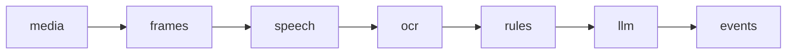

# Использование ИИ

ИИ-сценарий SAQ Qurylys по ТЗ §6: где работает ИИ, что он выдаёт, как сервер проверяет выводы, как аналитик их принимает или отклоняет, сколько это стоит и как проверено качество. Документ для жюри, аналитика и разработчика. Модель риска - [RISK_MODEL.md](RISK_MODEL.md), ключи и статусы подключений - [INTEGRATIONS.md](INTEGRATIONS.md).

| Компонент | Что выдаёт | Внешняя сеть | Код |
|---|---|---|---|
| OCR | Текст скриншотов и кадров видео | нет, Tesseract | `backend/app/ai/ocr.py` |
| Речь в роликах | Расшифровка звука видео | нет, faster-whisper | `backend/app/speech.py` |
| Правила `saq-ai-1` | Условия оплаты, гипотезы ЖК с уверенностью | нет | `backend/app/ai/` |
| Анализ Claude | Признаки продажи, суммы, ЖК, стадия объекта, нормы закона | Anthropic API, по ключу | `backend/app/llm.py` |
| Стадия по снимку | Стадия стройки на спутниковом снимке | Anthropic API, по ключу | `backend/app/satstage.py` |

## Принципы

ИИ предлагает, решает аналитик. Каждый вывод - гипотеза с дословным фрагментом-основанием и уверенностью; в интерфейсе он помечен значком "гипотезы ИИ", неуверенный - пометкой "низкая уверенность".

Чего ИИ не делает:

- не выносит юридического вердикта и не подтверждает нарушение;
- не меняет балл R1-R6: привязка-гипотеза к ЖК даёт 0 баллов и "Нужна проверка" при любой уверенности([RISK_MODEL.md, "Факты и гипотезы"](RISK_MODEL.md#факты-и-гипотезы));
- не ставит R2: его ставит правило модели риска по словарю `markers.money`, снять R2 у публикации может только аналитик;
- не привязывает собранную публикацию к ЖК. `SAQ_COLLECTED_AUTOLINK=1` включает для неё правило ручного ввода(лучшая гипотеза от порога - привязка-гипотеза); эта настройка - только для показа;
- не меняет статус публикации, решения аналитика и сигналы: ответ Claude пишется только в `llm_analyses` и журнал.

Выводы Claude читает "Проверка по рекламе"(кандидаты ЖК высокой и средней уверенности, признаки приёма денег, стадия объекта); такая оценка имеет основание "гипотеза", пока привязку не подтвердил аналитик([RISK_MODEL.md, "Проверка по рекламе"](RISK_MODEL.md#проверка-по-рекламе)).

Анализ выполняется только на сервере, фронтенд его не дублирует и лишь показывает результат; в офлайн-режиме OCR и анализа нет([ARCHITECTURE.md, "Офлайн-режим"](ARCHITECTURE.md#офлайн-режим)). Поставщика языковой модели(Anthropic, Claude) выбрал заказчик, локальная языковая модель не подключена.

## Конвейер анализа публикации

Собранную публикацию анализирует задание `analyze` воркера(`backend/app/analysis.py`; очередь - [ARCHITECTURE.md, "Очередь заданий и воркер"](ARCHITECTURE.md#очередь-заданий-и-воркер)). Начало этапа пишется в `ingest_items.analysis_stage` и `jobs.payload.stage`: при сбое видно, где он случился.



| Этап | Что делает |
|---|---|
| `media` | Загружает файлы публикации в хранилище, неудачную загрузку повторяет отдельным заданием |
| `frames` | ffmpeg берёт из видео кадр раз в 2 с, до 8 кадров, шириной до 1280 px |
| `speech` | Распознаёт речь в роликах, расшифровка добавляется к OCR |
| `ocr` | Распознаёт изображения и кадры; файл с уже распознанным SHA-256 не распознаётся повторно |
| `rules` | Правила `saq-ai-1`: условия оплаты и гипотезы ЖК |
| `llm` | Claude, только если задан `ANTHROPIC_API_KEY` |
| `events` | События журнала по итогам этапов |

- **Сбой этапа анализ не останавливает.** Нескачанный файл, нет Tesseract, ffmpeg или модели речи - пояснение у файла и в журнале, анализ идёт дальше. Сбой `llm` - событие "Анализ ИИ не выполнен: ..." с просьбой проверить вручную.
- **Сбой задания целиком** виден в `processing.error` публикации: только причина, написанная для аналитика; подробности(SQL, пути) - в журнале воркера. Версия публикации, пришедшая во время анализа, получает своё задание.
- **Повторный запуск журнал не дублирует:** событие OCR - если изменился текст, файлов - по новым неудачам, гипотезы - если назначена привязка, Claude - только по новому итогу этапа.
- **Пересчёт правил(`rulesOnly`).** Карточка ЖК, созданная по рекламе, меняет справочник; задание с `rulesOnly` выполняет только `rules` по уже проанализированной версии, без файлов, OCR и Claude. Событие пишется, если сменилась лучшая гипотеза.

## OCR

`backend/app/ai/ocr.py` распознаёт скриншоты формы ручного добавления(`POST /api/ocr`, текст можно поправить до сохранения) и изображения и кадры на этапе `ocr`.

- **Движок.** Tesseract 5(LSTM) как отдельная программа, языки rus, kaz, eng из установленных; без части пакетов - распознавание на остальных с пояснением.
- **Предобработка(Pillow).** Поворот по EXIF, прозрачность на белом фоне, оттенки серого, увеличение мелких до 1600 px по длинной стороне(не больше чем втрое), уменьшение больших до 5000 px, автоконтраст.
- **Ответ.** Текст, движок, версия, языки, средняя уверенность слов 0-1, время, шаги предобработки, пояснение; текст длиннее 20 000 символов обрезается.
- **Ошибки `POST /api/ocr`.** Не изображение или нечитаемый формат(HEIC, AVIF, SVG) - 415; больше 10 МБ или 40 Мп - 413; пустой или битый файл - 422; все места распознавания заняты дольше 3 с - 503 с `Retry-After`. Нет Tesseract - 200 с `engine: "none"` и пояснением: текст вводят вручную. Техническая причина - в журнал API.
- **Ресурсы.** Одновременных распознаваний в процессе - половина ядер, не меньше двух.
- **Настройка.** `TESSERACT_CMD` - программа(по умолчанию `tesseract` из `PATH`), `SAQ_OCR_TIMEOUT` - тайм-аут на изображение, 60 с; обе читаются при запуске процесса.
- **Установка.** В Docker-образе бэкенда Tesseract ставится с пакетами rus и kaz(`backend/Dockerfile`). Локально: `sudo apt install tesseract-ocr tesseract-ocr-rus tesseract-ocr-kaz`(Debian, Ubuntu), `sudo dnf install tesseract tesseract-langpack-rus tesseract-langpack-kaz`(Fedora), `brew install tesseract tesseract-lang`(macOS). Без Tesseract анализ текста работает.
- **В анализе публикации** тексты изображений и кадров собираются в `ads.ocr` без повторов; журнал различает "текста нет" и "OCR не выполнен: ...".

## Речь в роликах

Этап `speech`(`backend/app/speech.py`) распознаёт звук загруженных видео локально и без оплаты: в роликах TikTok и Instagram цена, бронь и название ЖК часто звучат голосом и не видны в кадре.

- **Движок.** faster-whisper 1.2.1(Whisper на CTranslate2), CPU, int8, 4 потока. Звук никуда не отправляется.
- **Модель.** `SAQ_ASR_MODEL`: `tiny`, `base`(по умолчанию), `small`, `medium`, `large-v3`; `off` выключает этап. Модель загружается в память воркера один раз.
- **Загрузка модели - отдельная команда.** Задание анализа в сеть не ходит и открывает модель только с диска. Модель скачивается один раз с huggingface.co без ключа в `SAQ_ASR_MODEL_DIR`: локально `backend/data/models`(вне Git), в Docker - том `asrmodels`. `base` занимает около 145 МБ, `small` - около 480 МБ. Настройки читаются при запуске процесса: смена `SAQ_ASR_MODEL` действует после перезапуска воркера.

```bash
cd backend && .venv/bin/python -m app.speech download         # модель SAQ_ASR_MODEL; --model small - другая
docker compose exec worker python -m app.speech download      # Docker
cd backend && .venv/bin/python -m app.speech <путь к видео>   # расшифровка одного ролика
```

- **Звук.** ffmpeg с ограничениями, как у кадров(только локальный файл, формат по сигнатуре, один поток, `prlimit`, 90 с): моно 16 кГц, не длиннее `SAQ_ASR_MAX_S` + 1 с.
- **Язык** определяется по речи и выбирается из русского и казахского. Музыку без слов отсекает VAD(Silero); типовые "галлюцинации" Whisper("Субтитры сделал...", "Продолжение следует..."), протяжные звуки без слов и сегменты, почти наверняка не речь, отбрасываются.
- **Пределы.** Ролик длиннее `SAQ_ASR_MAX_S`(300 с) не распознаётся, распознавание дольше `SAQ_ASR_TIMEOUT_S`(300 с) прерывается: оба случая - "пропущено", частичный текст не сохраняется. Расшифровка ролика - до 4000 символов.
- **Хранение.** `media_assets.meta.speech`(статус, текст, язык, модель, длительность) и абзац "Речь в ролике: ..." в `ads.ocr` после текста OCR; при нехватке места обрезается OCR, а не расшифровка. Тот же файл(SHA-256) у другой публикации повторно не распознаётся; "Проанализировать ещё раз" повторяет ролики с неудачей.
- **Кто читает и где видно.** Правила, "Проверка по рекламе" и Claude читают расшифровку вместе с OCR, поэтому цитаты из речи помечены источником `ocr`; системный промпт Claude отмечает такой абзац как речь, а не надпись. Аналитик видит блок "Речь в ролике(распознано автоматически)", API - `media[].speech`, журнал - "Речь в ролике распознана" или "не распознана: ...".

На 11 собранных роликах `base`(int8, 4 потока CPU) распознала 487 с звука примерно за 45 с - около 11 раз быстрее реального времени; в 3 роликах была только музыка, и результат - "речи нет". В названиях ЖК и числах бывают искажения, слова песен попадают в расшифровку; выбор казахского языка проверен только автотестом.

## Правила saq-ai-1

Офлайн-движок `backend/app/ai/`: правила, словари, нечёткое сравнение строк, без внешних API и ключей. Он детерминирован, версия `saq-ai-1` приходит в каждом ответе. Результат: условия оплаты, до трёх гипотез ЖК с причинами, маркеры словарей модели риска, телефоны, адреса и пояснение("похоже на подборку", "признаков конкретного ЖК не найдено"). Живой анализ формы `/ads/new`(`POST /api/analyze` через 400 мс после ввода) ничего не пишет; анализ сохранённой публикации - `GET /api/ads/{id}/analysis`, без отклонённых гипотез, в карточке `/ads/:id` - блок "Анализ ИИ". Нет ни одного признака ЖК - нет и гипотез.

**Условия оплаты**(`terms.py`): платная бронь, депозит или задаток, первоначальный взнос, рассрочка, ДДУ, оплата напрямую застройщику, инвестиционный вход, цена. Понимаются русские и казахские формы("бастапқы жарна", "бөліп төлеу"), числа рядом("500 тыс. тг", "1,2 млн ₸", "$10 000", цена за м², проценты, "на 2 года" = 24 мес.) и отрицания("бронь не нужна", "бронь 0 тг", "тегін"). У условия - дословная цитата и источник `text` или `ocr`; бесплатная бронь и цена - `money: false`, не предложение денег.

**Сопоставление с ЖК**(`matching.py`) - вклад признаков в логит уверенности:

| Признак | Вес |
|---|---|
| Название: точно(×1), в другом падеже или в транслитерации("Shygys" и "Шығыс", ×0,95), с опечаткой(× сходство триграмм) | 3,0 |
| Адрес "ул./пр./на" + улица + дом; без "ул."; только улица | 2,5; 1,5; 0,8 |
| Название ЖК в имени аккаунта | 2,0 |
| Аккаунт, сайт или телефон застройщика | 1,5 |
| Подтверждённые публикации аккаунта по этому ЖК | 1,2-1,6 |
| Район | 0,4 |

Число с единицей после улицы("9 этаж", "52 м²", "18 лет") номером дома не считается; латинские буквы-двойники в OCR приводятся к кириллическим. Аккаунт и ссылка из заявки жителя не учитываются: его слова не доказательство.

**Уверенность.**

- Условие: базовая уверенность ключевого слова; повышают число рядом и то же условие в тексте и на скриншоте, понижают источник OCR, бесплатность и два разных значения одного условия. Итог - 0,1-0,97.
- Гипотеза ЖК: логистическая функция суммы весов со сдвигом. Одно точное название - около 80%, адрес "улица + дом" - около 71%, только аккаунт или телефон застройщика - около 48%. Вес признака со скриншота умножается на 0,9; у застройщика с несколькими строящимися ЖК вклад его телефона и аккаунта делится на корень из их числа; в подборке ЖК уверенность каждого снижается.

Пороги - `thresholds` в `shared/risk_model.json`: ниже `lowConfidence`(0,5) - "низкая уверенность", ниже `hypothesisMin`(0,3) - гипотеза не показывается, показываются до `hypothesesTop`(3) лучших. Уверенность - подсказка, на балл она не влияет.

## Анализ Claude

Этап `llm`(`backend/app/llm.py`, транспорт - `backend/app/integrations/analyzer_anthropic.py`) после правил отправляет текст и OCR в Claude и получает структурированный разбор. Без `ANTHROPIC_API_KEY` этап не выполняется и ничего не пишет. Ключ и статусы подключения - [INTEGRATIONS.md, "Claude"](INTEGRATIONS.md#claude).

### Что отправляется

- текст публикации и OCR(с расшифровкой речи);
- площадка и аккаунт; у заявки жителя аккаунт и ссылка не передаются;
- справочник до 30 ЖК(id, название, застройщик, адрес): гипотезы правил первыми, без отклонённых аналитиком для этой публикации;
- в системном промпте - выдержки и пересказ ст. 7, 8, 18, 23 Закона РК "О долевом участии в жилищном строительстве" из `shared/law.json`([RISK_MODEL.md, "Правовая основа"](RISK_MODEL.md#правовая-основа)).

Не отправляются ссылки, файлы, изображения, звук, видео, данные заявителя и решения аналитика.

### Форма запроса

- SDK `anthropic` 1.15.0, Messages API потоком(`client.beta.messages.stream`, параметры как у `create`): `ANTHROPIC_MODEL`(по умолчанию `claude-sonnet-5-5`), `max_tokens` из `ANTHROPIC_MAX_TOKENS`(16 000), системный промпт, одно сообщение пользователя.
- `output_config`: `effort` из `ANTHROPIC_EFFORT`(low, medium, high, xhigh, max; по умолчанию medium) и `format` с `json_schema`.
- Без `thinking`, `budget_tokens`, `temperature` и предзаполнения: размышление у этих моделей адаптивное, глубину задаёт `effort`.
- Повторы SDK выключены(повторяет задание анализа), ключ передаётся клиенту явно, адрес API зафиксирован. `ANTHROPIC_TIMEOUT_S`(120 с) ограничивает ожидание соединения и очередного фрагмента ответа, а не весь ответ.
- **Резервная модель.** Для `claude-opus-5-5`, `claude-opus-5`, `claude-fable-5-1`, `claude-sonnet-5-5` - `fallbacks: "default"`(бета `server-side-fallback-2026-07-01`): запрос, от которого отказалась основная модель, в том же вызове выполняет резервная модель Anthropic. Ответившая модель сохраняется(`servedModel`, `fallback`), расход - по цене каждой попытки(`usage.iterations`).

### Версии промпта и схема ответа

`PROMPT_VERSION = "saq-llm-3"`. Версия входит в ключ повторного использования, поэтому её смена отправляет публикации на повторный анализ в пределах бюджета. Ответы прежних версий хранятся строками истории и показываются, пока нет ответа текущей.

| Поле | Содержимое | Версия |
|---|---|---|
| `saleSignals` | Вид признака(sale, presale, booking, installment, down_payment, ddu, price, discount, keys_handover, other) и цитата | `saq-llm-1` |
| `amounts` | Значение, валюта, вид суммы, цитата | `saq-llm-1` |
| `complexCandidates` | ЖК только из справочника, уверенность low, medium, high, цитата | `saq-llm-1` |
| `uncertainties`, `summary` | Что требует проверки; сводка по-русски | `saq-llm-1` |
| `mentionedComplexes` | Все названные ЖК, в том числе вне справочника: название и адрес как в материале, цитата | `saq-llm-2` |
| `objectStage` | under_construction, completed или unknown, с цитатой | `saq-llm-2` |
| `legalRefs` | Статья, пункт, объяснение, цитата - гипотеза, не вывод о нарушении | `saq-llm-3` |

Упомянутые ЖК вне справочника и открытого реестра становятся объектами из рекламы([DATA.md, "Карточки ЖК из реестра и по рекламе"](DATA.md#карточки-жк-из-реестра-и-по-рекламе)).

### Проверка ответа сервером

Валидный JSON ещё не правда. Сервер проверяет ответ своей схемой(pydantic, лишние поля - "не соответствует схеме") и сверяет с материалом:

- цитата - дословно в отправленном тексте или OCR(без учёта регистра и пробелов, от 3 символов), с источником `text` или `ocr`;
- `complexId` - из отправленного справочника, название берётся из справочника;
- название упомянутого ЖК есть в материале; адреса нет в материале - адрес очищается;
- стадия без найденной цитаты - `unknown`; статья - только 7, 8, 18 или 23, пункт вида "6" или "1-1"(иначе очищается);
- сумма - конечное неотрицательное число; списки до 20 элементов, ссылок на нормы до 5, сводка до 400 символов.

Не прошедшее отбрасывается и считается по причинам(`dropped`: quote, complex, amount, limit, name, address, stage, article); счётчики видны в карточке, API и журнале.

### Защита от prompt injection

- Материал - в сообщении пользователя внутри блоков `<publication_metadata>`, `<publication_text>`, `<ocr_text>`, `<complex_catalog>`.
- Эти теги и `<legal_context>` внутри материала обезвреживаются("‹/ocr_text>"), в том числе с пробелами и невидимыми символами внутри; NUL и символы-теги Unicode удаляются.
- Системный промпт требует считать содержимое блоков данными и игнорировать команды в нём.
- Ответ пишется только в `llm_analyses` и журнал и не может задать статус, привязку или подтверждение.

### Повторное использование и бюджет

Результат хранится по ключу "хеш материала + модель + версия промпта". Тот же материал повторно не отправляется: новая версия публикации с тем же текстом берёт сохранённый результат. Оплаченный, но негодный ответ(отказ, обрезан, не JSON) тоже не повторяется. Справочник ЖК входит в материал, поэтому после создания карточки ЖК по рекламе правила пересчитывает задание `rulesOnly` без запроса к Claude.

- **Резерв.** Перед запросом атомарно резервируется наихудшая стоимость: вход по оценке и весь `ANTHROPIC_MAX_TOKENS` на выходе, у `claude-sonnet-5-5` - около 0,17 $. После ответа резерв заменяется оценкой по `usage`(вход, выход, кэш). Запрос, заведомо не оплаченный(API отклонил его до генерации или соединения не было), резерв возвращает; тайм-аут и обрыв после отправки - нет.
- **Дневной бюджет** `ANTHROPIC_DAILY_BUDGET_USD`(5 $; 0 выключает этап) - строка `anthropic-usd:<дата>` в `quota_counters` в микродолларах, сутки по Усть-Каменогорску. Не хватает - этап пропускается, в журнале "Анализ ИИ пропущен: дневной бюджет ... исчерпан ...", подключение - "пауза: лимит", продолжение после полуночи.
- **Типичная стоимость.** В стартовом наборе средний ответ Sonnet 5.5 при `effort` medium на промпт `saq-llm-2` - около 0,018 $(около 6600 токенов входа и 480 выхода).

- **Цены** - таблица `PRICES` в `analyzer_anthropic.py`, $ за млн токенов входа и выхода: `claude-sonnet-5-5` и `claude-sonnet-5` - 2 и 10, `claude-opus-5-5` - 4 и 20, `claude-opus-5` и `claude-opus-4-8` - 5 и 25, `claude-haiku-5-5` - 0,10 и 0,50, `claude-fable-5-1` - 10 и 50; запись и чтение кэша - по своим ценам. `claude-opus-4-8`, `claude-opus-5` и `claude-sonnet-5` бывают резервными моделями; неизвестная модель считается по самой дорогой цене. Резервная модель не нужна - задают модель без неё, например `ANTHROPIC_MODEL=claude-haiku-5-5`. Оценка - не счёт Anthropic, фактический расход - в консоли Anthropic.

### Сбои и повторы

Любой сбой - "анализ ИИ не выполнен", никогда "риска нет".

| Случай | Поведение |
|---|---|
| Сеть, тайм-аут, обрыв, 429, 5xx, 408, 409 | До 3 попыток новым заданием через 60 · 2^(n-1) с(до часа, ±20%), не раньше `retry-after` и не позже 6 ч |
| 401 | Подключение "истёк доступ", этап пропускается до замены ключа или успешной проверки подключения |
| 403, 402 | "Нет доступа", пропуск до замены ключа или прав |
| 400, 404, прочие 4xx | "Не выполнен" без повтора, подключение "ошибка" |
| Отказ модели | `refused`: "модель отказалась ..." - это не значит, что риска нет |
| Ответ обрезан по `max_tokens`, не JSON, не по схеме | "Не выполнен" с причиной |

Итог в `llm_analyses`: `done`, `refused`, `failed`(с `retry_at` - ждёт повтора) или `skipped`(бюджет, ключ отклонён, нечего анализировать).

### Дозапрос старых публикаций

Лидер воркера раз в `ANTHROPIC_BACKFILL_INTERVAL_MIN`(10 мин) ставит задания анализа собранным публикациям с текстом или OCR, у которых нет ответа по текущей версии промпта. Ответ любой модели засчитывается: смена `ANTHROPIC_MODEL` не отправляет всё заново, смена версии промпта - отправляет.

- Новые первыми; за проход - до `ANTHROPIC_BACKFILL_BATCH`(5; 0 выключает) с учётом невыполненных заданий дозапроса и в пределах остатка бюджета по наихудшей стоимости; приоритет -1, после нового содержимого.
- Проход пропускает публикации с активным заданием анализа и ждущие повтора запроса(`retry_at`). Публикации со сбоем или пропуском этапа сегодня и уже получавшие задание дозапроса сегодня ждут следующего дня: цикла повторов нет.

**Стартовый набор** содержит ответы только `saq-llm-1` и `saq-llm-2`(459 строк по 230 публикациям), ответов `saq-llm-3` в нём нет. Поэтому при заданном ключе дозапрос отправляет публикации набора повторно под `saq-llm-3` в пределах дневного бюджета; промпт `saq-llm-3` длиннее за счёт правового контекста, и весь набор стоит порядка одного дневного бюджета по умолчанию. Без ключа видны сохранённые ответы прежних версий([DATA.md, "Стартовый набор"](DATA.md#стартовый-набор)).

### Проанализировать ещё раз

Кнопка в блоке "Анализ ИИ" карточки собранной публикации("Проанализировать сейчас", если анализа не было) отправляет тот же материал той же моделью снова. Запрос платный, поэтому только в режиме администратора: `POST /api/ads/{id}/reanalyze` с `{author}` и `X-Admin-Token`.

- Задание с приоритетом 1; прежний ответ остаётся строкой истории(`meta.materialHash`), в журнал - "Запрошен повторный анализ ИИ: ..." от автора и событие результата.
- Ответы: 202 - поставлено; 200 - анализ уже идёт или повтор уже в очереди; 401, 403 - токен; 404 - нет публикации; 409 - публикация не собрана, нет текста и OCR, ключ отклонён, бюджет 0 или его остатка не хватает; 503 - нет `ANTHROPIC_API_KEY`, пакета `anthropic` или настройки администрирования.
- Если к выполнению бюджет кончился или ключ отклонён, прежний ответ остаётся в силе.

### Где видно

- **Карточка публикации**, блок "Анализ ИИ": все поля ответа с цитатами, кандидаты ЖК с подписью "гипотеза - решение за аналитиком", нормы - "Может относиться к нормам закона", модель и стоимость; при сбое - "Это не значит, что риска нет".
- **API** - поле `llm` публикации(`GET /api/ads`, `GET /api/ads/{id}`): проверенный результат, `dropped`, ошибка, стоимость; request-id и сырой ответ не выводятся([API.md, "ИИ и OCR"](API.md#ии-и-ocr)).
- **Журнал** - событие "Системы": "Анализ ИИ: признаки продажи - ...; кандидаты ЖК - ... - гипотеза, привязку делает аналитик; ...".

### Приватность

Текст публикации и OCR уходят в Anthropic по условиям Anthropic API. В OCR входит расшифровка речи - в том числе имена и телефоны, которые диктует продавец; звук, видео и данные заявителей не отправляются. Если передача недопустима, ключ не задают; если недопустима только речь - `SAQ_ASR_MODEL=off`. Персональные данные в целом - [SECURITY.md, "Персональные данные"](SECURITY.md#персональные-данные).

## Решения аналитика по выводам ИИ

Блок "Анализ ИИ" правил `saq-ai-1` показывает гипотезы ЖК и условия оплаты с уверенностью числом и полоской, причинами и цитатами. Решение пишется условным обновлением по версии решений: если другой аналитик успел первым - 409 с текущим состоянием.

| Действие | Маршрут | Результат |
|---|---|---|
| "Принять привязку" | `POST /api/ads/{id}/hypotheses/accept` | Привязка - факт с именем и временем(`linkConfirmedBy`, `linkConfirmedAt`), уверенность - этой гипотезы; маркеры R2 и R3 этой публикации идут в балл ЖК. ЖК, которого ИИ не предлагал, - 422 |
| "Отклонить гипотезу" | `POST /api/ads/{id}/hypotheses/reject` | ЖК попадает в `rejectedLinks` и не предлагается ни правилами, ни Claude; текущая привязка-гипотеза к нему снимается. Подтверждённую привязку так не снять - 409 |
| "Условия верны" | `POST /api/ads/{id}/terms-review`, `accepted` | Пометка "подтверждено аналитиком", на балл не влияет |
| "Это не предложение денег" | `POST /api/ads/{id}/terms-review`, `rejected` | Публикация не даёт R2 ни ЖК, ни в своей оценке |

Решение по условиям можно изменить. Каждое решение - событие журнала вида `ai` с автором и временем; после него интерфейс перечитывает риск и историю.

- **Форма ручного добавления**(`POST /api/ads`): ЖК, выбранный вручную с подтверждением, - привязка-факт; выбранная гипотеза - привязка-гипотеза; без выбора сервер берёт лучшую гипотезу не ниже `lowConfidence` как привязку-гипотезу, а без неё пишет "ИИ: ЖК не определён - нужна ручная привязка".
- **Собранная публикация** приходит без привязки: "Гипотеза ИИ: ЖК ..., уверенность N% ... - нужна проверка аналитиком". Если привязка-гипотеза расходится с текущим анализом на 5 п. п. и больше, карточка объясняет расхождение.
- **Кандидаты Claude** - только гипотезы, кнопок принятия у них нет: аналитик принимает гипотезу правил или выбирает ЖК вручную.
- **В сигнале и PDF** привязка подписана "привязка - факт(подтвердил ...)" или "привязка - гипотеза ИИ N%, в балл не входит"([FEATURES.md, "Сигналы и маршрут рассмотрения"](FEATURES.md#сигналы-и-маршрут-рассмотрения)).

## Проверка качества на новых данных

`shared/ai_cases.json` - 26 текстов не из собранной рекламы: тексты, аккаунты и телефоны вымышлены. Справочник `catalog` - 14 вымышленных ЖК и 7 застройщиков прежнего демо-набора(`shared/testdata/demo_seed.json`) с историей аккаунтов; в данных приложения их нет, прогон воспроизводим и не зависит от БД.

Случаи: латиница, казахский текст, опечатки, падежи, шумный OCR, адрес без названия, телефон и история аккаунта, подборка ЖК, форматы сумм, бесплатная бронь, вторичка, контрпримеры(услуги, гараж, "9 этаж" после улицы). У кейса - полный список ожидаемых условий(лишнее - ошибка) и ожидаемый ЖК первой гипотезы, "без уверенной привязки" или "гипотез нет".

| Метрика(`backend/app/ai/evaluate.py`) | Смысл | Значение |
|---|---|---|
| Кейсы | Пройдено полностью | 26 из 26 |
| `termsFound` / `termsExpected` | Найдено ожидаемых условий | 40 из 40 |
| `termsPrecision` | Доля найденных условий, которые ожидались | 1,0 |
| `linkTop1` | Ожидаемый ЖК - первая гипотеза | 1,0(17 кейсов) |
| `falsePositives` | Уверенная гипотеза не того ЖК или там, где ЖК быть не должно | 0 |

Запуск: `GET /api/ai/eval`, экран `/method`(раздел "ИИ-анализ публикаций"), тест `backend/tests/test_ai.py`(входит в `make test-backend`):

```bash
make test-backend PYTEST_ARGS="-q tests/test_ai.py"
cd backend && .venv/bin/python -m pytest -q tests/test_ai.py      # без make
```

Кейсы составлены командой и не являются выборкой реальной рекламы: прогон показывает, что движок держит перечисленные случаи, а не точность в эксплуатации. Claude этим набором не оценивается; его выводы сервер проверяет на каждом ответе, а `dropped` показывает отброшенное.

## Стадия стройки по спутниковому снимку

`backend/app/satstage.py` спрашивает Claude, что видно на снимке площадки ЖК, чтобы сравнить это с заявлениями рекламы. Цели make у команды нет, она запускается локально:

```bash
cd backend && .venv/bin/python -m app.satstage   # --only ID,..., --limit N, --max-usd X, --force, --dry-run, --save-images DIR
```

- **Снимки.** Из индекса `frontend/public/wayback-index.json` - свежий снимок Esri World Imagery Wayback и снимок, ближайший к началу стройки по документам, если он другой. 3 × 3 тайла масштаба 17 склеиваются(Pillow) и обрезаются до 512 × 512 с точкой в центре и кольцом вокруг неё.
- **Запрос.** Один запрос Claude на ЖК со всеми его снимками: тот же клиент, модель, цены и резервные модели, ответ по JSON-схеме, версия промпта `saq-sat-1`.
- **Ответ по снимку.** Стадия `empty_lot`, `excavation`, `foundation`, `frame`, `roof_facade`, `completed` или `unclear`, уверенность, пояснение, видимые признаки.
- **Хранение.** `shared/sat_stage.json` в репозитории, ключ "ЖК/выпуск/дата съёмки"; те же снимки повторно не отправляются без `--force`.
- **Пределы за запуск** - 25 запросов и `--max-usd`(1 $). Без ключа запросов нет; `--dry-run --save-images DIR` склеивает снимки без запроса для проверки глазами.

`GET /api/complexes/{id}/sat-stage` сравнивает свежий снимок с рекламой ЖК(`objectStage` Claude, маркеры "каркас возведён", "сдача дома", "выдача ключей", "котлован" и признаки приёма денег; отнесение публикаций - как в "Проверке по рекламе"). Подсказки:

- реклама заявляет каркас или сдачу, а на снимке пустая площадка или котлован - сверить готовность(R5);
- признак приёма денег при стадии на снимке до каркаса - сверить основание(R1, ст. 7 п. 1);
- на снимке дом готов, а более поздняя реклама говорит "строится", или на снимке каркас, а реклама - про котлован: другая очередь, неточная точка или готовый дом продаётся как строящийся(R5);
- работы на снимке раньше начала стройки по документам - сверить снимок и документы;
- публикация новее снимка больше чем на 90 дней - "по снимку не проверить".

Подсказка баллов не добавляет: R5 требует подтверждённой готовности с источником и датой. Экран - [FEATURES.md, "Спутник и 3D"](FEATURES.md#спутник-и-3d).

В текущем файле - 22 ЖК по одному свежему снимку(съёмка сентября-октября 2024 года), 22 ответа Sonnet 5.5 на 0,11 $. Снимки старше почти всей рекламы стартового набора(2025-2026 годы), поэтому её заявления о стадии по снимку не проверить. У 4 ЖК(Золотой квадрат, Renesans, Престиж, Tumar Towers Oskemen) каркас виден на снимке раньше начала стройки по документам - повод сверить очередь и точку; у Orda и Asyl Tau стадия по снимку не определена.

## Настройки ИИ

`ANTHROPIC_API_KEY`, `ANTHROPIC_MODEL`, `ANTHROPIC_EFFORT`, `ANTHROPIC_MAX_TOKENS`, `ANTHROPIC_TIMEOUT_S`, `ANTHROPIC_DAILY_BUDGET_USD`, `ANTHROPIC_WORKSPACE_ID`, `ANTHROPIC_BACKFILL_BATCH`, `ANTHROPIC_BACKFILL_INTERVAL_MIN`, `SAQ_ASR_MODEL`, `SAQ_ASR_MODEL_DIR`, `SAQ_ASR_MAX_S`, `SAQ_ASR_TIMEOUT_S`, `SAQ_COLLECTED_AUTOLINK`, `TESSERACT_CMD`, `SAQ_OCR_TIMEOUT` - значения по умолчанию и границы в [DEPLOYMENT.md, "Переменные окружения"](DEPLOYMENT.md#переменные-окружения). Они читаются при запуске процесса: после изменения перезапускают API и воркер. Сторонние модели и лицензии(Tesseract, faster-whisper, модели Whisper, SDK `anthropic`) - [CREDITS.md](../CREDITS.md). Тесты: `test_ai.py`, `test_llm.py`, `test_speech.py`, `test_satstage.py`, `test_law.py` в `backend/tests/`; смена промпта - [DEVELOPMENT.md, "Изменение промпта Claude"](DEVELOPMENT.md#изменение-промпта-claude).
