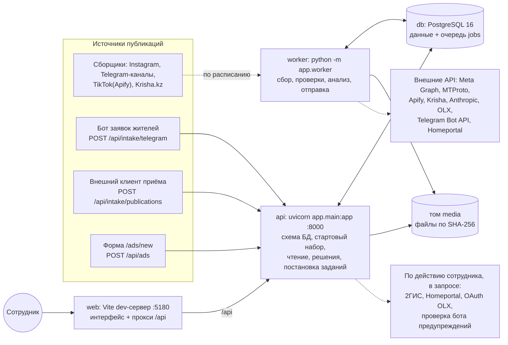
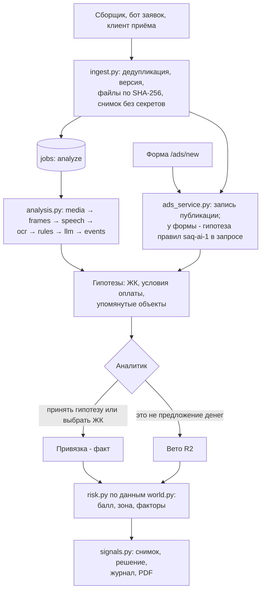
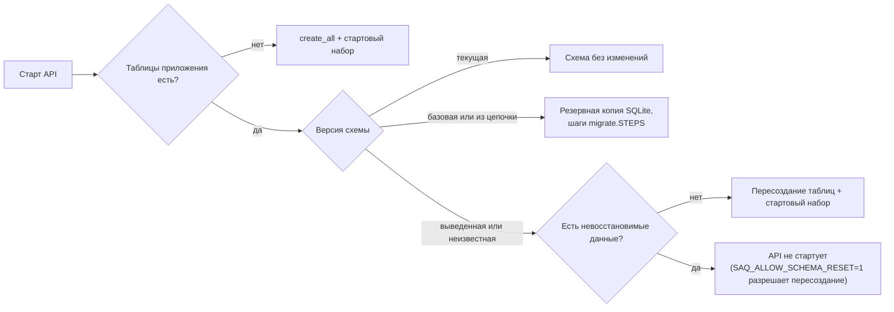

# Архитектура SAQ Qurylys

Как устроена система: процессы, модули бэкенда, модель данных, путь публикации до сигнала, очередь заданий, хранилище файлов, схема БД, общие файлы `shared/`, фронтенд и офлайн-режим. Документ для разработчиков, технического жюри и тех, кто будет сопровождать систему. Запуск и переменные окружения описаны в [DEPLOYMENT.md](DEPLOYMENT.md), маршруты - в [API.md](API.md), защиты - в [SECURITY.md](SECURITY.md).

- [Принципы](#принципы)
- [Процессы и компоненты](#процессы-и-компоненты)
- [Модули бэкенда](#модули-бэкенда)
- [Модель данных](#модель-данных)
- [Путь публикации до сигнала](#путь-публикации-до-сигнала)
- [Очередь заданий и воркер](#очередь-заданий-и-воркер)
- [Хранилище файлов](#хранилище-файлов)
- [Схема БД и её обновление](#схема-бд-и-её-обновление)
- [Общие источники правды](#общие-источники-правды)
- [Фронтенд](#фронтенд)
- [Офлайн-режим](#офлайн-режим)

## Принципы

1. **ИИ предлагает, аналитик решает.** Правила `saq-ai-1` и Claude по тексту, OCR и речи роликов выдают гипотезы с цитатой и уверенностью. Привязка публикации к ЖК становится фактом только после подтверждения аналитиком(`ads.link_confirmed_by`), вето "это не предложение внести деньги" и решение по сигналу принимает тоже человек. Анализ собранной публикации привязку не назначает, координаты ЖК по кандидатам 2ГИС меняются только выбором аналитика.
2. **Одна модель риска.** Веса, пороги, словари маркеров и тексты пояснений лежат в `shared/risk_model.json`. Python-движок(`backend/app/risk.py`) и его TypeScript-порт(`frontend/src/lib/risk.ts`) читают один файл, их совпадение проверяет эталон `shared/testdata/risk_golden.json`. Риск не хранится: он считается при каждом чтении из текущих фактов, а сигнал фиксирует снимок на момент создания.
3. **Неизвестное не становится фактом.** Отсутствие сведений даёт 0 баллов и пометку "Нужна проверка", а не "нарушений нет". Записи открытых реестров - сведения источника с провенансом, риск по ним не считается, пока аналитик не сверит данные. Подробности - [RISK_MODEL.md](RISK_MODEL.md#факты-и-гипотезы).
4. **Всё значимое пишется в журнал.** Таблица `audit_events` фиксирует, кто, что и когда сделал и когда зафиксированы сведения из источника. API журнал только пополняет: маршрутов правки и удаления записей нет.
5. **Простая инфраструктура.** Одна БД(PostgreSQL 16 в Docker, SQLite локально и в тестах), очередь заданий - таблица `jobs` в той же БД, без брокера сообщений. Два процесса Python из одного образа: API и воркер.
6. **Секреты только на сервере.** Ключи подключений читаются из `.env` в объекты `Secret`, в браузер, ответы API и журнал не попадают, логи проходят маскирование(`backend/app/logs.py`). Подробности - [SECURITY.md](SECURITY.md#секреты).
7. **Интерфейс работает и без API.** Если сервер не ответил, фронтенд открывает офлайн-копию стартового набора только для чтения: риск и "Проверка по рекламе" в ней - те, что посчитал сервер при выгрузке.

## Процессы и компоненты

| Компонент | Команда запуска | Что делает | Данные |
|---|---|---|---|
| `db` | образ `postgres:16-alpine` | хранит все данные и очередь заданий | том `pgdata`; порт 5432 только на 127.0.0.1 |
| `api` | `uvicorn app.main:app --host 0.0.0.0 --port 8000` | при старте применяет схему БД(`seed.init_db` → `migrate`), загружает стартовый набор в пустую БД(`seed.start` → `snapshot.load`), создаёт и дополняет карточки ЖК из открытого реестра(`demo.import_registry`); отвечает на чтение, записывает решения аналитиков, принимает публикации и ставит задания. Сбор, проверки подключений и анализ собранных публикаций сам не выполняет; в запросе работают только короткие действия сотрудника: OCR скриншота формы, правила для публикации из формы, сверка адреса 2ГИС, подгрузка фото Homeportal, обмен кода OAuth OLX, проверка бота и канала предупреждений | том `media`; порт 8000 только на 127.0.0.1 |
| `worker` | `python -m app.worker` | единственный исполнитель заданий: сбор, проверка подключений, анализ публикаций, отправка предупреждений жителям; планировщик расписаний и уборка. Схему БД не создаёт и не меняет: ждёт, пока API приведёт её к нужной версии | тома `media`, `tgsession`(сессия Telegram, только здесь), `asrmodels`(модели речи) |
| `web` | `npm ci && npx vite --host 0.0.0.0 --port 5180` | раздаёт интерфейс, проксирует `/api` на API(`API_PROXY`), отдаёт картинки офлайн-копии `/snapshot-media/`, отсекает соединения не с этой машины и не из `SAQ_ALLOWED_CLIENTS` | каталоги `frontend/` и `shared/`(второй - только для чтения); порт 5180 на IPv4 всех интерфейсов |

Сети Docker разделены: `backend`(db, api, worker) и `frontend`(api, web), `web` до БД не достаёт. При локальном запуске(`./dev.sh`) те же три процесса работают на SQLite-файле `backend/saq.db`. Запуск, порты и сетевой доступ - [DEPLOYMENT.md](DEPLOYMENT.md).

**Почему проверка подключения и "Собрать сейчас" отвечают 202.** Сбор может идти минуты(пагинация, загрузка файлов, платный запуск Actor Apify с ожиданием), а такая работа не должна держать запрос API и открытую транзакцию записи. Поэтому `POST /api/sources/{code}/test` и `POST /api/sources/{code}/collect` только создают запуск в `collection_runs` и задание в `jobs` и отвечают 202 с номером запуска. Если такое задание уже в очереди или выполняется, ответ - 200 с ним же, без дубля. Ход и итог запуска интерфейс читает через `GET /api/collection-runs/{id}`. Так же устроен повторный анализ `POST /api/ads/{id}/reanalyze`(202 - задание поставлено, 200 - анализ уже идёт или повтор уже в очереди; в ответе - публикация), а согласование предупреждения жителям ставит задание отправки `alert`. Статусы запусков - [INTEGRATIONS.md](INTEGRATIONS.md#статусы-подключения-и-запуска).

### Цепочка middleware

Порядок от внешней обёртки к приложению(`backend/app/main.py`):

| Обёртка | Назначение |
|---|---|
| `HostAllowlist` | отвечает только своим именам хоста: защита от подмены DNS(DNS rebinding), иначе 400 |
| `PublicHostGuard` | через публичный адрес обратного вызова OLX доступен только путь обратного вызова методами GET и HEAD, остальное - 404 |
| `CrossSiteGuard` | изменяющие запросы со страницы другого сайта(CSRF) - 403 до чтения тела |
| `SettingsCors` | CORS по `SAQ_CORS_ORIGINS`; пусто - CORS выключен |
| `InternalErrors` | необработанное исключение - 500 с JSON `{"detail": ...}`, трассировка - в лог |
| `UploadLimit` | предел размера тела по маршруту(OCR, скриншот, снимок площадки и фото объекта - 10 МБ, импорт реестра - 5 МБ, приём API - 2 МБ, заявка бота - 60 МБ, остальное - 16 МБ), 413 до чтения тела целиком |

Кроме того, общая зависимость приложения отклоняет NUL(`%00`) в пути и параметрах(422). Подробности каждой защиты - [SECURITY.md](SECURITY.md#защиты-http).

### Роутеры

| Роутер | Область |
|---|---|
| `main.py` | служебное(`/api/health`), модель риска(`/api/risk/model`, `/api/risk`), справочники(аналитики, застройщики, ЖК, обращения), публикации и решения по ним, гипотезы ИИ, OCR, оценка ИИ(`/api/ai/eval`), журнал и запросы сведений, сводка `/api/stats` |
| `signals.py` | сигнальные карточки: создание, решение, журнал, PDF |
| `route.py` | маршрут рассмотрения сигнала и сроки этапов |
| `letters.py` | проект запроса сведений по ЖК: предпросмотр и PDF |
| `registry.py` | открытые данные: источники, объекты реестра, импорт xlsx/csv |
| `discovery.py` | объекты из рекламы: список, привязка, отклонение, создание карточки ЖК, импорт |
| `verification.py` | сверка сведений аналитиком: основание, перечень ГАСК, готовность, обращения, снимки площадки |
| `decisions.py` | решения по "Проверке по рекламе": "Объект сдан", "Проверено - замечаний нет", отмена |
| `gallery.py` | фото объекта: загрузка оператором, обложка, подгрузка с Homeportal |
| `integrations/routes.py` | подключения, запуски, приём публикаций API, версии публикации, повторный анализ, файлы `/api/media` |
| `satstage.py` | стадия стройки на спутниковом снимке против рекламы |
| `changes.py` | "удалено в источнике" и история изменений публикаций |
| `integrations/telegram_bot.py` | приём заявок бота и статусы заявок(`/api/intake/telegram`) |
| `integrations/dgis.py` | сверка адреса через 2ГИС(`/api/geo/*`) |
| `integrations/olx.py` | OAuth OLX: старт, обратный вызов, отключение |
| `alerts.py` | предупреждения жителям, подписки жителей от бота |
| `sellers.py` | связанные продавцы, аномальная цена, связи застройщика |

Маршрутизаторы подключений(бот, 2ГИС, OLX) подключаются через реестр `integrations/registry.py`: модуль, который не загрузился, становится `BrokenConnector` со статусом "ошибка", остальное приложение работает. Полный перечень маршрутов - [API.md](API.md), схема OpenAPI - `/docs` API.

## Модули бэкенда

### backend/app

| Модуль | Ответственность |
|---|---|
| `main.py` | приложение FastAPI: старт(`lifespan`), middleware, маршруты публикаций, риска, справочников, журнала, OCR, подключение роутеров |
| `settings.py` | настройки из окружения и `.env`: перечень переменных `VARS`, класс `Settings`, секреты как `Secret`, проверка значений |
| `db.py` | движок SQLAlchemy, прагмы SQLite(WAL, `busy_timeout`, `foreign_keys=ON`), `get_for_update` для чтения-изменения-записи |
| `models.py` | ORM-модели всех таблиц, `SCHEMA_VERSION`, `insert_ignore`(INSERT ... ON CONFLICT DO NOTHING), приведение времени к UTC |
| `schemas.py` | схемы Pydantic входа и выхода API, camelCase через алиасы, проверки строк и ссылок |
| `migrate.py` | обновление схемы на месте: цепочка шагов, резервная копия SQLite, перечень невосстановимых данных |
| `seed.py` | инициализация БД при старте API: создание или обновление схемы, загрузка стартового набора, карточки ЖК из реестра |
| `snapshot.py` | стартовый набор: выгрузка рабочей БД в `shared/snapshot/` и загрузка в пустую БД, ответы API для офлайн-копии |
| `demo.py` | карточки ЖК и застройщиков из открытого реестра, импорт ЖК по рекламе, удаление демо-данных прежних версий(`purge`) |
| `importer.py` | импорт открытых данных xlsx/csv в нормализованные записи с провенансом и группировкой в объекты |
| `registry.py` | слой открытых данных: записи источников, объекты, перечень источников, маршруты импорта |
| `risk_model.py` | загрузка `shared/risk_model.json`, поиск каталога `shared/`, пороги зон, местное время UTC+5 |
| `risk.py` | движок риска: чистые функции над словарями в форме API, балл, зона, факторы R1-R6, наблюдения, оценка публикации |
| `world.py` | сборка входа движка риска из БД(ORM → camelCase-словари), справочник ЖК для сопоставления, выдача журнала |
| `screening.py` | "Проверка по рекламе": детерминированная объяснимая оценка ЖК и застройщиков по рекламе и открытым данным |
| `decisions.py` | решения аналитика по "Проверке по рекламе" и их отмена |
| `verification.py` | сверка сведений аналитиком по карточке ЖК, каждая запись - событие журнала от его имени |
| `discovery.py` | объекты из рекламы: сравнение упомянутых Claude ЖК со справочником и реестром, упоминания, решения |
| `ingest.py` | единый приём публикаций: дедупликация, версии, файлы, очистка снимка источника, постановка анализа |
| `ads_service.py` | создание публикации, общее для ручного ввода, сборщиков, приёма API и бота; события журнала публикации |
| `analysis.py` | этапы задания анализа: файлы, кадры, речь, OCR, правила, Claude, события журнала |
| `llm.py` | этап Claude: запрос, проверка ответа сервером, бюджет, кэш результатов, дозапрос по старым публикациям |
| `speech.py` | распознавание речи в роликах(faster-whisper, локально), загрузка модели отдельной командой |
| `video.py` | кадры видео для OCR через ffmpeg с ограничениями ресурсов(`prlimit`) |
| `media.py` | хранилище файлов по SHA-256: тип по сигнатуре, пределы, атомарная запись, квоты ручных загрузок, уборка |
| `jobs.py` | очередь заданий: постановка, захват, итоги, повторы, возврат зависших, обработчики видов заданий |
| `worker.py` | процесс воркера: аренды, пульс, такт лидера(расписание, дозапрос Claude, фото объектов, уборка), выполнение заданий |
| `signals.py` | сигнальная карточка: снимок доказательств при создании, решение, журнал, PDF |
| `pdf.py` | PDF сигнальной карточки на reportlab, шрифт Noto Sans из `backend/app/fonts` |
| `route.py` | маршрут рассмотрения сигнала и сроки этапов в рабочих днях, этап выводится из журнала |
| `letters.py` | проект запроса сведений по ЖК в ЖАО(МИО), Единому оператору или ГАСК: PDF и текст |
| `law.py` | нормативная база из `shared/law.json`: выдержки статей и ссылки факторов |
| `gallery.py` | фото объекта: снимки оператора, площадки, Homeportal, рекламы; выбор обложки |
| `changes.py` | "удалено в источнике" и история изменений публикаций по уже хранимым данным |
| `satstage.py` | командная строка оценки стадии по снимкам Esri Wayback и маршрут сравнения с рекламой |
| `sellers.py` | контакты публикаций, связанные продавцы, сводка по продавцу |
| `prices.py` | цена за м² из текста публикации и аномалия относительно медианы города |
| `affiliations.py` | проверка застройщика по БИН по собственным данным: совпадения руководителя, телефонов, уполномоченных компаний |
| `alerts.py` | предупреждения жителям: подготовка, согласование вторым сотрудником, отправка воркером, подписки |
| `auth.py` | проверка серверных токенов: администратор, клиент приёма, бот заявок |
| `logs.py` | маскирование секретов и `chat_id` в логах и текстах ошибок |
| `golden.py` | генерация эталона модели риска `shared/testdata/risk_golden.json` для тестов |

### backend/app/ai

| Модуль | Ответственность |
|---|---|
| `__init__.py` | правила `saq-ai-1`: детерминированный офлайн-анализ текста и OCR без внешних API |
| `nlp.py` | нормализация текста, транслитерация KZ/RU/Latin в общий скелет, сходство триграмм, телефоны Казахстана |
| `terms.py` | условия оплаты(бронь, взнос, рассрочка, ДДУ, цена) с дословной цитатой и уверенностью |
| `matching.py` | гипотезы "публикация - ЖК" по названию, адресу, аккаунту, телефону, истории аккаунта, району |
| `ocr.py` | распознавание изображений Tesseract(rus+kaz+eng) с предобработкой Pillow |
| `evaluate.py` | проверка правил на новых текстах `shared/ai_cases.json`: метрики условий и привязки |

### backend/app/integrations

| Модуль | Ответственность |
|---|---|
| `base.py` | каркас подключений: класс `Connector`, типизированные ошибки, данные публикации от сборщика, местное время в текстах |
| `context.py` | `RunContext`: всё, что подключение получает на один запуск; каждая запись - в своей короткой транзакции |
| `registry.py` | реестр подключений по коду с изоляцией модулей, которые не загрузились |
| `service.py` | фактический статус подключений, настройки, запуски, переходы статуса с записью в журнал, квоты, учёт отказов приёма |
| `routes.py` | API подключений, запусков, приёма публикаций, файлов и повторного анализа |
| `http.py` | HTTP-клиент, привязанный к хосту источника, и безопасная загрузка файлов только с публичных адресов |
| `smoke.py` | живая проверка подключений из командной строки без записи в БД |
| `instagram.py` | Instagram через Meta Graph API(Business Discovery) |
| `telegram.py` | публичные Telegram-каналы через MTProto(Telethon) от выделенного аккаунта |
| `telegram_login.py` | вход в Telegram для сборщика каналов из командной строки |
| `tiktok.py`, `tiktok_input.json` | TikTok через Actor Apify: фазы запуска, ожидания и чтения результата, лимиты расходов; шаблон входа Actor |
| `krisha.py` | HTML-сборщик выдачи Krisha.kz с соблюдением `robots.txt` и пауз |
| `olx.py` | OLX.kz Partner API через OAuth собственного аккаунта |
| `dgis.py` | геокодер 2ГИС: кандидаты адреса и решение аналитика |
| `intake_api.py` | подключение "Приём публикаций API": только живой статус |
| `telegram_bot.py` | приёмник заявок жителей от Telegram-бота и статусы заявок |
| `analyzer_anthropic.py` | подключение "Анализатор ИИ" и транспорт запросов к Claude(Messages API) |

Поведение каждого подключения описано в [INTEGRATIONS.md](INTEGRATIONS.md), этапы ИИ - в [AI.md](AI.md).

## Модель данных

Таблицы описаны в `backend/app/models.py`. JSON API отдаёт поля в camelCase через алиасы Pydantic(`schemas.py`), в БД столбцы называются в snake_case.

| Группа | Таблицы | Назначение |
|---|---|---|
| Каталог | `complexes` | ЖК: адрес, координаты(могут отсутствовать), стадия, документы-основания и сверки в JSON(`basis`, `readiness`, `photos`, `published_list_check`, `appeals_check`), происхождение |
| | `developers` | застройщики: БИН, руководитель, телефоны отдела продаж, происхождение |
| | `analysts` | учётные записи пилота для входа без пароля; имя пишется автором в журнал |
| Реклама | `ads` | публикации: текст, OCR, привязка к ЖК и кто её подтвердил, решение по условиям оплаты, статус разбора, номер версии решений `decision_rev`, способ поступления `source`(`manual` - форма, `parser` - сборщик или приём API, `bot` - заявка жителя) |
| | `ingest_items` | принятая публикация: внешний ID в пространстве площадки, хеш и версия содержимого, очищенный снимок ответа источника, состояние анализа |
| | `ingest_versions` | версии содержимого принятой публикации при каждом изменении в источнике |
| | `media_assets` | файлы публикаций и кадры видео: ключ хранилища, MIME по сигнатуре, источник, состояние загрузки и OCR, расшифровка речи |
| | `llm_analyses` | результаты Claude: одна строка на сочетание публикации, хеша материала, модели и версии промпта, прежний ответ после повторного анализа остаётся строкой истории; токены и стоимость |
| | `discovered_objects`, `discovered_mentions` | объекты из рекламы, которых нет в справочнике и реестре, и их упоминания с цитатой |
| Проверка и решения | `appeals` | обращения граждан по объекту(фактор R4), кто внёс и кто проверил |
| | `signals` | сигнальные карточки: снимок балла, зоны, факторов и доказательств на момент создания, решение аналитика |
| | `screening_decisions` | решения аналитика по "Проверке по рекламе", включая отменённые и заменённые |
| | `geo_checks` | сверки адреса через 2ГИС: кандидаты(временный кэш) и выбор аналитика с прежней точкой |
| Журнал | `audit_events` | события: кто, что, когда, вид, ссылки на публикацию, ЖК и сигнал |
| Открытые данные | `source_records` | записи открытых реестров с провенансом, сгруппированные в объекты по ключу |
| Сбор | `collectors` | подключение: включено ли, настройки, хранимый статус, расписание, курсоры; только ссылки на секреты |
| | `collection_runs` | запуски сбора и проверки: статус, счётчики, внешний ID запуска, стоимость, ошибка |
| | `jobs` | очередь заданий воркера |
| | `worker_leases` | аренды: лидерство планировщика `scheduler`, пульс `worker:{id}`, короткие блокировки сверки 2ГИС |
| | `oauth_states` | одноразовые state OAuth OLX(хранится только SHA-256) |
| | `integration_tokens` | токены OAuth OLX |
| | `quota_counters` | атомарные счётчики квот 2ГИС, ручных загрузок и дневного бюджета Claude |
| | `bot_submissions` | сведения о заявителе через бота, отдельно от публичного содержимого публикации |
| Жители | `resident_alerts` | предупреждения жителям: текст, автор, кто согласовал, итог |
| | `alert_deliveries` | доставка предупреждения одному получателю: канал ГАСК или подписчик |
| | `alert_subscriptions` | подписки жителей на район: только `chat_id` и район |
| Служебное | `meta` | версия схемы `schema_version` и служебные флаги |

### Инварианты, которые обеспечивает БД

- **Один нерассмотренный сигнал на ЖК** - частичный уникальный индекс `uq_signals_open_complex` по `complex_id` при `status = 'new'`. Два одновременных "Создать сигнал" не создают два сигнала.
- **Одно действующее решение "Проверки по рекламе" на ЖК** - индекс `uq_screening_decisions_active_complex` при `status = 'active'`.
- **Одно предупреждение на согласовании на ЖК** - индекс `uq_resident_alerts_pending_complex` при `status = 'pending'`.
- **Одно активное задание на ключ** - индекс `uq_jobs_active_dedupe` по `dedupe_key` для заданий в очереди и в работе.
- **Одна принятая публикация на внешний ID** - уникальность `(platform, external_id)` в `ingest_items`, одна запись источника на `(source, source_record_id)` в `source_records`.
- **Внешние ключи проверяются и на SQLite** - каждое соединение выполняет `PRAGMA foreign_keys=ON`. Проверка выключается только на время удаления и пересборки таблиц(`db.foreign_keys_off`).
- **Чтение-изменение-запись под блокировкой строки** - `db.get_for_update`: на PostgreSQL `SELECT ... FOR UPDATE`, на SQLite пустое изменение строки открывает транзакцию и берёт блокировку записи. Так пишутся JSON-поля ЖК и решения аналитика. Решения по публикации, кроме того, записываются условным UPDATE по прочитанному `decision_rev`: решение другого аналитика, принятое тем временем, даёт 409.

Таблицы, которые добавляют шаги обновления схемы, ссылаются внешними ключами только друг на друга: например, `media_assets.ad_id` - без внешнего ключа на `ads`. Поэтому пересборка исходных таблиц в шаге обновления не задевает новые.

### Журнал

Событие `audit_events` содержит `who`(имя вошедшей учётной записи или "Система"), `what`(текст), `at`(UTC), `kind` и необязательные ссылки `ad_id`, `complex_id`, `signal_id`. Виды: `system` - автоматические события, `data` - сведения из источника и сверка, `status`, `link`, `comment` - работа с публикацией, `ai` - гипотезы ИИ и решения по ним, `request` - запрос сведений, `signal` и `export` - сигнал и выгрузка PDF, `alert` - предупреждения жителям, `connector` - статусы и настройки подключений. События вида `connector` отдаются только администратору. Кто видит журнал - [SECURITY.md](SECURITY.md#журнал-и-его-видимость).

### Происхождение и время

У ЖК, застройщиков, публикаций и обращений есть поле `origin`: откуда запись и насколько её сведения проверены. Значения и их смысл - [DATA.md](DATA.md#происхождение-записей).

Время хранится в UTC(`DateTime(timezone=True)`; значения из SQLite без пояса считаются UTC, перед записью в SQL всё проходит `models.as_utc`). Местное время Усть-Каменогорска(фиксированное UTC+5, `risk_model.ALMATY`, без зависимости от tzdata) используется для даты расчёта риска и дат публикаций по умолчанию, границ суток дневного бюджета Claude и дневной квоты 2ГИС, текстов статусов и журнала, сроков маршрута рассмотрения и времени в PDF. Суточные квоты ручных загрузок считаются по суткам UTC.

## Путь публикации до сигнала

1. **Поступление.** Публикацию приносит сборщик подключения по расписанию воркера, Telegram-бот заявок жителей(`POST /api/intake/telegram`), внешний клиент приёма(`POST /api/intake/publications`) или аналитик через форму `/ads/new`(скриншот - `POST /api/media`, распознавание - `POST /api/ocr`, сохранение - `POST /api/ads`).
2. **Единый приём**(`ingest.py`, запись - `ads_service.py`). Дедупликация по паре "пространство площадки, внешний ID": новая публикация получает статус "new" без привязки к ЖК, версию 1, записи файлов и задание анализа в одной транзакции; неизменённая - только отметку "последний раз видели" и дозагрузку не скачанных ранее файлов; изменённая в источнике - новую версию в `ingest_versions` и новый анализ, а решения аналитика при этом не перезаписываются(в журнал пишется просьба проверить их по новой версии). Публикация с тем же внешним ID от другого подключения не записывается. Файлы ложатся в хранилище по SHA-256, снимок ответа источника очищается от токенов, телефонов, cookie и подписанных ссылок(`ingest.scrub`). Публикация из формы `/ads/new` анализируется правилами прямо в запросе, задания `analyze` у неё нет: если аналитик не выбрал ЖК сам, лучшая гипотеза с уверенностью от порога `lowConfidence` становится привязкой-гипотезой, которая не входит в балл до подтверждения.
3. **Задание `analyze`**(`analysis.py`, выполняет воркер). Этапы: загрузка файлов по ссылкам → кадры видео(ffmpeg) → речь в роликах(faster-whisper) → OCR(Tesseract) → правила `saq-ai-1`(условия оплаты, гипотезы ЖК) → Claude(только с `ANTHROPIC_API_KEY`) → события журнала. Текущий этап пишется в `ingest_items.analysis_stage`. Сбой файла или этапа не останавливает анализ: он виден у файла, в журнале и в поле `processing` публикации. Подробности этапов - [AI.md](AI.md#конвейер-анализа-публикации).
4. **Результат - гипотезы.** Анализ собранной публикации привязку к ЖК не назначает. Исключение включается настройкой `SAQ_COLLECTED_AUTOLINK=1`: тогда лучшая гипотеза выше порога становится привязкой-гипотезой, не подтверждённой и не входящей в балл. Упомянутые Claude ЖК, которых нет в справочнике и реестре, становятся объектами из рекламы(`discovery.py`).
5. **Решение аналитика.** Аналитик принимает гипотезу или выбирает ЖК вручную: привязка становится фактом с его именем и временем(`link_confirmed_by`, `link_confirmed_at`). Он же решает по условиям оплаты: "Это не предложение денег" снимает R2 по публикации. Все решения пишутся в журнал.
6. **Пересчёт риска.** `world.py` собирает из БД ЖК, застройщика, публикации и обращения в форме API, `risk.py` считает балл, зону, факторы R1-R6 с доказательствами и наблюдения вне балла. Риск считается при каждом чтении, поэтому любое решение или сверка сразу видны. "Проверка по рекламе"(`screening.py`) считается рядом и отдельно от балла. Правила - [RISK_MODEL.md](RISK_MODEL.md).
7. **Сигнал.** Аналитик формирует сигнал(`POST /api/signals`): балл, зона, факторы, наблюдения и доказательства фиксируются снимком и дальше не пересчитываются. Сигнал проходит маршрут рассмотрения(`route.py`), решение "Подтвердить" или "Вернуть" принимается с комментарием в журнал, PDF(`pdf.py`) выгружается для внутреннего маршрута.

## Очередь заданий и воркер

Очередь - таблица `jobs` в основной БД(`backend/app/jobs.py`). Задание хранит вид, статус(`queued`, `running`, `done`, `failed`, `cancelled`), приоритет, срок `run_after`, число попыток, захват(`locked_by`, `locked_at`) и `payload` с фазой и параметрами.

| Вид | Что выполняет | Приоритет |
|---|---|---|
| `test` | проверка подключения | 10 |
| `alert` | отправка согласованного предупреждения жителям через Telegram Bot API | 8 |
| `collect` | сбор публикаций подключения | 5 |
| `analyze`, повторный анализ по кнопке администратора | анализ публикации | 1 |
| `analyze` | анализ новой или изменённой публикации, повтор загрузки файлов или запроса к Claude к сроку повтора, пересчёт правил(`rulesOnly`) после создания карточки ЖК по рекламе | 0 |
| `analyze`, дозапрос Claude | анализ старой публикации без ответа Claude | -1 |

Обработчики видов - `jobs.HANDLERS`. Число попыток задаёт вид задания: у проверки подключения одна попытка, у сбора - по настройке подключения, у анализа и отправки предупреждения - 5.

- **Захват.** Следующее задание выбирается по приоритету, сроку и id. На PostgreSQL - `SELECT ... FOR UPDATE SKIP LOCKED`, на SQLite - условный UPDATE по прочитанному id, до трёх попыток при гонке. Анализ публикации, по которой уже идёт анализ, не захватывается; на PostgreSQL захват анализа дополнительно берёт рекомендательную блокировку по публикации.
- **Без транзакции во время работы.** Статус "выполняется" фиксируется до вызова обработчика; сеть, OCR и ffmpeg идут без открытой транзакции записи, итог пишется в новой сессии и только если задание всё ещё у того же захвата(воркер и номер попытки). Задание, которое уже отдали другому воркеру, прежний исполнитель не перезапишет.
- **Пульс и аренды.** Поток-пульс раз в 30 с продлевает пульс воркера(`worker:{id}`), аренду планировщика и блокировку текущего задания, но не дольше `SAQ_JOB_MAX_S`(по умолчанию 3600 с). Задание без продления дольше `SAQ_JOB_LEASE_S`(по умолчанию 1800 с) возвращается в очередь(`jobs.recover_stale`), а если попытки исчерпаны - завершается ошибкой. Воркер считается живым, если его пульс обновлялся в последние 120 с: иначе страница подключений сообщает, что воркер не отвечает. Второй процесс с тем же `SAQ_WORKER_ID` ждёт, пока первый остановится. При старте воркер возвращает в очередь задания прошлого запуска со своим `SAQ_WORKER_ID`(`jobs.requeue_own`); в Docker ID постоянный - `worker-1`, без `SAQ_WORKER_ID` и `--id` берётся имя хоста. Пауза опроса пустой очереди - `SAQ_WORKER_POLL_S`(по умолчанию 5 с).
- **Планировщик.** Сборы и проверки по расписанию, возврат зависших заданий, дозапрос Claude по старым публикациям(раз в `ANTHROPIC_BACKFILL_INTERVAL_MIN`, по умолчанию 10 мин), подгрузку фото объектов с Homeportal(раз в `SAQ_GALLERY_SYNC_HOURS`, по умолчанию 24 ч, 0 - выключено) и уборку ставит только держатель аренды `scheduler`. Выполнять задания может любой воркер. Расписания Apify и другие внешние планировщики не используются.
- **Повторы.** Ошибка с повтором ставит задание снова с паузой min(60·2^(попытка-1), 3600) с и разбросом ±20 %. Отсрочка(`Deferred`, например ожидание запуска Apify) попытку не расходует. Сбой источника никогда не выглядит как "нет новых", платный сбор после ошибки останавливается до ручной проверки.
- **Уборка раз в час.** Удаляются ручные загрузки, не привязанные к публикации за сутки, файлы хранилища без записей старше суток, брошенные временные файлы, истёкшие state OAuth; очищается кэш кандидатов 2ГИС старше срока.
- **Остановка.** По SIGTERM или SIGINT текущее задание дорабатывает(подключения проверяют `ctx.stopping()`), затем процесс выходит с кодом 0. В Docker на это отведено `stop_grace_period: 120s`.
- **Схема БД.** Воркер ждёт, пока API приведёт схему к версии `models.SCHEMA_VERSION`, и сам её не меняет.

Команды эксплуатации воркера(`--once`, `--id`, проверка состояния) - [DEPLOYMENT.md](DEPLOYMENT.md#воркер).

## Хранилище файлов

Файлы публикаций, снимки площадок и фото объектов хранятся под `MEDIA_ROOT`(`backend/app/media.py`; в Docker - том `media`, `/data/media`; локально - `backend/data/media`).

- **Раскладка по содержимому.** Ключ - `ab/cd/<sha256>.<ext>`: одинаковые файлы хранятся один раз, записи `media_assets` ссылаются на ключ. Файл отдаёт `GET /api/media/{id}`.
- **Тип по сигнатуре**, а не по заявленному Content-Type или имени: JPEG, PNG, WEBP, GIF, MP4, MOV, WEBM. HTML, SVG, PDF и прочее - 415.
- **Пределы.** Размер изображения и видео - `MEDIA_MAX_IMAGE_MB` и `MEDIA_MAX_VIDEO_MB`(по умолчанию 10 и 200 МБ, иначе 413), минимум свободного места - `MEDIA_MIN_FREE_MB`(по умолчанию 1024 МБ, иначе 507; ручной загрузке нужно ещё на 1024 МБ больше). Изображения декодируются только через `open_image` с пределом пикселей.
- **Атомарная запись.** Временные файлы - в `MEDIA_ROOT/.tmp` на той же файловой системе, перенос в хранилище - жёсткой ссылкой, которая не заменяет файл параллельного вызова.
- **Источник файла** - поле `origin_ref`: файлы публикаций(`apify-kv:...`, `telegram:...`, `intake`, `bot`), скриншот формы ручного ввода(`upload`), снимок площадки ЖК(`site`), фото оператора(`gallery`), фото Homeportal(`homeportal:{id}`), кадр видео(`frame`). Кадры ссылаются на своё видео через `parent_id`.
- **Загрузка по ссылкам** - только через `integrations/http.py`(`fetch_to_temp`): https(http - только для явно разрешённых хостов и без учётных данных), только публичные адреса с проверкой на каждом перенаправлении и при подключении, без учётных данных в ссылке, с общим сроком и проверкой типа по сигнатуре.
- **Кадры видео** - `video.py`: ffmpeg запускается списком аргументов, читает только локальный файл, работает в один поток, ограничен по памяти, CPU и размеру вывода через `prlimit`, с общим тайм-аутом. Сбой даёт пустой список кадров, а не исключение.

Квоты ручных загрузок и заголовки отдачи файлов - [SECURITY.md](SECURITY.md#недоверенные-данные).

## Схема БД и её обновление

Версия схемы хранится в `meta.schema_version` и в коде - `models.SCHEMA_VERSION`(сейчас `2026.10-audit-2`). API при старте(`seed.init_db`) сравнивает их и выбирает путь.

После схемы на любом пути, кроме отказа, выполняется `seed.start`: пустая БД получает стартовый набор `shared/snapshot`, затем карточки ЖК дополняются из открытого реестра.

**Цепочка шагов.** Базовая версия - `migrate.BASELINE = "2026.10-sources-1"`, шаги - `migrate.STEPS`:

| Шаг | Что делает |
|---|---|
| `2026.10-intake-1` | таблицы сбора публикаций(`collectors`, `collection_runs`, `ingest_items`, `ingest_versions`, `media_assets`, `jobs`, `worker_leases`, `oauth_states`, `integration_tokens`, `geo_checks`, `bot_submissions`, `quota_counters`) и столбец `ads.collected_at` |
| `2026.10-llm-1` | таблица результатов Claude `llm_analyses` |
| `2026.10-discovery-1` | таблицы объектов из рекламы `discovered_objects`, `discovered_mentions`; снимает NOT NULL с `complexes.lat` и `complexes.lng` |
| `2026.10-verification-1` | столбцы сверки аналитиком: `complexes.published_list_check`, `complexes.appeals_check`, кто внёс и кто проверил обращение в `appeals` |
| `2026.10-decisions-1` | таблица решений по "Проверке по рекламе" `screening_decisions` |
| `2026.10-alerts-1` | таблицы предупреждений жителям `resident_alerts`, `alert_deliveries`, `alert_subscriptions` |
| `2026.10-audit-2` | события подключений в журнале, записанные видом `data`, переводит в вид `connector` по шаблонам текста |

Правила шагов:

- Шаг только добавляет таблицы и столбцы(nullable или с константным `server_default`) или ослабляет ограничение. Ничего не удаляется. Особые случаи: `2026.10-discovery-1` снимает NOT NULL с координат ЖК(на PostgreSQL - `ALTER COLUMN ... DROP NOT NULL`, на SQLite - пересборка таблицы по текущей модели в транзакции шага), `2026.10-audit-2` меняет вид прежних событий журнала.
- Шаги идемпотентны и выполняются в одной транзакции вместе с записью новой версии. На PostgreSQL транзакция начинается с `pg_advisory_xact_lock`, на SQLite - с `BEGIN IMMEDIATE`: два процесса не обновляют схему одновременно, второй видит уже обновлённую версию.
- Перед шагами файловая SQLite копируется через backup API в `<db>.bak-<старая версия>-<UTC>` с правами 0600: в копии вся БД, в том числе токены подключений. Копию PostgreSQL делает оператор.
- Стартовый набор может быть выгружен прежней версией схемы. Загрузка такого набора создаёт таблицы последующих шагов пустыми(`migrate.STEP_TABLES`) и выполняет их переводы данных(`migrate.STEP_DATA`).

**Выведенные и неизвестные версии.** Версии `migrate.RETIRED`(`2026.10-audit-1`, `2026.10-ai-2`) и любая версия вне цепочки обновления не имеют. Такая база пересоздаётся(таблицы приложения удаляются, пустая БД получает стартовый набор), только если в ней нет невосстановимых данных(`migrate.durable_rows`): принятых публикаций и файлов, токенов OLX, заявок бота, сверок 2ГИС, результатов Claude, объектов из рекламы, решений по "Проверке по рекламе", предупреждений жителям и подписок, настроек подключений, изменённых администратором, собранных и внесённых аналитиком публикаций, обращений, внесённых аналитиком, событий журнала вида `data` от имени сотрудника(сверка сведений). Если такие данные есть, API не стартует и называет их; `SAQ_ALLOW_SCHEMA_RESET=1` разрешает пересоздание с потерей данных. Посторонние таблицы в той же базе не трогаются.

Процедура обновления для оператора - [DEPLOYMENT.md](DEPLOYMENT.md#обновление-версии), как добавить шаг - [DEVELOPMENT.md](DEVELOPMENT.md#шаг-схемы-бд).

## Общие источники правды

Данные и правила, которые нужны и бэкенду, и фронтенду, лежат в `shared/` один раз.

| Файл | Содержимое | Кто читает |
|---|---|---|
| `shared/risk_model.json` | коды и веса факторов, условия, пороги зон, словари маркеров, тексты пояснений, контрольные кейсы, ссылки на нормы | `risk_model.py` → `risk.py`, `law.py`, `GET /api/risk/model`; `frontend/src/lib/risk.ts` → `lib/law.ts`, `lib/mapFilters.ts`, `pages/Method.tsx` |
| `shared/law.json` | выдержки статей Закона РК № 486-V с адресом и редакцией источника, ссылки факторов и документов основания | `law.py` → `letters.py`, `pdf.py`, промпт Claude в `llm.py`; `frontend/src/lib/law.ts` → `lib/llm.ts`, `pages/Check.tsx`, `pages/Method.tsx` |
| `shared/env_labels.json` | понятные названия переменных окружения для текстов интерфейса | `frontend/src/lib/plain.ts`, `lib/connectors.ts`, `integrations/olx.py`; полноту проверяет `backend/tests/test_settings.py` |
| `shared/registry_ust_kamenogorsk.json` | записи открытых реестров и объекты, собранные импортёром | `registry.py` и `demo.py`(загрузка в `source_records`, карточки ЖК при каждом старте API); офлайн-режим фронтенда(`frontend/src/data/openData.ts`) |
| `shared/ai_cases.json` | новые тексты и ожидаемые условия и ЖК для проверки правил ИИ | `ai/evaluate.py`(`GET /api/ai/eval`), `backend/tests/test_ai.py` |
| `shared/sat_stage.json` | стадии стройки на спутниковых снимках(гипотезы Claude) | `GET /api/complexes/{id}/sat-stage`; записывает командная строка `python -m app.satstage` |
| `shared/snapshot/` | стартовый набор: строки таблиц, `manifest.json`, изображения `media/`, ответы API `api/*.json` | `snapshot.py`(загрузка в пустую БД, выгрузка); офлайн-копия фронтенда(`frontend/src/data/snapshot.ts`, `/snapshot-media/` из `vite.config.ts`) |
| `shared/testdata/` | прежний вымышленный демо-набор, синтетические случаи и эталон модели риска | только тесты бэкенда и фронтенда и `golden.py` |
| `frontend/public/wayback-index.json` | индекс снимков Esri Wayback по точкам ЖК(строит `frontend/scripts/wayback-index.mjs`) | `frontend/src/lib/wayback.ts`; командная строка `app.satstage`(в образе API файла нет) |

**Как бэкенд находит `shared/`.** `risk_model.py` берёт путь из `SAQ_SHARED_DIR`, иначе ищет каталог `shared/` с `risk_model.json` вверх от своего файла. В образе API каталог копируется в `/app/shared` и `SAQ_SHARED_DIR=/app/shared` задан в `backend/Dockerfile`. Контекст сборки ограничен разрешающим `.dockerignore`: в образ попадают только `backend/requirements.txt`, `backend/app` и `shared/`, причём `shared/testdata` исключён. Контейнер `web` монтирует `shared/` только для чтения в `/shared`, Vite разрешает чтение этого каталога(`server.fs.allow`).

Состав наборов данных и их перегенерация - [DATA.md](DATA.md), паритет Python и TypeScript - [RISK_MODEL.md](RISK_MODEL.md#реализация-и-паритет).

## Фронтенд

React 19, TypeScript, Vite, маршрутизация react-router-dom, карта maplibre-gl. Версии - `frontend/package.json`.

| Путь | Содержимое |
|---|---|
| `src/main.tsx` | точка входа: стили, корневой компонент |
| `src/App.tsx` | маршруты: открытые `/login`, `/about`, `/check`; остальные - после входа, внутри оболочки `Shell`; полноэкранные `/tv`, `/field`, `/signals/:id/print` |
| `src/lib/store.tsx` | данные приложения, режим работы, загрузка с сервера или из офлайн-копии, действия с записью в API, локальный расчёт риска при отсутствии ответа сервера |
| `src/lib/api.ts` | HTTP-запросы к API, базовый адрес `VITE_API_URL`(по умолчанию `/api`), перевод ошибок валидации на русский, признак связи с сервером |
| `src/lib/session.ts` | сессия входа пилота в `localStorage`, общая для вкладок |
| `src/lib/admin.ts` | режим администратора подключений: токен только в `sessionStorage` вкладки |
| `src/lib/i18n.ts`, `src/lib/i18n/` | двуязычный интерфейс: словари `ru.ts`, `kk.ts`, тексты публичной проверки `public.ts` |
| `src/lib/plain.ts` | тексты сервера для человека: имена переменных, команды и пути заменяются понятными словами |
| `src/lib/risk.ts` | порт движка риска: офлайн-фоллбэк и оценка черновика публикации |
| `src/lib/*.ts` | логика экранов; рядом - тесты vitest |
| `src/pages/` | экраны(карта и обзор, реестр и карточка ЖК, лента и разбор публикации, очередь, сигналы, объекты из рекламы, методика, источники, жители, отчёты и другие) |
| `src/components/` | общие блоки: карта, факторы, происхождение, журнал, сверка, решения, подключения, просмотр файлов; UI-кит компонентов - `components/ui.tsx` |
| `src/data/` | типы данных API(`types.ts`), офлайн-копия стартового набора(`snapshot.ts`) и открытого реестра(`openData.ts`) |
| `src/styles/` | токены и компоненты UI-кита(`go.css`), стили экранов |
| `src/ui/icons.tsx` | иконки интерфейса(Gravity UI и Tabler Icons) |
| `public/fonts/` | шрифты Golos Text и Roboto Condensed с текстами лицензий |

Экраны и сценарии - [FEATURES.md](FEATURES.md), лицензии шрифтов, иконок и подложек карты - [CREDITS.md](../CREDITS.md).

**Режимы работы**(`Mode` - `loading`, `api`, `snapshot` - и признак `offline` в `lib/store.tsx`, индикатор в шапке):

- "Подключение…"(`loading`) - начальная загрузка, ответа ещё нет.
- "Данные из API"(`api`) - список ЖК получен с сервера. Если не загрузились отдельные части, баннер называет их; если не получен риск(`/api/risk`), риск считается локально той же моделью(`lib/risk.ts`) и баннер об этом говорит.
- "Офлайн-копия"(`snapshot`) - API не ответил или ответил ошибкой при запуске: открыта копия стартового набора только для чтения.
- "Нет связи с сервером"(`offline`) - режим API, но последний запрос до сервера не дошёл(сеть или 502-504 от прокси без ответа самого API, `lib/api.ts`). Любой ответ сервера снимает признак.

"Проверить связь" запрашивает `/api/health` и при успехе перечитывает данные и переходит в режим API, в том числе из офлайн-копии. Подробности для пользователя - [FEATURES.md](FEATURES.md#режим-работы-и-ошибки).

**`vite.config.ts`.** Прокси `/api` на `API_PROXY`(по умолчанию `http://localhost:8000`) с `changeOrigin: false`: Host браузера уходит в API как есть, по нему API проверяет имя хоста и Origin изменяющих запросов. Фильтр соединений пускает только эту машину и адреса из `SAQ_ALLOWED_CLIENTS`, `allowedHosts` берётся из `SAQ_WEB_HOSTS`(подробности - [SECURITY.md](SECURITY.md#сетевой-периметр)). Плагин `saq-snapshot-media` отдаёт `GET /snapshot-media/<sha256>.<ext>` из `shared/snapshot/media`, принимая только имя из 64 hex-символов и расширение изображения.

## Офлайн-режим

**Когда включается.** При запуске интерфейс запрашивает данные у API. Если список ЖК не получен(сервер недоступен или ответил ошибкой), `lib/store.tsx` открывает офлайн-копию и переходит в режим "Офлайн-копия". Если сервер ответил ошибкой, баннер говорит об этом прямо, а не "сервер недоступен".

**Что показывает.** Ответы `GET /api/...`, сохранённые при выгрузке стартового набора в `shared/snapshot/api/*.json`(ЖК, застройщики, публикации, обращения, риск, сводка, сигналы, аналитики, объекты из рекламы, соответствие файлов), и открытый реестр из `shared/registry_ust_kamenogorsk.json`. Каждый файл грузится отдельным чанком(`import.meta.glob` без `eager`, динамический `import`) и только в этом режиме. Риск и "Проверка по рекламе" показываются такими, какими их посчитал сервер при выгрузке на дату `manifest.json` → `api.asOf`. Изображения идут из `/snapshot-media/`. Видео, фото Homeportal и фото оператора в копию не входят и не показываются: вместо обложки публикации - значок площадки.

**Что недоступно.** Всё, что меняет данные или хранится только на сервере: журнал, создание и решение сигналов, OCR и анализ, сверка сведений, решения по публикациям и "Проверке по рекламе", подключения. Кнопки таких действий неактивны с пояснением, что копия только для просмотра и действие доступно с сервером(`READ_ONLY` в `src/data/snapshot.ts`).

**Возврат в режим API** - кнопкой "Проверить связь" или "Повторить" в баннере: при ответе `/api/health` данные перечитываются с сервера, а копия, догружающаяся после этого, сервер не затирает.

**Согласованность.** Тест `test_offline_views_match_api`(`backend/tests/test_snapshot.py`) загружает набор в пустую БД и сравнивает ответы API с `shared/snapshot/api/*.json`: офлайн-копия должна совпадать с тем, что отдаст API нового развёртывания. После изменения кода риска или "Проверки по рекламе" ответы копии пересчитываются - [DEVELOPMENT.md](DEVELOPMENT.md#перегенерация-данных).
