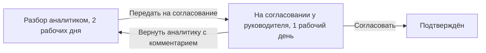

# Экраны и сценарии работы

Функциональное руководство по интерфейсу SAQ Qurylys: что видят и делают аналитик, руководитель, специалист ГАСК и житель, какие решения попадают в журнал и как они влияют на риск и "Проверку по рекламе". Для пользователей пилота, жюри и разработчика. Правила расчёта - [RISK_MODEL.md](RISK_MODEL.md), ИИ - [AI.md](AI.md), маршруты HTTP - [API.md](API.md).

## Экраны

Маршруты - `frontend/src/App.tsx`, файлы - `frontend/src/pages/`. Закрытый входом адрес ведёт на `/login?next=<адрес>`, после входа - обратно.

| Путь | Экран | Доступ | Файл |
|---|---|---|---|
| `/about` | Лендинг | без входа | `Landing.tsx` |
| `/` | Гостю - лендинг, после входа - карта ЖК | без входа / вход | `Dashboard.tsx` |
| `/check` | Публичная проверка ЖК | без входа | `Check.tsx` |
| `/login` | Выбор роли | без входа | `Login.tsx` |
| `/ops` | Оперативная сводка | вход | `Ops.tsx` |
| `/complexes` | Реестр ЖК, `?layer=open` - открытые данные | вход | `Complexes.tsx` |
| `/complexes/:id` | Карточка ЖК, `?tab=basis\|risk\|ads\|photos\|sat\|dev\|log` | вход | `ComplexCard.tsx` |
| `/registry/:key` | Объект открытых данных | вход | `RegistryCard.tsx` |
| `/ads` | Лента публикаций | вход | `Ads.tsx` |
| `/ads/:id` | Разбор публикации | вход | `AdDetail.tsx` |
| `/ads/new` | Ручное добавление публикации | вход | `AdNew.tsx` |
| `/queue` | Очередь проверки, `?who=me\|none` | вход | `Queue.tsx` |
| `/signals` | Реестр сигналов | вход | `Signals.tsx` |
| `/signals/:id` | Сигнальная карточка и маршрут | вход | `SignalCard.tsx` |
| `/signals/:id/print` | Печатная версия сигнала(A4) | вход | `SignalPrint.tsx` |
| `/developers` | Застройщики, проверка по БИН | вход | `Developers.tsx` |
| `/discovered` | Объекты из рекламы, `?tab=linked\|dismissed` | вход | `Discovered.tsx` |
| `/sellers` | Кто продаёт, цена за м² | вход | `Sellers.tsx` |
| `/changes` | Изменения и удаления в источниках | вход | `Changes.tsx` |
| `/sites` | Фото-мониторинг | вход | `Sites.tsx` |
| `/method` | Методика: `#calc`, `#cases`, `#law`, `#ai`, `#ai-eval` | вход | `Method.tsx` |
| `/sources` | Подключения, открытые данные, импорт | вход; настройка - администратор | `Sources.tsx` |
| `/reports` | Отчёты за период | вход | `Reports.tsx` |
| `/residents` | Предупреждения жителям | вход; согласование - администратор | `Residents.tsx` |
| `/tv` | Ситуационный центр | вход | `Tv.tsx` |
| `/field` | Выезд на объект с телефона | вход | `Field.tsx` |

`/about`, `/login`, `/check`, `/tv`, `/field` и печатная версия открываются без шапки. Экраны, которых нет во вкладках шапки, - в меню "ещё".

## Вход и роли

Вход пилотный, без пароля(`pages/Login.tsx`, `lib/session.ts`). Три учётные записи названы ролями: "Аналитик ДЭР", "Ведущий аналитик ДЭР", "Специалист ГАСК"; вместо имени показываются должность и ведомство. Права ролей различаются в одном: в маршруте рассмотрения сигнал согласует и возвращает аналитику только "Ведущий аналитик"([Сигналы и маршрут рассмотрения](#сигналы-и-маршрут-рассмотрения)).

- Имя учётной записи - автор каждого действия в журнале. Имя "Система" зарезервировано за автоматическими записями(422).
- Сессия - `localStorage`(`saq.analyst`), общая для вкладок; без доступа к хранилищу вход живёт до перезагрузки.
- "Сменить роль" возвращает на текущую страницу, "Выйти" - нет: следующий сотрудник не попадёт на страницу предыдущего.
- Кнопка "Войти по ЭЦП(NCALayer) · после пилота" неактивна.
- Кнопки A / B / C контрольных сценариев(войти и сразу открыть сценарий) появляются, только если их ЖК есть в данных.

Режим администратора включает токен на `/sources` или `/residents`, отдельно от входа - [SECURITY.md, "Доступ"](SECURITY.md#доступ).

## Карта и обзор

Главная карта(`pages/Dashboard.tsx`, `components/MapView.tsx`):

- **Метка ЖК**: цвет и знак - статус "Проверки по рекламе", кружок с кольцом цвета зоны - балл риска(если риск оценён). ЖК без координат - в списке "Без координат".
- **Фильтры**: "Проверка по рекламе"(несколько статусов), "Формальный риск"(диапазон балла, ЖК без оценки, "нужна проверка"), "Показывать"(сданные, без замечаний, проверенные аналитиком); переключатели "Названия на карте", "Только с рекламой", "Стройка стоит 30+ дней".
- **Боковая карточка**: оценка, риск, основания, застройщик, реклама; выбранный ЖК - в адресе(`?sel=`).
- **Слой "Открытые данные"**: объекты реестра серыми метками без балла, клик ведёт на `/registry/:key`.
- **Подложки** "Схема", "Спутник", "3D" - раздел [Спутник и 3D](#спутник-и-3d).
- **Горячие точки рекламы**(`lib/hotspots.ts`): круг под ЖК, размер - публикации с предложением оплаты за окно "Проверки по рекламе"(`SAQ_SCREENING_DAYS`, по умолчанию 120 дней), красный - по открытым данным основания нет, жёлтый - есть. Панель "Районы" группирует по полю `district`, без него - по ячейке ~1,5 км с названием по частой улице. Контекст для планирования проверок, не вывод о нарушении.

**Сводка**(`/ops`): показатели по разделам; "Последние действия" - 8 последних действий людей, без событий "Системы", данных и подключений. "Контрольные сценарии ТЗ §5" появляются, только если их ЖК есть в данных(тестовый набор), - [RISK_MODEL.md, "Контрольные кейсы"](RISK_MODEL.md#контрольные-кейсы).

## Реестр и карточка ЖК

**Реестр**(`pages/Complexes.tsx`): переключатель "ЖК на контроле" / "Открытые данные". У ЖК - обложка, метка происхождения("Открытый реестр · не проверено", "По рекламе · не проверено"), оценка, балл. Фильтры "Проверка", "Зона", "Район", "Стадия", застройщик и чипы, в том числе "Риск не оценивается" и "Нужна проверка".

**Карточка ЖК**(`pages/ComplexCard.tsx`):

- Шапка: название, оценка, зона, метка происхождения; у ЖК контрольного сценария(`c14`, `c2`, `c10`) - баннер. Ниже - "Проверка по рекламе" с "Решением аналитика", "Сверено N из 4", галерея.
- Вкладки: "Основания"(документы с источником, датой сверки и ссылкой, готовность, обращения), "Риск"(факторы с доказательствами), "Реклама", "Снимки", "Спутник", "Застройщик", "Журнал".
- Правая колонка: "Почему N баллов"(к доказательствам; без оценки - что её откроет), "Сформировать сигнал" или переход к открытому сигналу, "Запросить сведения", "Запрос в ЖАО / ЕО(письмо)".
- Сверка адреса в 2ГИС(`components/GeoCheck.tsx`): запрос только по кнопке "Сверить адрес", сначала из кэша; кандидаты - подсказка, координаты меняются только отметкой "Перенести координаты в карточку ЖК", в журнал - "было → стало". Квоты - [INTEGRATIONS.md, "2ГИС"](INTEGRATIONS.md#2гис).

**Объект открытых данных**(`pages/RegistryCard.tsx`): записи источников с провенансом, мини-карта, сверка адреса без переноса координат(сведения источника не меняются), плашка "риск не оценивается"; балла и сигналов нет. Поля - [DATA.md, "Происхождение записей"](DATA.md#происхождение-записей).

## Сверка сведений аналитиком

У карточек из реестра и по рекламе эти сведения изначально "нет сведений". Сверку вносит аналитик в карточке ЖК(`components/Verification.tsx`, сервер - `backend/app/verification.py`); автор - вошедшая учётная запись, каждое действие - событие журнала `data`.

| Что | Действие |
|---|---|
| Гарантия ЕО, разрешение МИО, банк | "Подтвердить - совпадает с источником": "есть" с номером, источником и ссылкой из записи реестра одним действием. "Сверить" - форма: есть / нет / нет сведений, номер и дата, где проверено(Homeportal, Казреестр, ответ органа, ЕГКН), ссылка, дата |
| Перечень ГАСК(O1) | есть / нет / нет сведений, где проверено(перечень ГАСК в Instagram, сайт ГАСК ВКО, ответ ГАСК), ссылка, дата |
| Готовность | заявленная или подтверждённая: процент, источник, дата |
| Обращения | "Добавить обращение", затем "Подтвердить" или "Отклонить"; "Обращений нет - сверено" |
| Снимки площадки | файл JPEG, PNG, WEBP или GIF до 10 МБ, дата, источник, на площадке "идут работы", "работ нет" или "не видно / нет сведений", примечание |

"Сверено N из 4 оснований" считает гарантию, МИО, банк и перечень и ведёт к первой несверенной плитке. Отметка "нет сведений" сверкой не считается и снимает прежнюю сверку. Сверка аналитика важнее открытых данных: документ Homeportal того вида, по которому сверено "нет", основанием не считается.

Риск и "Проверка по рекламе" пересчитываются сразу. Оценку риска карточки реестра или рекламы открывает первое проверенное сведение: документ основания "есть" или "нет" с источником и датой, подтверждённая готовность, проверенное обращение, датированный снимок или подтверждённая привязка публикации; перечень ГАСК и "обращений нет" оценку не открывают - [RISK_MODEL.md, "Риск не оценивается"](RISK_MODEL.md#риск-не-оценивается). Заявка жителя через бота - публикация, а не обращение. В офлайн-копии сверка недоступна.

## Мониторинг рекламы

**Лента**(`pages/Ads.tsx`): подсветка формулировок, метки происхождения("собрано автоматически", "прислано через бота", "добавлено аналитиком") и "привязка - гипотеза ИИ N%", фильтры и чипы, в том числе "Привязка - гипотеза ИИ".

**Разбор публикации**(`pages/AdDetail.tsx`): время получения, файлы, ход обработки, "Версии в источнике", "Оценка публикации", "Анализ ИИ", "Речь в ролике", анализ Claude, "Кто продаёт", история, комментарии(до 2000 символов). Пока анализ собранной публикации в очереди или выполняется, разбор обновляется каждые 10 с, не дольше 5 минут. Решения по выводам ИИ("Условия верны", "Это не предложение денег" и другие) - [AI.md, "Решения аналитика по выводам ИИ"](AI.md#решения-аналитика-по-выводам-ии).

**Решение по публикации** - на первом экране правой колонки:

| Действие | Основание | Статус |
|---|---|---|
| "Взять в работу" | - | "На проверке" |
| "Подтвердить нарушение" | обязательно(иначе 422) | "Нарушение подтверждено" |
| "Отклонить" | по желанию | "Отклонено": не учитывается в риске и оценке |
| "Доп. проверка" | по желанию | "Нужна проверка" |

Основание пишется в журнал. Если другой аналитик уже изменил публикацию - 409 без перезаписи, интерфейс показывает серверное состояние.

**Привязка к ЖК**: "Принять привязку"(гипотезу ИИ), выбрать другой ЖК, "Снять привязку". Подтверждённая привязка - факт с автором и временем, гипотеза в балл не входит([RISK_MODEL.md, "Факты и гипотезы"](RISK_MODEL.md#факты-и-гипотезы)).

**Ручное добавление**(`pages/AdNew.tsx`): площадка, аккаунт, ссылка, текст, скриншот(PNG, JPG до 10 МБ) - сохраняется на сервере и распознаётся, текст OCR правится. Через 400 мс после ввода - живой анализ: условия оплаты, гипотезы ЖК, оценка. Выбранная гипотеза сохраняется гипотезой, ЖК, выбранный вручную, - подтверждённой привязкой; без выбора привязку назначают правила([AI.md, "Правила saq-ai-1"](AI.md#правила-saq-ai-1)).

**Очередь проверки**(`pages/Queue.tsx`): доска по статусам, карточки перетаскиваются; перенос в "Нарушение подтверждено" запрашивает основание. Фильтр "Все / Мои / Без исполнителя" - в адресе(`?who=`).

## Проверка по рекламе и объекты из рекламы

Статусы, отнесение публикаций и снятие решения новой рекламой - только в [RISK_MODEL.md, "Проверка по рекламе"](RISK_MODEL.md#проверка-по-рекламе). Оценка видна на карте, в реестре, карточке ЖК, у застройщиков и в сводке - с пометкой "Предварительная автоматическая оценка по рекламе и открытым данным - не вывод о нарушении".

**Решение аналитика**(`components/Decision.tsx`) - блок под оценкой в карточке ЖК:

| Решение | Поля | Проверки ввода |
|---|---|---|
| "Объект сдан" | акт №, дата акта, источник(ЕГКН, акт приёмки, 2ГИС, ответ акимата или ГАСК, другое), ссылка | дата обязательна и не позже сегодня, источник обязателен, номер до 128 символов |
| "Проверено - замечаний нет" | что проверено, источник, ссылка | описание от 10 символов, источник обязателен |
| "Отменить решение" | причина | от 5 символов |

- Действующее решение - зелёная карточка "Сдан: акт № ... от ..., источник ... · подтвердил: ..."; новое решение - после отмены текущего. "Объект сдан" ставит стадию "введён", отмена возвращает прежнюю.
- Решение, снятое новой рекламой, - янтарная карточка "Решение снято автоматически: новая реклама <дата>" с цитатой; кнопки снова доступны.
- Решения и отмены - события `data`, история хранится([API.md, "Решения по Проверке по рекламе"](API.md#решения-по-проверке-по-рекламе)).

**Объекты из рекламы**(`pages/Discovered.tsx`) - ЖК, которые называет реклама, но нет ни в справочнике, ни в реестре. Вкладки "Новые", "Привязаны", "Отклонены".

- "Найти в 2ГИС" - по названию и адресу из рекламы, сначала из кэша.
- "Создать карточку" - с точкой кандидата или без координат; публикации с упоминаниями пересопоставляются правилами без нового запроса к Claude.
- "Это существующий ЖК" - объект становится другим написанием названия выбранного ЖК.
- "Отклонить" - только с причиной.

Решения - события `data`. Импорт списком - у администратора([DATA.md, "Карточки ЖК из реестра и по рекламе"](DATA.md#карточки-жк-из-реестра-и-по-рекламе)).

## Сигналы и маршрут рассмотрения

**Создание**: "Сформировать сигнал" в карточке ЖК или "Сформировать сигнал по ЖК" в разборе публикации, привязанной к ЖК(`backend/app/signals.py`). Открытый сигнал по ЖК один: при существующем сервер отвечает 409 с его id, интерфейс переходит к нему; одновременные запросы разводит частичный уникальный индекс БД. По ЖК без оценки риска - 422(кнопка неактивна), по объекту открытых данных - 404.

**Снимок** на момент создания(балл, зона, факторы с доказательствами, версия модели, застройщик, неотклонённые публикации и обращения, снимки, документы основания) не пересчитывается.

**Статусы**: код `S-0001`; `new`, `confirmed`, `returned`. "Подтвердить сигнал" и "Вернуть на доработку" - только из `new` и только с комментарием, повтор - 409.

**Маршрут**(`backend/app/route.py`, `components/SignalRoute.tsx`):

- Согласует и возвращает только роль "Ведущий аналитик"(остальным - 403). "Согласовать" подтверждает сигнал, комментарий по умолчанию "Согласовано без замечаний". Возврат начинает разбор и его срок заново.
- "Подтвердить сигнал" и "Вернуть на доработку" закрывают маршрут с любого этапа.
- Сроки(`SLA_DAYS`) - рабочие дни пн-пт по Алматы без праздников. Карточка показывает этап, срок, "осталось" или "просрочено"; реестр - колонку "Срок".
- Переходы - события `signal`, недопустимый переход - 409.

**Выгрузка**: "Скачать PDF"(A4, reportlab и шрифт Noto Sans, файл `signal-S-0001.pdf`) - событие `export`, время выгрузки сохраняется в сигнале; печатная версия - `/signals/:id/print`. Везде пометка: оценка предварительная, автоматической отправки в госорганы нет.

## Запрос сведений и проект письма

**"Запросить сведения"** - внутренняя запись `request` в журнале объекта: темы(основание, подтверждённая готовность, обращения, перечень ГАСК, другое; по умолчанию - темы без проверенных сведений) и комментарий(обязателен для "другое"). Никуда не отправляется.

**Проект письма**(`backend/app/letters.py`, `components/RequestLetter.tsx`) - в карточке ЖК и в сигнале. Адресаты: ЖАО(МИО) ВКО - разрешение МИО(ст. 18 Закона), Единый оператор жилищного строительства - гарантия(ст. 8), ГАСК ВКО - перечень и разрешительная документация.

- Письмо собирает сервер, окно показывает предпросмотр: пометка "ПРОЕКТ", пункты запроса, сведения об основании с источником и датой сверки, до 10 публикаций с цитатами, нормы ст. 7, 8, 18, 23 дословно из `shared/law.json`, подпись должностью без имён.
- PDF или DOCX(без python-docx), имя `request-<id ЖК>-<mio|operator|gask>-<ГГГГММДД>`(дата по Алматы). Скачивание - событие `request`, предпросмотр в журнал не пишется.
- Наименования адресатов общие - их нужно сверить с ДЭР.

## Журнал действий

Таблица `audit_events`: кто(`who`), что(`what`), когда(`at`, UTC), вид(`kind`), ссылки на публикацию, ЖК, сигнал. Записи только добавляются; интерфейс показывает время браузера(`components/Audit.tsx`).

| Вид | Что пишется |
|---|---|
| `system` | сбор публикации, заявка через бота, новая версия, OCR, сбой анализа |
| `data` | сведения источников, итоги сборов, сверка, решения по оценке, 2ГИС, фото |
| `status` | статус и ответственный публикации с основанием |
| `link` | привязка к ЖК и её снятие |
| `comment` | комментарий к публикации |
| `ai` | гипотезы ИИ, анализ Claude, решения аналитика по ним |
| `request` | запрос сведений, скачивание письма |
| `signal` | создание, решение, маршрут сигнала |
| `export` | выгрузка PDF сигнала |
| `alert` | подготовка, согласование, итог предупреждения жителям |
| `connector` | статусы и настройки подключений, аккаунт OLX |

Где виден: история публикации, вкладка "Журнал" карточки ЖК(с фильтром по группам), сигнальная карточка, "Последние действия". События `connector` - только администратору([SECURITY.md, "Журнал и его видимость"](SECURITY.md#журнал-и-его-видимость)). Новая версия публикации решений аналитика не перезаписывает - журнал предлагает проверить их по новой версии. В офлайн-копии журнала нет.

## Фото объекта и фото-мониторинг

**Галерея и обложка**(`components/Gallery.tsx`, `backend/app/gallery.py`); у каждого фото подписан источник. Порядок обложки:

1. Фото оператора: "Добавить фото"(JPEG, PNG, WEBP, GIF до 10 МБ; без закреплённой обложки новое фото становится обложкой), "Удалить фото".
2. Датированные снимки площадки.
3. Фото Homeportal: подгружает воркер раз в `SAQ_GALLERY_SYNC_HOURS`(по умолчанию 24 ч, `0` - выключено) для ЖК реестра без фото, вручную - кнопка "Фото с Homeportal"; за подгрузку ЖК - до 3 карточек и 16 файлов([INTEGRATIONS.md, "Фото Homeportal"](INTEGRATIONS.md#фото-homeportal)).
4. Изображения рекламы: "Реклама" при подтверждённой привязке, иначе "Реклама · гипотеза".

"Сделать обложкой" закрепляет, "Обложка автоматически" снимает закрепление; действия - события `data`. На риск и оценку фото не влияют: сведения о площадке даёт только датированный снимок с активностью.

**Фото-мониторинг**(`/sites`): сравнение снимков строящихся объектов во времени.

**Выезд**(`/field`): ЖК по расстоянию от геолокации(без неё - поиск), "Сделать снимок" камерой, активность, комментарий. Дальше 300 м от точки ЖК - предупреждение. Снимок уходит тем же запросом, что снимок площадки(источник "Выезд на площадку"), геометка и расстояние - в примечании. Ограничения: геолокация только по HTTPS или на `localhost`, EXIF не читается, офлайн-очереди нет.

## Кто продаёт и цена

Гипотезы вне балла(`backend/app/sellers.py`, `prices.py`, `affiliations.py`): решений аналитика не меняют, в офлайн-копии раздела нет.

- **Контакты** из текста, OCR и речи роликов, с цитатой: телефоны РК, WhatsApp, @упоминания, БИН с верной контрольной цифрой.
- **Продавец** - группа аккаунтов, связанных телефоном, БИН, одним именем, упоминанием или одной картинкой(dHash, расстояние ≤ 6; хэши кэшируются). Экран `/sellers`: схема "аккаунты - контакты - ЖК", "Почему вместе" с цитатами. В разборе публикации - "Этот номер встречается ещё в N публикациях".
- **Цена за м²** - названная или цена квартиры на площадь(без взносов, кладовых, машино-мест, коммерции). Медиана - по городу, по числу комнат, если таких публикаций 5 и больше; дешевле 70% медианы - "цена ниже рынка на X%". Цена берётся из текста и OCR, речь роликов не используется; отдельно - отметка "100% оплата".
- **Проверка по БИН**(профиль на `/developers`): контрольная цифра, ЖК, телефоны, уполномоченные компании, совпадения с другими застройщиками, ссылки на КГД, статистику, госзакупки и е-лицензирование(система их не опрашивает).
- **Ограничения**: скрытые телефоны не видны, речь распознаётся с ошибками, общий номер бывает у агентства.

## Изменения и удаления в источнике

**Статус в источнике**(`backend/app/changes.py`): `present`, `deleted`, `unknown`. Окно последних публикаций аккаунта есть только у Instagram и TikTok: публикация "удалена", если аккаунт позже собирался, а её, попадавшую бы в окно, не нашли в двух и более запусках. Krisha(порядок выдачи меняется, карточки закрыты проверкой доступа), Telegram и ручные публикации - всегда `unknown`. Удаление - признак, не подтверждение; копия со всеми версиями остаётся на сервере.

В разборе публикации - бейдж "Удалено в источнике · копия сохранена" и блок "История изменений"(`components/SourceChanges.tsx`): пословное сравнение версий, цена, удалённые условия оплаты, файлы. Экран `/changes` - то же за 7, 30, 90 или 365 дней.

## Спутник и 3D

**Подложки**(`components/MapView.tsx`, выбор хранится в `localStorage`, `saq.mapMode`): "Схема" - стиль Liberty OpenFreeMap(OpenStreetMap) с подписями `name:ru`; "Спутник" - Esri World Imagery; "3D" - снимок, объёмные дома OpenStreetMap и ЖК столбиками цвета статуса(этажность × 3,2 м, без этажности - 36 м).

**Архив снимков**(вкладка "Спутник"): выпуски Esri Wayback с 2014 года, шторка "до / после", лента времени со стройкой по документам, "По годам" - показ выпусков подряд. Индекс - `frontend/public/wayback-index.json`, для ЖК вне индекса браузер обходит архив сам(кэш 7 дней).

**"Спутник против рекламы"**(`components/SatStage.tsx`): стадия на снимке(гипотеза ИИ, [AI.md, "Стадия стройки по спутниковому снимку"](AI.md#стадия-стройки-по-спутниковому-снимку)) против заявлений рекламы с цитатами. Подсказки `ahead`(реклама опережает снимок, R5), `money_early`(деньги до каркаса, R1), `behind`(на снимке дом, реклама "строится", R5), `before_start`, `stale`(реклама новее снимка больше чем на 90 дней), `match`, `unclear` баллов не добавляют.

Ограничения: нужен интернет, архив - до 17-го масштаба, свежайшие снимки точек ЖК - осень 2024 года. Атрибуция - на карте и в [CREDITS.md](../CREDITS.md).

## Нормативная база в интерфейсе

Выдержки закона - `shared/law.json`; дословный текст отделён от пересказа(`lib/law.ts`), ссылки ведут на "Әділет". Где видно: `/method#law`; строка "Основание: ст. ..." у факторов в карточке ЖК, сигнале, печатной версии и PDF; блок "Может относиться к нормам закона" в анализе Claude(гипотеза); `/check`; проект письма. Связь статей и факторов - [RISK_MODEL.md, "Правовая основа"](RISK_MODEL.md#правовая-основа).

## Публичная проверка ЖК

`/check`(`pages/Check.tsx`) - без входа, RU/KZ, для телефона.

- Поиск по названию, адресу, застройщику, БИН с учётом казахских букв и транслитерации.
- Только записи открытого реестра: гарантия ЕО, разрешение ЖАО(МИО), участие банка - с номером, датой, источником и ссылкой или "нет сведений"; записи Казреестра; раздел Homeportal. Для ЖК только из рекламы - "в загруженных записях открытого реестра этого объекта нет".
- Пояснения по ст. 7, 8, 18, 23, чек-лист перед договором, оговорка: не юридическое заключение.
- Балла, "Проверки по рекламе" и решений аналитика нет.
- Ссылка на результат - `/check?q=...&k=...`.

## Предупреждения жителям

`/residents`(`pages/Residents.tsx`):

1. ЖК и шаблон, доступный, только если факт есть в данных: "Проверьте основание"(объект не введён), "Стройка стоит"(простой подтверждён снимками), "Есть в перечне"(перечень ГАСК). Шаблоны не утверждают нарушение.
2. Правка текста до 240 символов и предпросмотр.
3. "Отправить на согласование"; по ЖК - одно предупреждение на согласовании.
4. Согласует другой сотрудник в режиме администратора: автор своё не согласует, автоматически система ничего не отправляет. "Отклонить" - комментарий по желанию.
5. Итог: публикация в канале, сколько подписчиков получили и кто нет с причиной; "Повторить отправку" - администратор.

Получатели - канал ГАСК и подписчики района ЖК в боте заявок; шаги - события `alert`. Доставка и настройка - [INTEGRATIONS.md, "Предупреждения жителям через Bot API"](INTEGRATIONS.md#предупреждения-жителям-через-bot-api).

## Ситуационный центр

`/tv`(`pages/Tv.tsx`) - тёмный экран для кабинета руководства: карта, часы, показатели, доли "Проверки по рекламе" и зон. Лента внизу каждые 12 с переключается между тремя списками по 5 строк: реклама с предложением оплаты, сигналы на решении, простои 30+ дней. Данные обновляются раз в 60 с без баннеров. ←/→ - лента, пробел - пауза, курсор прячется, кнопка "На весь экран".

## Двуязычный интерфейс

- Переключатель "РУС | ҚАЗ"(`components/LangSwitch.tsx`) - в шапке, на входе, лендинге, `/check` и `/field`; выбор в `localStorage`(`saq.lang`), без перезагрузки, меняет `lang` у `html`, синхронизируется между вкладками.
- Ядро `lib/i18n.ts` без библиотек: `useT()` с `t`, `tn`(формы по числу), `tr`(подписи из данных); без перевода - русский текст. Словари `lib/i18n/ru.ts`, `kk.ts`(одинаковые ключи проверяет `lib/i18n.test.ts`), `public.ts`.
- Переведены шапка, навигация, вход, лендинг, панель карты, очередь, новостройки, `/check`, `/tv`, `/field`, частично - реестр сигналов и "Кто продаёт"; данные сервера и остальные экраны - нет. Казахские тексты не вычитаны носителем языка.

## Удобство аналитика

- **Быстрый поиск**(клавиша "/", `components/QuickSearch.tsx`): ЖК, объекты открытых данных, публикации, сигналы; ё, казахские буквы и латиница сводятся к одному виду("shygys" находит "Шығыс").
- **Состояние в адресе**: фильтры, `?tab=`, `?who=`, `?sel=`. Ссылка "откуда пришёл" принимает только внутренние адреса(`lib/nav.ts`).
- **Действия на виду**: блок решений - на первом экране, одинаковые действия названы одинаково, "Почему N баллов" ведёт к доказательствам.
- **Отчёты**(`/reports`): неделя, месяц или квартал; разделы "Светофор", "Рейтинг риска", "Реклама за период", "Фото-мониторинг", "Методика" и показатели считаются из данных; "Печать / сохранить в PDF" - окном браузера.
- **Без имитации**: идеи развития(облёты, пакетная загрузка снимков, ЭЦП) - неактивные кнопки с пояснением "после пилота".

## Режим работы и ошибки

**Индикатор режима** в шапке(`components/Shell.tsx`): "Данные из API"; "Офлайн-копия"(API не ответил при запуске, копия стартового набора только для просмотра - [ARCHITECTURE.md, "Офлайн-режим"](ARCHITECTURE.md#офлайн-режим)); "Подключение…"; "Нет связи с сервером"(последний запрос не дошёл). По клику - адрес API, время синхронизации, "Проверить связь".

**Ошибки**(`lib/api.ts`):

- Баннер под шапкой: текст, время, "Повторить", "Скрыть"; несохранённое изменение откатывается. Ошибки форм(409, 413, 415, 422, 429, 507) показывает окно формы.
- 422 переводится на русский с названием поля; обрыв сети и 502-504 от прокси - "Сервер недоступен"; 500 - общий текст без подробностей.
- Риск, не загрузившийся с сервера, считается локально той же моделью с пометкой в баннере.

Интерфейс не показывает имена переменных, команды и пути: тексты сервера переводятся в понятные(`lib/plain.ts`, названия настроек - `shared/env_labels.json`). Ошибка источника не выглядит пустой выдачей: на `/sources` - фактический статус подключения, "Нет новых" - только у запуска без ошибок и без записей([INTEGRATIONS.md, "Статусы подключения и запуска"](INTEGRATIONS.md#статусы-подключения-и-запуска)).
